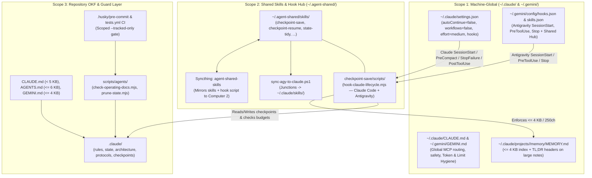
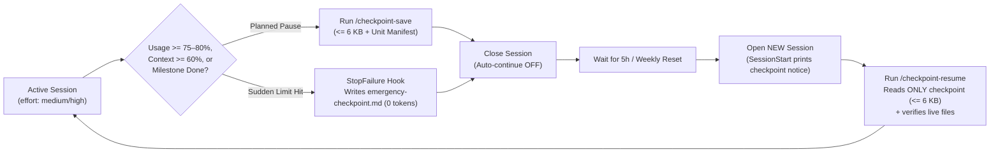
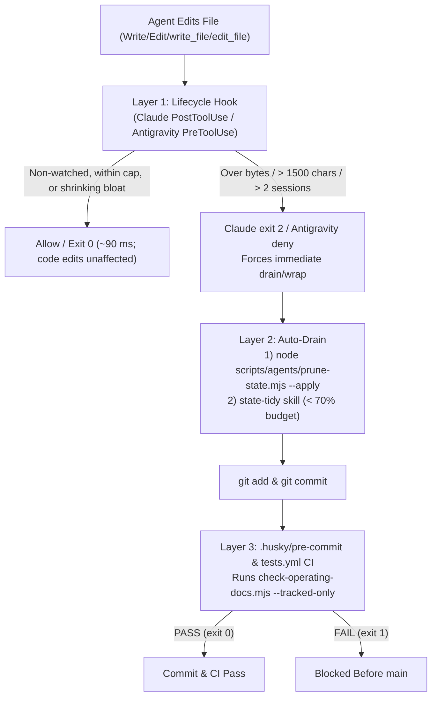

# DavinTrade System Files Architecture (v2.2)

**Lean Routers, Open Knowledge Format (OKF), Limit-Safe Checkpointing & 3-Layer Automated Anti-Bloat System**

- **Document Version:** 2.2.0
- **Updated:** 2026-11-25
- **Status:** Active Canonical Architecture (Supersedes [OKF_CLAUDE_MD_ARCHITECTURE_DESIGN.md](./OKF_CLAUDE_MD_ARCHITECTURE_DESIGN.md) v1.0.0)
- **Target Repository:** `trading-alerts-saas-public`
- **Applies To:** Claude Code (`v2.1.330+`), Antigravity Advisor, Codex Collaborator (Computer 1 & Computer 2)

---

## 1. Executive Summary & Architecture Evolution (v1.0 → v2.0)

### 1.1 Three Eras of Agent Memory in `trading-alerts-saas-public`

1. **Pre-OKF Era (Monolithic `CLAUDE.md`):**
   A single `CLAUDE.md` grew to **480,403 bytes (5,376 lines)**, consuming ~100,000–120,000 tokens at every cold start.
2. **OKF v1.0 Era (Sep–Oct 2026):**
   Introduced a lean `CLAUDE.md` router (`< 5 KB`), `.claude/` OKF tree (`state/`, `rules/`, `architecture/`, `protocols/`), and the Codex/Antigravity collaboration layer ([AGENTS.md](../AGENTS.md) and [docs/agent-collaboration/README.md](../docs/agent-collaboration/README.md)).
3. **v1.0 Regression & Limit-Reset Token Spike (Diagnosed 2026-11-25):**
   Even with OKF v1.0 in place, two compounding problems caused severe token burn — especially immediately after a 5-hour or weekly usage limit reset:
   - **Append-Only Mega-Line Regression:** Line-count gates were bypassed by packing multi-kilobyte narratives onto single lines (`.claude/state/current-state.md` reached **105 KB** with 4 lines totaling 41 KB; `waiting-on.md` reached **241 KB**; `active-tasks.md` reached **67 KB**; `environment-gotchas.md` **116 KB**; `database-traps.md` **47 KB**; auto-memory `MEMORY.md` **7.1 KB**; plus 6 untracked `.claude/push-*.log` files totaling **~162 MB**). Reading startup state alone burned **~45,000–55,000 tokens** before real work began.
   - **Cold-Cache Reset + `Ultracode` Multiplier:** Anthropic prompt caching has a ~1-hour TTL on subscription main sessions (and ~5 minutes on subagents/extra credits). Waiting through a 5-hour or weekly limit lockout with `Auto-continue when limits reset` enabled woke up an expired, bloated conversation and triggered a full cold-cache write (~12.5x–20x warm read cost) on turn 1. Combined with `enableWorkflows: true` (`Ultracode` dynamic multi-agent swarms spinning up 26 subagents / 8.4M tokens on a Pro plan), new quota windows were exhausted within minutes.
4. **v2.0 Live Architecture (Shipped 2026-11-25):**
   Combines global Claude Code limit defenses, zero-token lifecycle hooks, cross-machine shared skills (`~/.agent-shared/skills/`), slimmed OKF state/architecture files with verbatim archives, and a **3-layer automated anti-bloat & auto-drain system**.

### 1.2 Measured Before vs. After (2026-11-25)

| File / Artifact                                                          | Before (v1.0 Regression) |    After (v2.0 Live)     |      Reduction      | Archive / Companion Location                                                                                  |
| :----------------------------------------------------------------------- | :----------------------: | :----------------------: | :-----------------: | :------------------------------------------------------------------------------------------------------------ |
| [current-state.md](../.claude/state/current-state.md)                    |        105,029 B         | **14,836 B** (157 lines) |     **-85.9%**      | [project-position-archive-2026-10-11.md](../.claude/state/history/project-position-archive-2026-10-11.md)     |
| `.claude/state/active-tasks.md` _(gitignored)_                           |         66,689 B         |  **2,416 B** (39 lines)  |     **-96.4%**      | `.claude/state/checkpoints/archive-active-tasks-2026-11-25.md`                                                |
| [waiting-on.md](../.claude/state/waiting-on.md)                          |        240,927 B         | **7,903 B** (108 lines)  |     **-96.7%**      | [waiting-on-details-archive-2026-11-25.md](../.claude/state/history/waiting-on-details-archive-2026-11-25.md) |
| [environment-gotchas.md](../.claude/architecture/environment-gotchas.md) |        115,741 B         |  **5,485 B** (69 lines)  |     **-95.3%**      | [environment-gotchas-archive.md](../.claude/architecture/details/environment-gotchas-archive.md)              |
| [database-traps.md](../.claude/architecture/database-traps.md)           |         47,462 B         |  **6,112 B** (75 lines)  |     **-87.1%**      | [database-traps-archive.md](../.claude/architecture/details/database-traps-archive.md)                        |
| `MEMORY.md` _(machine auto-memory)_                                      |         7,135 B          |  **2,573 B** (17 lines)  |     **-63.9%**      | `## Quick Summary (TL;DR)` headers in large topic notes                                                       |
| [CLAUDE.md](../CLAUDE.md) _(repo router)_                                |         4,999 B          |  **4,898 B** (70 lines)  | Within `< 5 KB` cap | —                                                                                                             |
| `.claude/push-*.log` _(6 untracked logs)_                                |         ~162 MB          |    **0 B** (deleted)     |      **-100%**      | Ignored via `.claude/*.log` in `.gitignore` & `.stignore`                                                     |

---

## 2. System Topology & Three-Scope Architecture

Operating roles remain unchanged (details in [role-distinction.md](../.claude/architecture/role-distinction.md) and [docs/agent-collaboration/README.md](../docs/agent-collaboration/README.md)): **Davin** = Owner/Approver, **Antigravity** = Advisor & Architect, **Claude Code** = Primary Executor, **Codex** = Collaborator (Implementer/Reviewer).

System files operate across **three distinct scopes** so token hygiene, checkpoints, and skills persist across projects and across Computer 1 and Computer 2:



---

## 3. Complete Directory & File Specification

### 3.1 Repository System Files (`trading-alerts-saas-public/`)

```text
trading-alerts-saas-public/
├── CLAUDE.md                                     <-- Lean router for Claude Code (< 5,000 B, <= 150 lines)
├── AGENTS.md                                     <-- Lean router for Codex (<= 6,000 B, <= 150 lines)
├── GEMINI.md                                     <-- Lean router for Antigravity (<= 4,000 B, <= 120 lines)
├── .gitignore                                    <-- Ignores active-tasks.md, .claude/*.log, .claude/state/checkpoints/
├── .stignore                                     <-- Syncthing ignore (ignores .claude/*.log; allows checkpoints/ sync)
├── .husky/
│   └── pre-commit                                <-- LF-only; runs check-operating-docs.mjs --tracked-only when agent docs staged
├── .github/workflows/
│   └── tests.yml                                 <-- CI runs check-operating-docs.mjs --tracked-only + agent unit tests
├── scripts/agents/
│   ├── check-operating-docs.mjs                  <-- Validator (53 docs default / 52 --tracked-only, budgets, links)
│   ├── check-operating-docs.test.mjs             <-- 13 unit tests (node --test)
│   ├── prune-state.mjs                           <-- Safe 0-loss auto-drain (--dry-run default, --apply)
│   └── prune-state.test.mjs                      <-- 7 unit tests (rotation, tasks archive, wrapped quotes, bare links)
├── docs/
│   ├── agent-collaboration/                      <-- Shared Claude/Codex/Antigravity protocols & language policy
│   └── codex/                                    <-- Codex catalog, protocols, compact state, tasks, handoffs
└── .claude/
    ├── index.md                                  <-- OKF catalog (updated 2026-11-25 with archive/checkpoint entries)
    ├── rules/
    │   ├── non-negotiables.md                    <-- Binding rules 1–9 (auto-loaded)
    │   ├── security-overrides.md                 <-- Package override policy (paths-scoped)
    │   └── i18n-compliance.md                    <-- Locale/currency/UI rules (paths-scoped)
    ├── state/
    │   ├── current-state.md                      <-- <= 18 KB, <= 200 lines, <= 2 verbatim sessions
    │   ├── waiting-on.md                         <-- <= 24 KB concise open blockers index
    │   ├── active-tasks.md                       <-- Gitignored, <= 12 KB open checklist (auto-archives [x] > 8 KB)
    │   ├── checkpoints/                          <-- Gitignored + Syncthing-synced (latest.md, emergency-checkpoint.md, etc.)
    │   └── history/
    │       ├── index.md                          <-- Session history catalog (for Grep)
    │       ├── YYYY-MM-sessions.md               <-- Verbatim rotated session entries (newest first)
    │       ├── resolved-waiting-on.md            <-- Verbatim resolved blockers
    │       ├── project-position-archive-2026-10-11.md
    │       └── waiting-on-details-archive-2026-11-25.md
    ├── architecture/
    │   ├── role-distinction.md
    │   ├── infrastructure.md
    │   ├── microservices-cutover.md
    │   ├── environment-gotchas.md                <-- <= 20 KB Quick Reference
    │   ├── database-traps.md                     <-- <= 20 KB Quick Reference
    │   └── details/
    │       ├── environment-gotchas-archive.md    <-- Verbatim full incident transcripts (Grep on demand)
    │       └── database-traps-archive.md         <-- Verbatim full SQL/migration/spec logs (Grep on demand)
    └── protocols/
        ├── session-lifecycle.md                  <-- Open, Checkpoint-first, Rotate, Prune, Close rules
        ├── subagent-orchestration.md             <-- Pro-plan fan-out cap (<= 3–4) & file-backed outputs
        ├── verification-checklist.md
        └── dependency-hygiene.md
```

### 3.2 Shared Skills Hub & Machine-Global Files (`~/` on Windows)

```text
C:\Users\WiN\
├── .agent-shared\
│   ├── sync-agy-to-claude.ps1                    <-- Creates Directory Junctions -> ~/.claude/skills/
│   └── skills\                                   <-- Syncthing folder `agent-shared-skills` (mirrored to PC2)
│       ├── checkpoint-save\
│       │   ├── SKILL.md                          <-- /checkpoint-save (<= 6 KB snapshot + Unit Manifest)
│       │   └── scripts\
│       │       └── hook-claude-lifecycle.mjs     <-- Unified 0-token Node.js hook (~92 ms, UTF-8, .git fallback)
│       ├── checkpoint-resume\
│       │   └── SKILL.md                          <-- /checkpoint-resume (cold-start safe resume)
│       ├── state-tidy\
│       │   └── SKILL.md                          <-- /state-tidy (semantic drain back under 70% budget)
│       ├── install-skills-shared\
│       └── sync-agy-to-claude\
├── .gemini\
│   ├── GEMINI.md                                 <-- Global Antigravity MCP routing, safety, §4 Token/Context/State Hygiene
│   └── config\
│       ├── skills.json                           <-- Points Antigravity to C:/Users/WiN/.agent-shared/skills
│       └── hooks.json                            <-- Antigravity SessionStart / PreToolUse / Stop lifecycle hooks
└── .claude\
    ├── settings.json                             <-- Global flags, custom env (preserved), & 4 lifecycle hooks
    ├── CLAUDE.md                                 <-- Global MCP routing, safety, §4 Token & Limit Hygiene
    ├── skills\                                   <-- Live Directory Junctions managed by sync-agy-to-claude.ps1
    ├── checkpoints\<dir-slug>\                   <-- Fallback checkpoints for non-repo/scratch workspaces
    └── projects\<project-key>\memory\MEMORY.md   <-- Project auto-memory index (<= 4 KB, <= 250 chars/line)
```

### 3.3 Git vs. Syncthing Visibility Matrix

| Path                                                                                                                                 |   Git Tracked   |     Syncthing Mirrored      | Purpose                                                             |
| :----------------------------------------------------------------------------------------------------------------------------------- | :-------------: | :-------------------------: | :------------------------------------------------------------------ |
| `CLAUDE.md`, `AGENTS.md`, `GEMINI.md`, `.claude/{rules,architecture,protocols,state/history}/*`, `current-state.md`, `waiting-on.md` |       Yes       |         Yes (repo)          | Canonical shared project knowledge & 3 agent routers                |
| `.claude/state/active-tasks.md`                                                                                                      | No (gitignored) |         Yes (repo)          | Per-checkout open task checklist                                    |
| `.claude/state/checkpoints/`                                                                                                         | No (gitignored) |         Yes (repo)          | Enables switching PC1 → PC2 or Claude ↔ Antigravity via checkpoint |
| `.claude/*.log`                                                                                                                      | No (gitignored) |      No (`.stignore`)       | Prevents 162 MB push-log clutter                                    |
| `~/.agent-shared/skills/**`                                                                                                          |  Outside repo   | Yes (`agent-shared-skills`) | Skills & hook scripts shared across both PCs & tools                |
| `~/.claude/{settings.json,CLAUDE.md,projects/*/memory/}` & `~/.gemini/{GEMINI.md,config/hooks.json}`                                 |  Outside repo   |     No (machine-local)      | Global config & credentials; mirror non-secret config manually      |

---

## 4. Global Claude Code Configuration & Post-Limit Token Defense

### 4.1 Why Limit Resets Previously Burned Quotas

Anthropic prompt caching keeps a conversation prefix warm for ~1 hour on subscription main sessions (and ~5 minutes on subagents or extra credits). When a session hits the 5-hour or weekly cap:

- Waiting out the reset **expires the warm cache**.
- With `Auto-continue when limits reset` enabled, Claude Code re-sent the entire accumulated history as a **cold cache write** (~12.5x–20x the token cost of a warm read) on turn 1.
- With `enableWorkflows: true` (`Ultracode`), dynamic swarms multiplied that cost across dozens of parallel subagents (`5m` TTL each), causing repeated mid-flight failures and cascading quota exhaustion.

### 4.2 Active `~/.claude/settings.json` Controls (Verified on `v2.1.330`)

| Setting Key                           | Value      | Effect                                                                                                                   |
| :------------------------------------ | :--------- | :----------------------------------------------------------------------------------------------------------------------- |
| `autoContinueAtUsageLimit`            | `false`    | Disables automatic cold-cache session wake-up after 5h/weekly reset                                                      |
| `enableWorkflows`                     | `false`    | Disables `Ultracode` automatic multi-agent swarms by default on Pro plan                                                 |
| `effortLevel`                         | `"medium"` | Prevents burning `max`/`xhigh` thinking tokens on routine turns (`/effort high` per turn when needed)                    |
| `env.CLAUDE_AUTOCOMPACT_PCT_OVERRIDE` | `"70"`     | Compacts earlier (70% vs default ~83.5%) while cache is still warm; existing `env` keys (`ANTHROPIC_*`) preserved intact |

In addition, `autoMode.environment` was cleaned of UTF-8 mojibake and stale references (reflecting GitHub Ruleset Stage 1 `27789976` and removal of `frontend/`), and `~/.claude/CLAUDE.md` gained **Section 4 (Token & Limit Hygiene)** codifying checkpointing, Pro-plan subagent caps, and bounded reads.

### 4.3 Lifecycle Hook Matrix (`~/.claude/settings.json`)

Consolidating all Claude Code lifecycle hooks into one Node.js ESM script (`hook-claude-lifecycle.mjs`) eliminates Windows PowerShell UTF-8 mojibake on Thai excerpts, prevents multi-byte character splits at the 6,000-byte cap, protects `CLAUDE.md`/`AGENTS.md`/`MEMORY.md` across standalone `.git` repos without `.claude/state/` (skipping `os.homedir()`), and cuts `SessionStart` hook latency from ~570 ms (2 processes) down to **~92 ms** (1 Node.js process after `sync-agy-to-claude.ps1`).

| Hook Event          | Matcher                                 | Handler Script                                                      | Timeout | Behavior & Exit Contract                                                                                                               |
| :------------------ | :-------------------------------------- | :------------------------------------------------------------------ | :-----: | :------------------------------------------------------------------------------------------------------------------------------------- |
| `SessionStart` (#1) | `""`                                    | `~/.agent-shared/sync-agy-to-claude.ps1 -Silent`                    |  15 s   | Syncs skills & MCPs via mutex (~100 ms fast-exit)                                                                                      |
| `SessionStart` (#2) | `""`                                    | `checkpoint-save/scripts/hook-claude-lifecycle.mjs --session-start` |   5 s   | Prunes old checkpoints, prints `[Checkpoint Notice]` if open (`<= 7d`) & `[Budget Notice]` if `>= 85%`; silent when healthy (`~92 ms`) |
| `PostToolUse`       | `Write\|Edit\|MultiEdit`                | `checkpoint-save/scripts/hook-claude-lifecycle.mjs --post-tool-use` |   5 s   | **Mode A:** instant `exit 0` for non-watched files; returns **`exit 2` + `stderr`** across `.claude/state` & standalone `.git` repos   |
| `PreCompact`        | `""`                                    | `checkpoint-save/scripts/hook-claude-lifecycle.mjs --pre-compact`   |  10 s   | Writes 0-token UTF-8 `pre-compact-checkpoint.md` (`<= 6,000 B`, redacted) before context compaction                                    |
| `StopFailure`       | `rate_limit\|overloaded\|billing_error` | `checkpoint-save/scripts/hook-claude-lifecycle.mjs --stop-failure`  |  10 s   | Writes 0-token UTF-8 `emergency-checkpoint.md` (`<= 6,000 B`, redacted) when cut off by limit                                          |

### 4.4 Antigravity Lifecycle Hooks (`~/.gemini/config/hooks.json`)

Antigravity uses camelCase JSON stdin/stdout hooks (via `hook-claude-lifecycle.mjs --agy-*`) so Advisor sessions receive the same checkpoint visibility, real-time budget protection, and abnormal-stop snapshots as Claude Code:

| Hook Event     | Matcher / Shape                   | Handler Mode          | Timeout | Behavior & Exit Contract                                                                                                                               |
| :------------- | :-------------------------------- | :-------------------- | :-----: | :----------------------------------------------------------------------------------------------------------------------------------------------------- |
| `SessionStart` | Flat array                        | `--agy-session-start` |   5 s   | Prunes old checkpoints; returns `{}` when healthy, or `injectSteps[0].systemMessage` with `[Checkpoint Notice]` / `[Budget Notice]` when triggered     |
| `PreToolUse`   | `write_file\|edit_file` (grouped) | `--agy-pre-tool-use`  |   5 s   | Simulates resulting content before write; returns `{"decision":"deny"}` if a watched file would exceed budget, while allowing edits that shrink bloat  |
| `Stop`         | Flat array                        | `--agy-stop`          |  10 s   | Returns `{}` cleanly on normal turns (`NO_TOOL_CALL`, etc.); writes `emergency-checkpoint.md` only on `MAX_TOKEN_BUDGET_EXCEEDED`, `MAX_*`, or `ERROR` |

---

## 5. Limit-Safe Checkpoint Lifecycle & Resumable Subagent Protocol



### 5.1 `/checkpoint-save` & `/checkpoint-resume` Contract

- **Locations:** `<repo>/.claude/state/checkpoints/latest.md` (plus up to 10 dated `YYYY-MM-DD-HHmm-<slug>.md` snapshots) or `~/.claude/checkpoints/<dir-slug>/latest.md` for scratch folders outside the repo.
- **Hard Budget:** `<= 120 lines`, `<= 6,000 bytes`, `<= 300 chars/line`, zero secrets or raw infra addresses.
- **Five Mandatory Sections:**
  1. `Goal & Guardrails` (objective + non-negotiable scope limits)
  2. `Exact Paths & Verification State` (changed files/temp dirs + latest test counts)
  3. `Unit Manifest (Completed / Failed / Pending)` (explicit `PASS` output paths vs `FAILED`/`PENDING` units so resumed sessions never re-run finished work)
  4. `Settled Decisions` (prevents re-litigating closed choices)
  5. `Exact Next Action` (1–3 concrete lines for the new session)
- **Cold-Start Resume Rule ([CLAUDE.md](../CLAUDE.md) §1.1 & [session-lifecycle.md](../.claude/protocols/session-lifecycle.md)):**
  When resuming an open checkpoint via `/checkpoint-resume`, Claude reads **only** the newest open checkpoint first and skips bulk-loading `current-state.md` / `waiting-on.md`, cutting cold-start context down to **~1,500–3,000 tokens**.

### 5.2 Pro-Plan Subagent Discipline ([subagent-orchestration.md](../.claude/protocols/subagent-orchestration.md) Rule 6)

- Cap parallel subagent batches to **<= 3–4 subagents** unless Davin explicitly authorizes a larger fan-out.
- Require each subagent to write its findings directly to its own output file immediately rather than holding large payloads only in chat memory.
- Maintain a `PASS | FAILED | PENDING` unit manifest in the active checkpoint so limit-interrupted sweeps resume only unfinished units.

---

## 6. Unified Budgets & OKF Governance Rules (Single Source of Truth)

All three enforcement layers (`hook-claude-lifecycle.mjs`, `prune-state.mjs`, and `check-operating-docs.mjs`) share these exact thresholds:

| File                                                                     |      Hard Byte Limit       |  Line Limit   | `SessionStart` Warn Threshold | Max Line Chars | Extra Rules                                                                    |
| :----------------------------------------------------------------------- | :------------------------: | :-----------: | :---------------------------: | :------------: | :----------------------------------------------------------------------------- |
| [CLAUDE.md](../CLAUDE.md)                                                |          4,999 B           |      150      |       `> 100%` (static)       |       —        | Must link `docs/agent-collaboration/README.md`; preserve Next.js block         |
| [AGENTS.md](../AGENTS.md)                                                |          6,000 B           |      150      |       `> 100%` (static)       |       —        | Must reference `.claude/rules/non-negotiables.md`                              |
| [GEMINI.md](../GEMINI.md)                                                |          4,000 B           |      120      |       `> 100%` (static)       |       —        | No YAML frontmatter; must reference `non-negotiables.md` & `ADVISOR-PROTOCOL`  |
| [current-state.md](../.claude/state/current-state.md)                    |          18,000 B          |      200      |      `>= 85%` (15,300 B)      |     1,500      | `<= 2` `<!-- session ... -->` entries                                          |
| `.claude/state/active-tasks.md`                                          |          12,000 B          |       —       |      `>= 85%` (10,200 B)      |     1,500      | Auto-archives `- [x]` items when `> 8,000 B`                                   |
| [waiting-on.md](../.claude/state/waiting-on.md)                          |          24,000 B          |       —       |      `>= 85%` (20,400 B)      |     1,500      | Resolved items move verbatim to `resolved-waiting-on.md`                       |
| [environment-gotchas.md](../.claude/architecture/environment-gotchas.md) |          20,000 B          |       —       |      `>= 85%` (17,000 B)      |     1,500      | Detailed transcripts live in `details/environment-gotchas-archive.md`          |
| [database-traps.md](../.claude/architecture/database-traps.md)           |          20,000 B          |       —       |      `>= 85%` (17,000 B)      |     1,500      | Detailed SQL/check logs live in `details/database-traps-archive.md`            |
| `MEMORY.md` _(auto-memory)_                                              |          4,000 B           |      120      |      `>= 85%` (3,400 B)       |      250       | Topic notes `> 15 KB` carry a `## Quick Summary (TL;DR)` header                |
| `docs/codex/**/*.md`                                                     | 16,000 B _(6,000 B state)_ | _(100 state)_ |               —               |       —        | Required YAML frontmatter (`type`, `status`, `updated_at`) & valid local links |

**Key OKF v2.0 Invariants:**

1. **Zero Data Loss:** Never delete historical records — rotate/archive verbatim into `.claude/state/history/` or `.claude/architecture/details/`.
2. **Bounded Reads:** Never `Read` whole files `> 15 KB`; use `Grep` or line-bounded section reads.
3. **CI Link Safety:** Keep gitignored paths (such as `.claude/state/checkpoints/...` or gitignored security folders) in backticks, never as relative Markdown links inside tracked files, so CI `check-operating-docs.mjs` stays green.

---

## 7. 3-Layer Automated Anti-Bloat & Zero-Loss Auto-Drain System



### 7.1 Layer 1 — Real-Time Guard (`hook-claude-lifecycle.mjs`)

- **`--session-start` / `--agy-session-start`:** Prunes expired checkpoints, surfaces open checkpoints (`<= 7d`), and inspects all 9 watched targets across `.claude/state` or standalone `.git` repos. Silent (`{}` / 0 stdout) when healthy; emits `[Checkpoint Notice]` / `[Budget Notice]` when triggered.
- **`--post-tool-use` (Claude Mode A) & `--agy-pre-tool-use` (Antigravity Pre-Guard):** Immediately allows ordinary source files. For the 9 watched files (in both this repo and standalone `.git` repos), enforces hard byte/line/`maxLineChars`/`maxSessions` rules (`exit 2` on Claude, `{"decision":"deny"}` on Antigravity) while allowing edits that actively shrink an already-over-budget file.

### 7.2 Layer 2 — Mechanical & Semantic Auto-Drain (`prune-state.mjs` + `/state-tidy`)

- **Mechanical Drain ([prune-state.mjs](../scripts/agents/prune-state.mjs)):**
  - Defaults to `--dry-run`; pass `--apply` to execute.
  - Idempotently moves 3rd+ `<!-- session ... -->` blocks verbatim (ignoring markers inside fenced code blocks) from `current-state.md` to `.claude/state/history/YYYY-MM-sessions.md` (adjusting `./`, `../`, `history/`, and bare relative links cleanly) and prepends full wrapped blockquote summary rows to [history/index.md](../.claude/state/history/index.md).
  - Moves `- [x]` items (with indented continuation lines) from `active-tasks.md` when `> 8 KB` into `.claude/state/checkpoints/completed-tasks-YYYY-MM.md`.
  - Enforces checkpoint retention (keeps 10 newest dated files; deletes `status: completed` ephemeral checkpoints `> 14 days` old).
  - Prints full 8-file telemetry (`GREEN`, `NEAR`, `OVER`).
- **Semantic Drain (`/state-tidy` skill):**
  Used when `waiting-on.md`, `environment-gotchas.md`, `database-traps.md`, `MEMORY.md`, or `## Where the project stands` needs summarization and verbatim archiving to drop back below **70% of budget**.

### 7.3 Layer 3 — Git Pre-Commit Gate, CI & Router Alignment

- **[.husky/pre-commit](../.husky/pre-commit)** (LF-only): Runs `npx lint-staged`, then checks `git diff --cached --name-only -- CLAUDE.md AGENTS.md GEMINI.md .claude/ docs/codex/ docs/agent-collaboration/`. Only when agent docs are staged does it run `node scripts/agents/check-operating-docs.mjs --tracked-only` so gitignored `active-tasks.md` never blocks unrelated commits.
- **[.github/workflows/tests.yml](../.github/workflows/tests.yml) (`unit-and-component-tests`):** Runs `node scripts/agents/check-operating-docs.mjs --tracked-only` and `node --test scripts/agents/check-operating-docs.test.mjs scripts/agents/prune-state.test.mjs` on every PR/push (`< 1 s`).
- **[check-operating-docs.mjs](../scripts/agents/check-operating-docs.mjs):** Validates all required Codex/collaboration docs and routers (`CLAUDE.md`, `AGENTS.md`, `GEMINI.md`), `OPTIONAL_CLAUDE_BUDGETS`, and local links (`0` broken links across `.claude/**` and `docs/codex/`).
- **[AGENTS.md](../AGENTS.md) & [GEMINI.md](../GEMINI.md):** Both aligned with Checkpoint-first resume, bounded reads (`> 15 KB`), Pro-plan prompt sizing, and `prune-state.mjs --apply` within their byte budgets.

---

## 8. Daily Operator Playbook & Multi-Machine Sync Guide

### 8.1 Daily Workflow Rules

1. **1 Milestone = 1 Session:** Finish one logical milestone, run `/checkpoint-save`, and close the session instead of accumulating marathon histories.
2. **Check `/usage` Before Heavy Work:** At `>= 75%` of the 5-hour cap, save a checkpoint and wait for reset rather than launching a multi-file review.
3. **Never `/compact` on Cold Cache (>1h idle):** Open a **NEW session** and run `/checkpoint-resume` instead of paying cold-cache compaction costs or using `Auto-continue`.
4. **Keep `Ultracode` Off by Default:** Run `medium` effort normally (`/effort high` for hard turns), and cap parallel Pro-plan subagents to `<= 3–4` file-backed units.
5. **Drain Early on `[Budget Notice]`:** Run `node scripts/agents/prune-state.mjs --apply` or `/state-tidy` whenever a file approaches 85%.

### 8.2 Maintenance & Verification Cheat Sheet

```powershell
# Check budgets & telemetry without modifying files
node scripts/agents/prune-state.mjs --dry-run

# Apply mechanical rotation & task/checkpoint draining
node scripts/agents/prune-state.mjs --apply

# Validate all 53 operating docs (or 52 with --tracked-only)
node scripts/agents/check-operating-docs.mjs
node scripts/agents/check-operating-docs.mjs --tracked-only

# Run validator + pruner unit tests (20 tests total)
node --test scripts/agents/check-operating-docs.test.mjs scripts/agents/prune-state.test.mjs

# Force-link ~/.agent-shared/skills into ~/.claude/skills on Windows
powershell.exe -NoProfile -ExecutionPolicy Bypass -File "$HOME\.agent-shared\sync-agy-to-claude.ps1" -Force
```

### 8.3 Mirroring to Computer 2

- **Automatic via Syncthing:** `~/.agent-shared/skills/` (`checkpoint-save`, `checkpoint-resume`, `state-tidy`, `hook-claude-lifecycle.mjs`) and repo `.claude/state/checkpoints/` mirror automatically. Wait for Syncthing `Up to Date` and verify junctions in `~/.claude/skills/`.
- **Manual on Computer 2 (Machine-Local Files Outside Syncthing):**
  1. Uncheck `Auto-continue when limits reset` in Claude Desktop.
  2. In Computer 2's `~/.claude/settings.json` (preserving its existing `env` credentials/model overrides), merge these non-secret settings and hooks:

```json
{
  "autoContinueAtUsageLimit": false,
  "enableWorkflows": false,
  "effortLevel": "medium",
  "env": {
    "CLAUDE_AUTOCOMPACT_PCT_OVERRIDE": "70"
  },
  "hooks": {
    "SessionStart": [
      {
        "matcher": "",
        "hooks": [
          {
            "type": "command",
            "command": "powershell.exe -NoProfile -NonInteractive -ExecutionPolicy Bypass -File \"C:\\Users\\<USER>\\.agent-shared\\sync-agy-to-claude.ps1\" -Silent",
            "timeout": 15
          }
        ]
      },
      {
        "matcher": "",
        "hooks": [
          {
            "type": "command",
            "command": "node \"C:\\Users\\<USER>\\.agent-shared\\skills\\checkpoint-save\\scripts\\hook-claude-lifecycle.mjs\" --session-start",
            "timeout": 5
          }
        ]
      }
    ],
    "PostToolUse": [
      {
        "matcher": "Write|Edit|MultiEdit",
        "hooks": [
          {
            "type": "command",
            "command": "node \"C:\\Users\\<USER>\\.agent-shared\\skills\\checkpoint-save\\scripts\\hook-claude-lifecycle.mjs\" --post-tool-use",
            "timeout": 5
          }
        ]
      }
    ],
    "PreCompact": [
      {
        "matcher": "",
        "hooks": [
          {
            "type": "command",
            "command": "node \"C:\\Users\\<USER>\\.agent-shared\\skills\\checkpoint-save\\scripts\\hook-claude-lifecycle.mjs\" --pre-compact",
            "timeout": 10
          }
        ]
      }
    ],
    "StopFailure": [
      {
        "matcher": "rate_limit|overloaded|billing_error",
        "hooks": [
          {
            "type": "command",
            "command": "node \"C:\\Users\\<USER>\\.agent-shared\\skills\\checkpoint-save\\scripts\\hook-claude-lifecycle.mjs\" --stop-failure",
            "timeout": 10
          }
        ]
      }
    ]
  }
}
```

3. Mirror Section 4 (`Token & Limit Hygiene`) into Computer 2's `~/.claude/CLAUDE.md` and `Token, Context & State Hygiene` into Computer 2's `~/.gemini/GEMINI.md`.
4. Merge Computer 2's Antigravity hooks into `~/.gemini/config/hooks.json`:

```json
{
  "davintrade-lifecycle": {
    "SessionStart": [
      {
        "type": "command",
        "command": "node \"C:\\Users\\<USER>\\.agent-shared\\skills\\checkpoint-save\\scripts\\hook-claude-lifecycle.mjs\" --agy-session-start",
        "timeout": 5
      }
    ],
    "PreToolUse": [
      {
        "matcher": "write_file|edit_file",
        "hooks": [
          {
            "type": "command",
            "command": "node \"C:\\Users\\<USER>\\.agent-shared\\skills\\checkpoint-save\\scripts\\hook-claude-lifecycle.mjs\" --agy-pre-tool-use",
            "timeout": 5
          }
        ]
      }
    ],
    "Stop": [
      {
        "type": "command",
        "command": "node \"C:\\Users\\<USER>\\.agent-shared\\skills\\checkpoint-save\\scripts\\hook-claude-lifecycle.mjs\" --agy-stop",
        "timeout": 10
      }
    ]
  }
}
```

---

## 9. Verification Baseline & Document Relationship

### 9.1 Recorded Verification Baseline (2026-11-25)

| Check                                                                        | Result                                                                                       | Exit Code |
| :--------------------------------------------------------------------------- | :------------------------------------------------------------------------------------------- | :-------: |
| `node scripts/agents/check-operating-docs.mjs`                               | `PASS: 53 operating documents checked` (0 errors across 3 routers + 50 docs)                 |    `0`    |
| `node scripts/agents/check-operating-docs.mjs --tracked-only`                | `PASS: 52 operating documents checked` (skips gitignored `active-tasks.md`)                  |    `0`    |
| `node --test check-operating-docs.test.mjs prune-state.test.mjs`             | `20/20` PASS (`13` validator tests + `7` pruner tests)                                       |    `0`    |
| `node scripts/agents/prune-state.mjs --dry-run`                              | `9/9` files `GREEN` (`AGENTS.md`, `CLAUDE.md`, `GEMINI.md`, `.claude/*`, `MEMORY.md`)        |    `0`    |
| `hook-claude-lifecycle.mjs` smoke suite (18 checks)                          | `18/18` PASS (`10` Claude Code + `8` Antigravity `--agy-*`, non-deadlock shrink, Thai UTF-8) |    `0`    |
| Full `.claude/**` + `CLAUDE.md` + `AGENTS.md` + `GEMINI.md` + `DAVINTRADE_*` | `0` broken local links across all 31 docs (all 143 archive/history links fixed)              |    `0`    |
| `.husky/pre-commit` & `.github/workflows/tests.yml`                          | Pre-commit LF-only (`sh -n` clean); `tests.yml` valid YAML (`yaml.safe_load`)                |    `0`    |
| `npx prettier --check --end-of-line auto`                                    | All modified docs, archives, routers, and agent scripts pass Prettier formatting             |    `0`    |

### 9.2 Relationship to Other Documents in `davintrade-claude-md-okf-management/`

| Document                                                                               | Status              | Role Relative to `DAVINTRADE_SYSTEM_FILES.md`                                         |
| :------------------------------------------------------------------------------------- | :------------------ | :------------------------------------------------------------------------------------ |
| `DAVINTRADE_SYSTEM_FILES.md` _(this file)_                                             | **Active (v2.2.0)** | Canonical end-to-end 3-agent architecture & operations reference                      |
| [OKF_CLAUDE_MD_ARCHITECTURE_DESIGN.md](./OKF_CLAUDE_MD_ARCHITECTURE_DESIGN.md)         | Historical (v1.0.0) | Original Sep 2026 proposal decomposing the 480 KB `CLAUDE.md`; superseded by this doc |
| [OKF_OPUS_5_5_FINE_TUNING_ARCHITECTURE.md](./OKF_OPUS_5_5_FINE_TUNING_ARCHITECTURE.md) | Reference           | Earlier fine-tuning/settled-answers notes incorporated into `.claude/` rules          |
| [codex/README.md](./codex/README.md)                                                   | Active Companion    | Codex collaboration package (`AGENTS.md`, `docs/codex/`, Advisor protocol)            |
