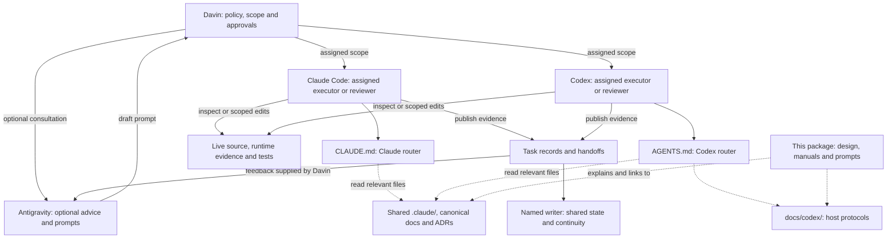
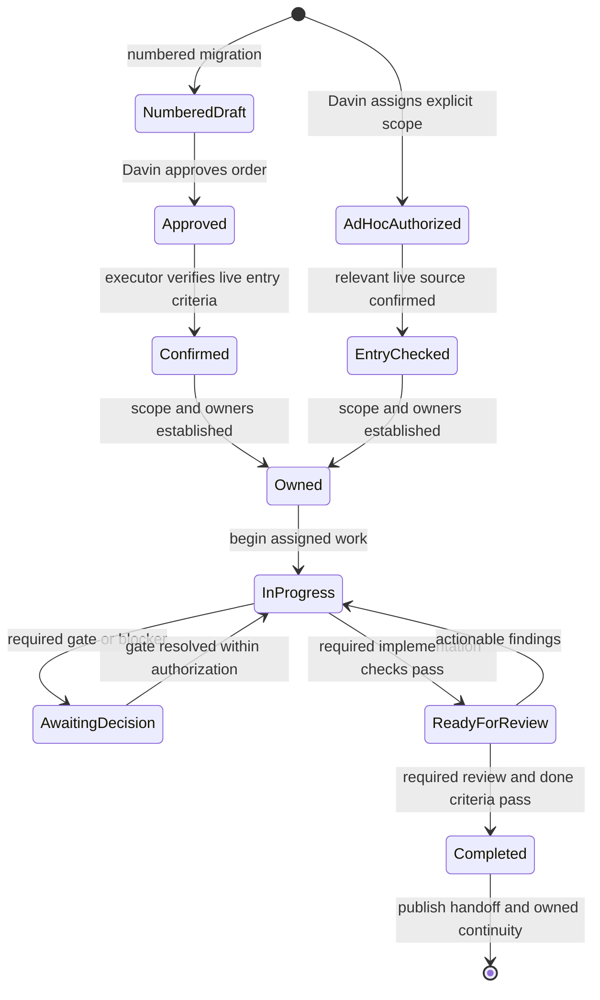

# Codex and Claude Code collaboration architecture

This design describes the repository's implemented collaboration protocol as of
11 October 2026: two executor routers, one shared knowledge base, explicit task
ownership, verification evidence and durable handoffs. Davin owns policy and
decisions. Antigravity advises and prepares prompts when Davin involves it.

The target repository is `D:/SaaS Project/trading-alerts-saas-public/`. The
system uses Markdown documents and a read-only validator. It is a local
operating protocol, not an enforced scheduler or a guarantee of production
health. Use the [operating manual](OPERATING_MANUAL.md) for procedures and the
[prompt library](PROMPT_LIBRARY.md) for task contracts.

## 1. Objectives and boundaries

The architecture lets Claude Code and Codex cooperate while respecting their
hosts' different instruction and permission systems. Its objectives are:

- Share domain knowledge and current project facts.
- Establish scope, authorization, owners and done criteria before edits.
- Support independent review, parallel implementation and transfer of work.
- Preserve progress through compaction, new sessions and changes of executor.
- Keep entry guidance compact and load relevant concepts when needed.
- Support direct assignment and optional Advisor-prepared prompts.

These are design objectives, not measured performance claims. The system does
not fine-tune model weights, require a model version, permanently assign
frontend/backend roles or replace the application's architecture. Documents
cannot bypass the current host's instruction hierarchy or permissions.
Development approval does not grant commit, push, merge, deploy or flag
permission. Executors never enter login credentials or apply production
migrations.

## 2. Relationship to the Claude OKF designs

The [original OKF design](../OKF_CLAUDE_MD_ARCHITECTURE_DESIGN.md) proposed a lean
router and linked knowledge tree in place of an accumulated `CLAUDE.md`
journal. The [frontier-model adaptation](../OKF_OPUS_5_5_FINE_TUNING_ARCHITECTURE.md)
proposed settled decisions, durable checklists, action-first reports and
subagent orchestration. Both are blueprints with historical examples; current
repository contracts determine present behavior.

| Source idea                            | Implemented Codex adaptation                                                                                 |
| -------------------------------------- | ------------------------------------------------------------------------------------------------------------ |
| Lean router and progressive disclosure | `AGENTS.md` routes to the existing knowledge tree and task-relevant Codex adapters.                          |
| Shared concepts and settled answers    | `.claude/` remains shared; non-negotiable 8 permits reopening on Davin's steering or contradictory evidence. |
| File-based task progress               | Claude retains its active checklist; Codex uses unique durable task records rather than overwriting it.      |
| Action-first handoff                   | Reports separate needs from Davin, changed/verified work and unconfirmed findings.                           |
| Multiple agents                        | Explicit path owners, worktrees, integrator, snapshots and transfer acceptance govern cooperation.           |
| Compact state                          | Codex keeps a bounded continuity pointer; Claude retains its two-entry/archive policy.                       |

The design does not adopt the proposals' model-version claims, token estimates,
speed figures or failure-rate guarantees. Shared Claude state can contain long
entries despite its entry limit, so readers select relevant sections. Old SQL
examples and historical project status are not instructions for today's live
environment. Prompt adaptation here does not train model weights.

## 3. Component and knowledge architecture



Document arrows mean deliberate reads or assigned writes. Markdown links do
not automatically load their destinations. The feedback arrow sends no
message: Davin supplies the handoff or authorizes dispatch under host rules.

| Component                                                                                                        | Responsibility and ownership                                                                     |
| ---------------------------------------------------------------------------------------------------------------- | ------------------------------------------------------------------------------------------------ |
| [AGENTS.md](../../AGENTS.md) and [CLAUDE.md](../../CLAUDE.md)                                                    | Separate compact entry contracts; updated by the assigned operating-doc owner.                   |
| [.claude/index.md](../../.claude/index.md), rules and architecture                                               | Shared knowledge, read by relevant scope; concepts have assigned owners.                         |
| [Shared current-state](../../.claude/state/current-state.md) and [waiting-on](../../.claude/state/waiting-on.md) | Canonical project continuity and blockers; only the named shared-state writer publishes changes. |
| [docs/codex/index.md](../../docs/codex/index.md) and protocols                                                   | Codex lifecycle, collaboration and verification adapters.                                        |
| [Codex continuity](../../docs/codex/state/current-state.md)                                                      | Compact links to the latest Codex task, report and next action; one continuity writer.           |
| [Task template](../../docs/codex/templates/task.md) and `docs/codex/tasks/`                                      | Authorization, ownership, checklist and continuation; each task owner edits its record.          |
| [Handoff template](../../docs/codex/templates/handoff.md) and `docs/handoffs/`                                   | Snapshot evidence, findings and next owner; reports remain individually attributable.            |
| [Validator](../../scripts/agents/check-operating-docs.mjs)                                                       | Manual structure, selected size and local-link checks; no task enforcement.                      |
| This `codex/` package                                                                                            | Reference material explaining the live contracts; no automatic loading.                          |

`docs/codex/` and this package are ordinary documentation, not personal Codex
app configuration. Live operational sources remain canonical. Application facts
remain in source, relevant `.claude/` concepts,
[Stack D architecture](../../docs/STACK-D-ARCHITECTURE.md) and
[ADRs](../../docs/adr/README.md). Archives explain history, not current policy.
Codex's pointer does not duplicate project phases, flags or deployment status.

## 4. Roles and authority

| Role                      | Responsibility                                                                   | Authority boundary                                                             |
| ------------------------- | -------------------------------------------------------------------------------- | ------------------------------------------------------------------------------ |
| Davin                     | Set policy, propose plans, select executors, define scope and decide owner gates | General approval does not satisfy a separate explicit sign-off.                |
| Antigravity, when engaged | Analyze plans, recommend modes and draft stage prompts from evidence             | A draft does not authorize work or establish live facts.                       |
| Implementer               | Inspect source, make routine choices within scope, implement and verify          | No ownership of another agent's work or automatic publication permission.      |
| Independent reviewer      | Inspect stable source, check done criteria and publish findings                  | No silent implementation fixes or self-approval of owner gates.                |
| Integrator                | Combine scoped outputs, own assigned contracts/resources and verify integration  | Separately passing slices do not prove the combined result.                    |
| Shared-state writer       | Publish canonical status once and retain archive rules                           | No right to erase another agent's checklist or create competing project state. |

Roles may be combined, but each task names its implementer, reviewer,
integrator and shared-state writer. The integrator can also be the state writer
when assigned. Shared interfaces have one owner.

[Shared non-negotiables](../../.claude/rules/non-negotiables.md) bind both
executors. Codex reads them explicitly; Claude's automatic rule loading does
not transfer to Codex. Live source, runtime observations and tests resolve
factual assumptions without overriding Davin's policy or expanding scope.
Record contradictions and correct the plan or obtain the required decision
before dependent work proceeds.

## 5. Four participation setups and three development modes

Participation describes how Davin assigns work. Development mode describes how
two executors cooperate. These are separate choices.

| Participation setup       | Assignment path                                                                 |
| ------------------------- | ------------------------------------------------------------------------------- |
| Antigravity + Claude Code | Advisor recommends and drafts; Davin decides and forwards the prompt to Claude. |
| Antigravity + Codex       | Advisor recommends and drafts; Davin decides and forwards the prompt to Codex.  |
| Claude Code directly      | Davin assigns work and decisions directly to Claude.                            |
| Codex directly            | Davin assigns work and decisions directly to Codex.                             |

All four remain valid. Antigravity is optional, and a task may use one executor
without adding the other. When both executors participate, select a mode:

| Mode                         | Writing arrangement                                            | Transition                                                          |
| ---------------------------- | -------------------------------------------------------------- | ------------------------------------------------------------------- |
| Build and independent review | Builder writes its scope; reviewer reads the stable result     | Findings return to builder; affected fixes are rechecked.           |
| Parallel implementation      | Separate Claude/Codex worktrees and disjoint scopes            | One integrator transfers outputs and verifies combined behavior.    |
| Handoff and takeover         | Sender freezes writes; receiver becomes owner after acceptance | Stable snapshot, source/authorization checks and recorded transfer. |

Choose roles by task, access and availability. Investigation/design can prepare
any mode. A required fresh P6/session B review cannot be supplied by the builder
or a subagent that helped implement the work. Each host's delegation rules
still govern its subagents. Switching setup or mode requires updating scope,
evidence and ownership rather than assuming an implicit transfer.

## 6. Loading and task lifecycle

The router is a reading map; state records outcomes and remaining work. Session
narratives belong in tasks/handoffs, not either root router.

1. Read the executor router and standing rules, including relevant nested
   `AGENTS.md`/`AGENTS.override.md` before edits.
2. Inspect branch, HEAD, absolute checkout path and pre-existing changes.
3. Read shared-state frontmatter and task-relevant sections, blockers, orders
   and handoffs. Search history before repeating an investigation.
4. Load concepts for the changed domain and confirm assumptions against live
   source and the required runtime evidence.
5. Establish scope and owners, then maintain a durable task checklist for
   three or more steps, broad audits or cross-agent work.

OpenAI documents global/project instruction discovery through the working
directory, `AGENTS.override.md` precedence and a configurable combined byte
limit. The chain is built once per run; explicitly read changed guidance or
start a new run when needed.
[Official AGENTS.md documentation](https://learn.chatgpt.com/docs/agent-configuration/agents-md)

This product mechanism is distinct from the repository's deliberate reads.
A link to `.claude/` requires reading its target; the validator cannot prove
instruction loading in a new session.

The task contract includes authorization, ID, goal and done criteria; roles;
absolute worktree/branch/base SHA and dirty target files; allowed/excluded
paths; interface/generated-output owners; required checks; return artifacts and
next owner. Assign build, generator, mutation-runner and Git-publication rights.

### Authorization paths



`NumberedDraft` abbreviates PRE-DRAFT and DRAFT. Numbered migrations retain
PRE-DRAFT → DRAFT → APPROVED by Davin → CONFIRMED by the executor after live
code, runtime and entry checks under the
[Executor Protocol](../../docs/migration-orders/EXECUTOR-PROTOCOL.md).
Unavailable runtime access leaves required confirmation pending.

Ad-hoc work records Davin's direct authorization and confirms relevant source;
phase/session remains unchanged. Do not demand duplicate approval or invent a
numbered order. A task record or Advisor prompt documents authorization without
granting it. Explicit sign-off remains separate. Out-of-scope money, auth,
grants, secrets or CORS changes return to Davin. `seed-code/**` is read-only.

Progress updates or compaction do not end authorized work while unblocked items
remain. Reconcile checklist and diff before resuming; completed records are
historical, not automatic assignments. Preserve a recoverable state at a
blocker and record its next owner. Continue independent authorized work only.
Task-file statuses are documentation fields, not Codex application goal controls.
Codex never overwrites/deletes Claude's `.claude/state/active-tasks.md`.

## 7. Concurrency and resource isolation

Use one writing agent per checkout by default; read-only review can share a
stable checkout. Concurrent Claude/Codex implementation uses separate
worktrees/branches, with `codex/` as the default new Codex branch prefix unless
Davin specifies another name.

Git worktrees provide separate working directories associated with one
repository. They do not isolate shared databases or every external resource.
[Official Git worktree documentation](https://learn.chatgpt.com/docs/environments/git-worktrees)

| Resource                                        | Coordination requirement                                                                                   |
| ----------------------------------------------- | ---------------------------------------------------------------------------------------------------------- |
| Source and tests                                | Explicit disjoint writable paths; inspect diffs before transfer.                                           |
| Schemas, API contracts and common types         | Agree interfaces first; one owner controls shared changes.                                                 |
| Generated clients, lockfiles and shared outputs | Name the generator/output owner; do not regenerate another owner's outputs.                                |
| Servers, builds and mutation runners            | Coordinate process ownership, paths, ports and timing.                                                     |
| Databases, queues and external services         | Identify shared resources and use dedicated disposable resources when required.                            |
| Project state and continuity                    | One assigned writer publishes the consolidated result.                                                     |
| Internal Codex subagents                        | Strictly disjoint files, including tests/generated metadata, under one integrator and current host policy. |

Root prebuild removes `.next`, `tsconfig.tsbuildinfo` and
`node_modules/.prisma` and rebuilds shared types. Coordinate it with active
servers, generators and tests. Mutation tests cannot run against another
agent's changing checkout; use a scratch copy and verify restoration.

Claude's [subagent protocol](../../.claude/protocols/subagent-orchestration.md)
requires Davin's authorization and separate worktrees for editing subagents.
Codex internal delegation follows the current host policy and the disjoint-file
arrangement above; those host-specific rules are not interchangeable.

Task records are advisory agreements, not enforced locks or a global registry.
A record on one branch does not announce ownership to every branch/machine.
Silence does not release a scope. Unknown ownership on dirty/active paths needs
handoff or separation. Never stash, broadly reset/restore/clean or delete
another agent's work.

Uncommitted changes do not appear in another worktree automatically. Transfer
a scoped patch, authorized commit or accessible artifact identified by absolute
source/worktree path. Publication authorization remains separate.

## 8. Evidence, review and ownership transfer

Evidence must identify actual reviewed content. HEAD alone cannot identify
uncommitted work. Record:

- Worktree, branch, base/head SHA and exact reviewed paths.
- Scoped diff or SHA-256 hashes for uncommitted snapshots.
- Observable done criteria and the required gates.
- Actual command, cwd, exit code, pass/fail/skip counts and limitations.
- Findings with severity, file/line, failure, evidence and suggested correction.
- Authorization, unresolved sign-off, open work, next action and owner.

The reviewer inspects source and reports checks actually performed, rather than
relabeling the builder's claim as independently verified. Separate confirmed
defects from suspicions. Findings return to the implementation owner; the
reviewer does not silently fix code or rewrite builder state. Recheck affected
findings after fixes. If source or HEAD changes, invalidate dependent evidence
and rerun the affected checks. Review success does not authorize production.

```mermaid
sequenceDiagram
    participant D as Davin
    participant S as Sender
    participant A as Task and handoff artifacts
    participant R as Receiver
    D->>S: Assign handoff scope and intended receiver
    S->>S: Stop writing the scope
    S->>A: Publish stable snapshot, evidence and open work
    D->>R: Assign takeover and provide artifact path
    R->>A: Read authorization and remaining checklist
    R->>R: Revalidate live source and entry criteria
    alt Receiver accepts
        R->>A: Record acceptance and ownership transfer
        R->>R: Begin implementation in accepted scope
        Note over S: Sender remains stopped
    else Receiver rejects
        R->>A: Record mismatch; no receiver implementation writes
        D->>S: Explicitly restore prior ownership if appropriate
        S->>S: Resume only after ownership is restored
    end
```

The sender freezes writes before publishing snapshot evidence. The receiver
checks authorization/source/open work, accepts and records transfer before its
first implementation write. An unfinished checklist or absent reply does not authorize
takeover. Rejection requires explicit ownership restoration before writes
resume. Include accessible artifact paths or the scoped transfer method;
another app's access and memory cannot be assumed.

## 9. Integration, verification and closeout

The integrator re-reads source/diffs, combines only assigned outputs, resolves
contract conflicts and verifies the combined state. New scope or owner gates
are recorded before dependent edits. Findings cannot be discarded by
unexplained overwrites.

Select checks from the [verification adapter](../../docs/codex/protocols/verification.md),
[shared checklist](../../.claude/protocols/verification-checklist.md), current
package/configuration and the order. Numbered orders retain required gates.
Documentation-only work uses document checks rather than a full app build by
default.

Keep coverage limits explicit: root `tsc` excludes tests; transpilation does not
prove their types; opt-in PostgreSQL suites require their specified disposable
environment; Python/tokenizer-backed checks can skip without prerequisites.
UI changes need browser evidence. Passing assertions can still yield a nonzero
exit from thresholds/teardown; report both results and command exit codes.

Closeout creates a unique `docs/handoffs/` report. Mark the task completed only
when required done criteria and review gates pass. Assign owners to unavailable
checks or remaining shared-state publication. The named state writer publishes
canonical status and preserves Claude's two-entry/archive policy; other agents
provide reports for that writer. One owner updates Codex's compact pointer.
Keep full narratives in task records and handoffs.

## 10. Advisor feedback and language

When engaged, the loop is Davin's policy/plan → Antigravity's recommendation and
draft prompt → Davin's decision and forwarding → executor's live checks/work →
handoff → Davin supplies evidence to the Advisor → next-stage prompt. Future
prompts remain conditional until actual entry gates pass. Distinguish proposals,
owner decisions and verified facts; never invent approvals, SHAs or runtime
observations.

Use the [Advisor guide](ANTIGRAVITY_ADVISOR_GUIDE.md),
[opening prompt](OPENING_PROMPT_TO_ANTIGRAVITY.md) and live
[Advisor protocol](../../docs/agent-collaboration/ADVISOR-PROTOCOL.md).
Onboarding alone does not authorize codebase edits. Without repository access,
the Advisor uses documents supplied by Davin and names what it could not inspect.

The [language policy](../../docs/agent-collaboration/LANGUAGE-POLICY.md) applies
in all setups: durable documents and prompts default to English even during
Thai conversation. Replies default to English; a session where Davin writes
Thai uses Thai replies unless explicitly overridden. This session choice does
not change future sessions or product internationalization requirements.

## 11. Failure handling and tradeoffs

| Tradeoff or failure                                  | Design response                                                             |
| ---------------------------------------------------- | --------------------------------------------------------------------------- |
| Portable Markdown lacks enforced coordination        | Named owners and explicit task contracts; verify ownership before writing.  |
| Lean routers can hide required linked rules          | Mandatory standing-rule reads, routing triggers and onboarding checks.      |
| Different executor instruction behavior              | Separate small routers, one knowledge tree and host adapters.               |
| Separate worktrees still share external resources    | Assign resource owners and isolate disposable test resources explicitly.    |
| Stale review evidence or missing uncommitted content | Identify snapshots, provide a transfer method and rerun affected checks.    |
| Compaction loses chat detail                         | Durable checklist, next action and reconciliation against disk.             |
| Required runtime access/sign-off is unavailable      | Document the pending gate/owner; continue independent authorized work only. |
| Reference prose drifts from operating rules          | Follow live authority, update assigned docs and revalidate links/contracts. |

See [maintenance and troubleshooting](MAINTENANCE_AND_TROUBLESHOOTING.md) for
recovery procedures and upkeep.

## 12. Validation, adoption and current limits

From the repository root, the manual document gate is:

```powershell
node scripts/agents/check-operating-docs.mjs
node --test scripts/agents/check-operating-docs.test.mjs
```

The checker validates selected metadata, size budgets and local-link existence;
its tests validate checker behavior. These checks do not prove instruction
loading, agent compliance, concurrency safety, approval, application coverage,
runtime health or performance. Formatting and `git diff --check` complement
them for document changes.

Adopt the protocol through a real scoped task: load the router, inspect source,
publish evidence, and have the receiver confirm access and snapshot identity.
When using Antigravity, start with the opening prompt and require an inventory
of actual reads and unverified facts. Record observed results before claiming
end-to-end onboarding.

Creating this package does not establish automatic loading in new external
Claude/Antigravity sessions. The architecture installs no CI job, hook, daemon,
mutex, automatic rotation, message dispatch or deployment pipeline. Additional
enforcement/automation needs a separately assigned implementation. Performance
claims need repeatable tasks and measured results; none are implied here.
