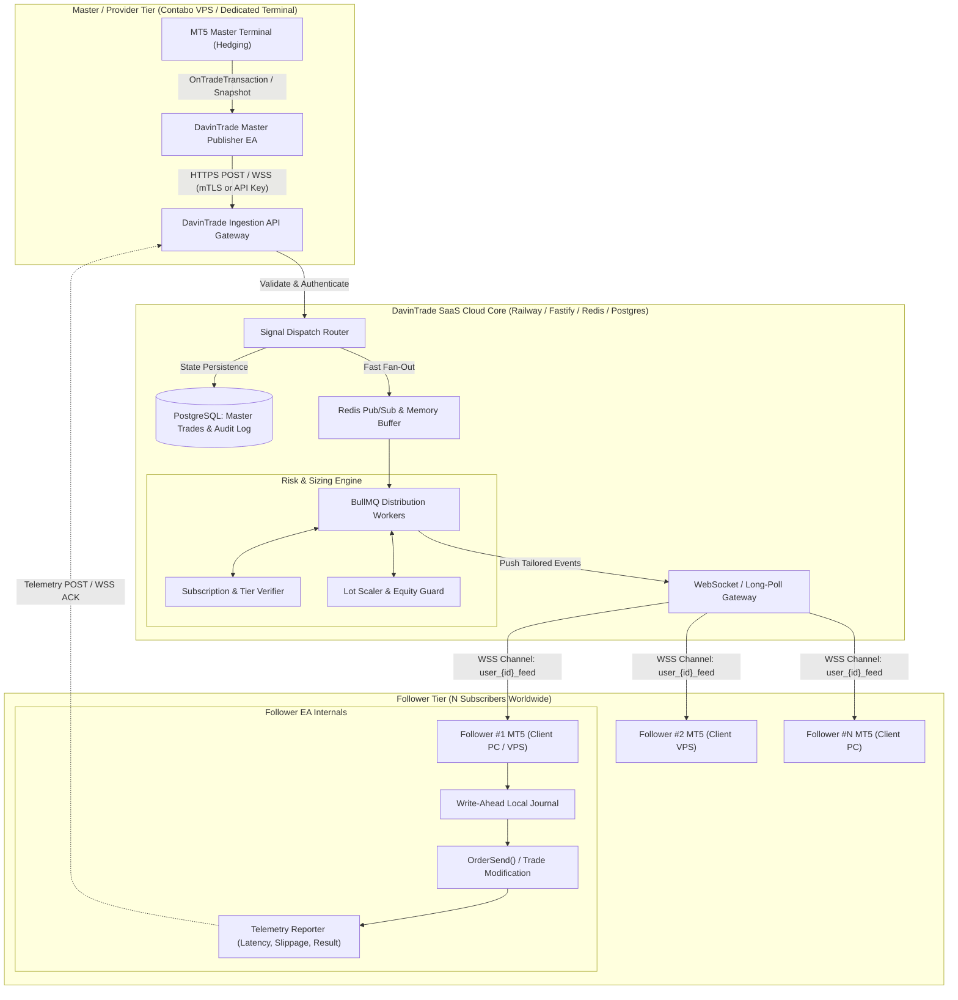
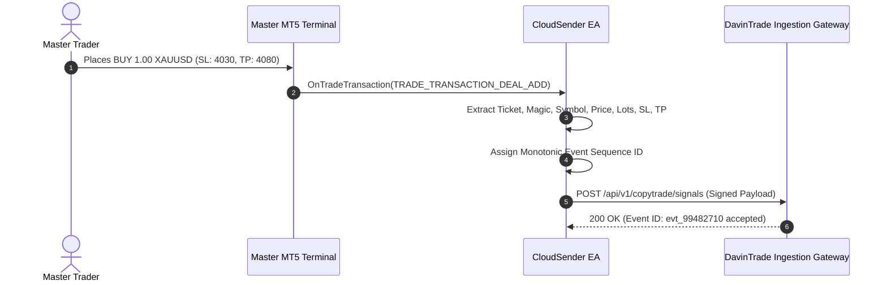
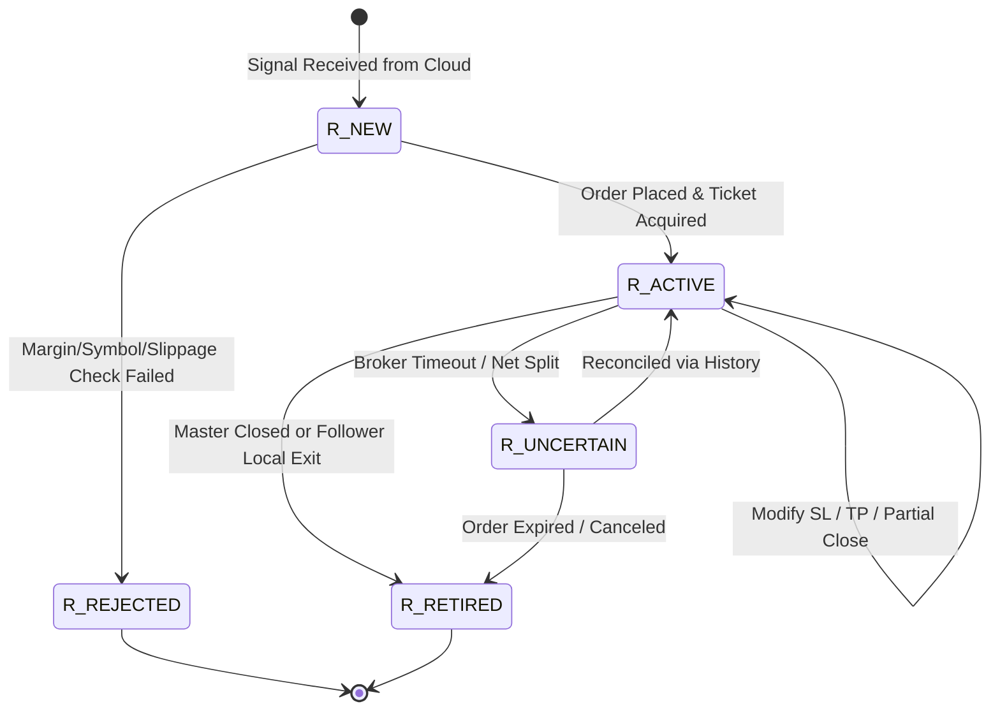
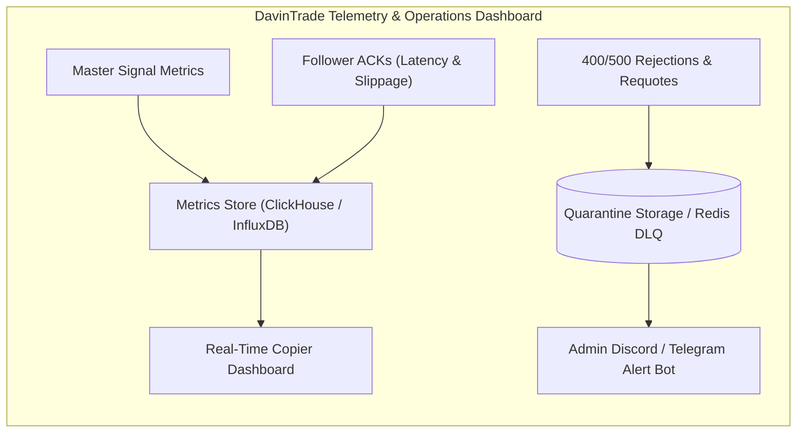
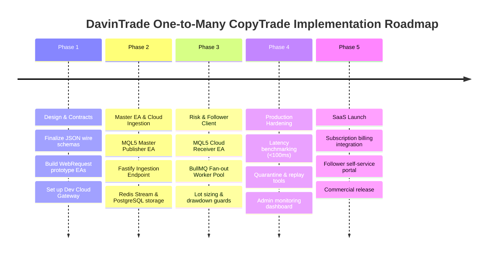

# DavinTrade Cloud CopyTrade System — Complete Architecture Blueprint (One-to-Many Approach)

**Canonical Architectural Specification**  
**Document Reference:** `ARCH-SPEC-DAVINTRADE-COPYTRADE-V1`  
**Target Platform:** DavinTrade App SaaS Ecosystem (Stack C / Stack D Integration)  
**Primary Symbol / Asset Class:** Multi-Asset (XAUUSD, Forex Majors/Minors, Indices)  
**Architecture Topology:** Cloud Relay & Fan-Out Pub/Sub (1 Master Trader / Signal Provider $\to$ $N$ Followers / Subscribers)

---

## Table of Contents

1. [Executive Summary & Architectural Vision](#1-executive-summary--architectural-vision)
2. [End-to-End System Architecture](#2-end-to-end-system-architecture)
3. [Design Principles & Core Lessons Ingested](#3-design-principles--core-lessons-ingested)
4. [Master Signal Ingestion Subsystem (Sender)](#4-master-signal-ingestion-subsystem-sender)
5. [DavinTrade Cloud Core & Fan-Out Pipeline](#5-davintrade-cloud-core--fan-out-pipeline)
6. [Risk Management, Lot Scaling & Entitlements Engine](#6-risk-management-lot-scaling--entitlements-engine)
7. [Follower Client Subsystem (Receiver EA)](#7-follower-client-subsystem-receiver-ea)
8. [Wire Contracts & Event Schema (JSON Schema)](#8-wire-contracts--event-schema-json-schema)
9. [Idempotency, Fault Recovery & Journal State Machine](#9-idempotency-fault-recovery--journal-state-machine)
10. [Observability, Latency Telemetry & Quarantine System](#10-observability-latency-telemetry--quarantine-system)
11. [Phased Implementation Roadmap](#11-phased-implementation-roadmap)

---

## 1. Executive Summary & Architectural Vision

The **DavinTrade Cloud CopyTrade System** is an enterprise-grade, low-latency, cloud-mediated trade replication engine designed to scale from single-user peer copying to commercial **One-to-Many SaaS copy-trading**.

### Strategic Value Proposition

- **Decoupled Topology:** Completely eliminates the need for followers and masters to share a local computer, Windows user session, or VPN tunnel.
- **Carrier-Grade NAT (CGNAT) Transparency:** Followers and masters run behind arbitrary residential routers, firewalls, and cellular networks without requiring port forwarding, static public IPs, or dynamic DNS.
- **Centralized Risk & Entitlements:** DavinTrade App enforces tier-based subscriptions, subscriber authorization, lot scaling models, risk throttles, and maximum slippage protection before commands reach client accounts.
- **Deterministic Execution & Auditability:** Every trade action is logged with millisecond timestamps, generating end-to-end trace telemetry from Master Execution $\to$ Cloud Dispatch $\to$ Receiver Execution $\to$ Broker Confirmation.

---

## 2. End-to-End System Architecture



---

## 3. Design Principles & Core Lessons Ingested

This blueprint directly incorporates hardened mechanisms from the existing **DavinTrade v2.29 Data Pipeline** (`DATA_COLLECTION_PIPELINE_BLUEPRINT_v2_29.md`) and the **Local Trade Copier** (`LocalTradeCopier`):

1. **State Machine Integrity (`LocalTradeCopier` Journal Model):**  
   The Follower EA retains a write-ahead persistent journal (`.json` or binary `.dat`) recording intent, server results, and broker tickets (`R_NEW`, `R_ACTIVE`, `R_RETIRED`, `R_IGNORED`). This ensures that client disconnects, MT5 restarts, or system crashes **never result in duplicate order entries**.
2. **Strict Wire Contracts & Validation (`v2.29` Pipeline):**  
   All payloads conform to strict, versioned JSON schemas with closed enums. Incoherent or malformed trade events are rejected at ingestion rather than corrupting follower state.
3. **Quarantine & Dead-Letter Queue (DLQ):**  
   Failed trade dispatches or broker-rejected orders are quarantined into an outbox for post-mortem forensics rather than causing silent pipeline stalls or endless retry loops.
4. **Market-Hours & Warm-up Gating:**  
   Terminals connecting or reconnecting undergo a 3-second warm-up window to re-synchronize order cache before executing reconciliation logic.
5. **Separation of Concerns:**  
   The Master EA is strictly a **passive publisher**—it never executes orders on the master account. The Cloud Core is the **orchestrator and risk arbiter**. The Follower EA is the **deterministic executor**.

---

## 4. Master Signal Ingestion Subsystem (Sender)

### 4.1 Master EA (`DavinTrade_CloudSender.mq5`)

- **Execution Trigger:** Combines event-driven `OnTradeTransaction()` with a high-resolution safety poll (`OnTimer()` at 100ms–250ms).
- **Payload Generation:** Tracks open positions, pending orders (Limit/Stop/Stop-Limit), and modifications (Stop Loss, Take Profit, Expiration, Volume Reductions).
- **Connection Security:** Communicates via outbound `WebRequest()` over TLS (HTTPS/WSS) using a hardware-fingerprinted `Bearer` token and Master API key.



---

## 5. DavinTrade Cloud Core & Fan-Out Pipeline

The cloud backend runs within the existing DavinTrade microservices ecosystem (Fastify on Node.js/TypeScript + Redis 7 + PostgreSQL + Prisma).

### 5.1 Ingestion & Sequence Engine

- **Idempotency Filter:** De-duplicates incoming signals based on `master_account_id` + `source_order_ticket` + `event_type` + `sequence_id`.
- **Outbox Persistence:** Writes signal to PostgreSQL `copytrade_master_events` table before acknowledging the master.

### 5.2 Fast Fan-Out via Redis Pub/Sub & BullMQ

To achieve execution latency under 100ms across thousands of subscribers:

1. Signal arrives $\to$ Written to Redis Stream `stream:copytrade:signals`.
2. **Fan-Out Processor** queries active subscribers for the master trader from Redis cache (`active_followers:{master_id}`).
3. Computes individual risk parameters (custom lot size, symbol mapping) for each subscriber.
4. Pushes tailored commands to user-specific WebSocket client channels: `channel:follower:{subscriber_uuid}`.

---

## 6. Risk Management, Lot Scaling & Entitlements Engine

The Cloud Core enforces multi-tier account safety before broadcasting commands:

### 6.1 Lot Sizing Models (Per-Follower Configuration)

| Mode                            | Formula                                                                                                                                                        | Description                                                  |
| ------------------------------- | -------------------------------------------------------------------------------------------------------------------------------------------------------------- | ------------------------------------------------------------ |
| **Fixed Lot**                   | $V_{\text{follower}} = \text{InpFixedLot}$                                                                                                                     | Ignores master lot; always trades fixed volume (e.g. 0.01).  |
| **Proportional (Equity Ratio)** | $V_{\text{follower}} = V_{\text{master}} \times \left( \frac{\text{Equity}_{\text{follower}}}{\text{Equity}_{\text{master}}} \right) \times \text{Multiplier}$ | Dynamically scales risk based on actual account sizes.       |
| **Fixed Multiplier**            | $V_{\text{follower}} = V_{\text{master}} \times \text{Multiplier}$                                                                                             | Direct ratio multiplier (e.g., 0.5x, 1.0x, 2.0x).            |
| **Fixed Risk % per Trade**      | $V_{\text{follower}} = f(\text{Equity}_{\text{follower}}, \text{SL Distance})$                                                                                 | Calculates lots so SL hit equals exact \$ or % balance risk. |

### 6.2 Pre-Trade Safety Filters (Circuit Breakers)

- **Max Slippage Guard:** If follower market price has drifted beyond `InpMaxSlippagePoints` (e.g., news spikes), order is aborted.
- **Max Drawdown Brake:** Disables copying if follower account equity falls below subscriber's preset loss floor.
- **Symbol Resolution & Mapping:** Translates standard symbols (`XAUUSD`) to broker-specific symbols (`XAUUSD.m`, `GOLD`, `XAUUSD_raw`) using cloud-stored or local symbol dictionaries.

---

## 7. Follower Client Subsystem (Receiver EA)

### 7.1 Follower EA (`DavinTrade_CloudReceiver.mq5`)

- **Transport Mode:** Persistent bi-directional WebSocket connection via secure DLL or persistent lightweight HTTP long-polling loop (`InpPollMs = 100ms`).
- **Dry-Run / Live Switch:** Features `InpEnableTrading` and `InpAllowRealAccount` flags for foolproof acceptance testing.
- **Broker Execution:** Executes orders asynchronously (`OrderSendAsync` or optimized `OrderSend`), validating broker limits (min/max lots, freeze levels, lot step).



---

## 8. Wire Contracts & Event Schema (JSON Schema)

### 8.1 Master Trade Event Contract (`signal.event.schema.json`)

```json
{
  "$schema": "http://json-schema.org/draft-07/schema#",
  "title": "DavinTrade_MasterTradeEvent",
  "type": "object",
  "required": [
    "event_id",
    "master_id",
    "source_ticket",
    "action",
    "order_type",
    "symbol",
    "volume",
    "timestamp_utc"
  ],
  "properties": {
    "event_id": { "type": "string", "format": "uuid" },
    "master_id": { "type": "string" },
    "sequence_no": { "type": "integer" },
    "source_ticket": { "type": "integer" },
    "action": {
      "type": "string",
      "enum": [
        "OPEN_MARKET",
        "OPEN_PENDING",
        "MODIFY",
        "CLOSE_PARTIAL",
        "CLOSE_FULL",
        "CANCEL_PENDING"
      ]
    },
    "order_type": {
      "type": "string",
      "enum": [
        "BUY",
        "SELL",
        "BUY_LIMIT",
        "SELL_LIMIT",
        "BUY_STOP",
        "SELL_STOP",
        "BUY_STOP_LIMIT",
        "SELL_STOP_LIMIT"
      ]
    },
    "symbol": { "type": "string" },
    "volume": { "type": "number", "minimum": 0.01 },
    "price": { "type": "number" },
    "sl": { "type": "number" },
    "tp": { "type": "number" },
    "expiration": { "type": "integer" },
    "timestamp_utc": { "type": "string", "format": "date-time" }
  }
}
```

### 8.2 Execution Telemetry ACK Contract (`execution.ack.schema.json`)

```json
{
  "$schema": "http://json-schema.org/draft-07/schema#",
  "title": "DavinTrade_ExecutionAck",
  "type": "object",
  "required": [
    "ack_id",
    "event_id",
    "follower_user_id",
    "status",
    "latency_ms"
  ],
  "properties": {
    "ack_id": { "type": "string", "format": "uuid" },
    "event_id": { "type": "string", "format": "uuid" },
    "follower_user_id": { "type": "string" },
    "follower_account": { "type": "integer" },
    "status": {
      "type": "string",
      "enum": ["FILLED", "REJECTED", "SLIPPAGE_EXCEEDED", "ERROR"]
    },
    "executed_price": { "type": "number" },
    "executed_volume": { "type": "number" },
    "slippage_points": { "type": "number" },
    "broker_retcode": { "type": "integer" },
    "latency_ms": {
      "type": "integer",
      "description": "Time elapsed from master open to follower broker fill"
    }
  }
}
```

---

## 9. Idempotency, Fault Recovery & Journal State Machine

### 9.1 The Write-Ahead Journal Rule

The Receiver EA never relies solely on memory or in-transit network packets:

1. **Pre-Submission Journal Intent:** Before calling `OrderSend()`, writes intent: `source_ticket`, `target_symbol`, `attempt_count`, `timestamp`.
2. **Post-Submission Ticket Pinning:** Once the broker returns `10009 (TRADE_RETCODE_DONE)`, links the follower `order_ticket` / `position_id` with `source_ticket`.
3. **Crash Recovery on Startup:** If MT5 crashes or the terminal is restarted, the EA reads `journal.dat`. Any active position matching the master's source ID is recognized immediately. **No blind re-orders are ever placed.**

### 9.2 Local Exit Independence

If a follower manually closes a copied trade in their terminal, or if the trade hits the follower's local Stop Loss:

- The Receiver state transitions to **`R_RETIRED`**.
- The EA logs the retirement and **refuses to re-open that trade**, even if the master continues holding the source position.

---

## 10. Observability, Latency Telemetry & Quarantine System



### 10.1 Key Metrics Tracked (KPIs)

- **Propagation Latency:** Time from Master `OnTradeTransaction` $\to$ Cloud Fan-out dispatch (Target: $< 35\text{ ms}$).
- **Execution Latency:** Time from Cloud Dispatch $\to$ Follower MT5 `OrderSend` execution (Target: $< 150\text{ ms}$).
- **Slippage Drift Distribution:** Distribution of $(P_{\text{follower}} - P_{\text{master}})$ across different brokers and liquidity conditions.
- **Fill Ratio:** Ratio of successfully copied orders versus rejections/timeouts per follower account.

---

## 11. Phased Implementation Roadmap



---

_Authored for DavinTrade App Infrastructure — Architectural Blueprint v1.0_
