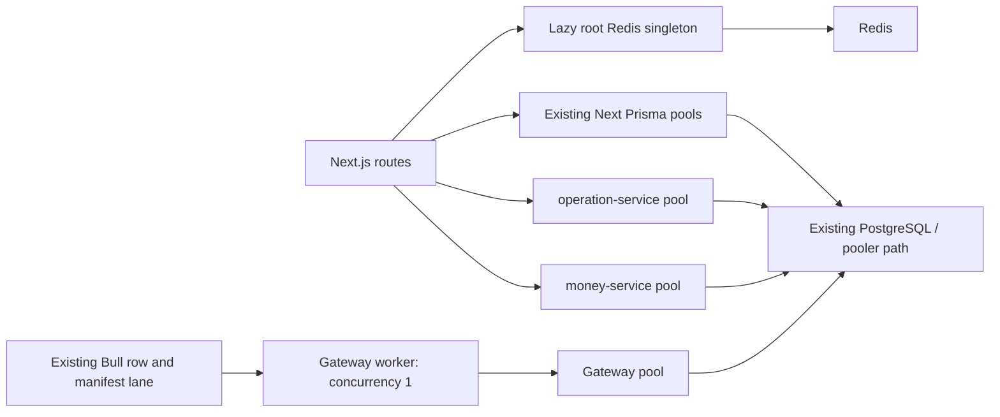

# Database Scaling: Second-Wave Architecture Design

- **Status:** Proposed for Claude Code review; documentation only.
- **Prepared:** 2026-10-20, Asia/Bangkok.
- **Source baseline:** `main` at `de61737ebfba6d63345cffe4b000dec2ab55f588`.
- **Implementation order:** Redis recovery → ID-only RETURNING → pool deadlines.

## 1. Decision and intended outcome

Use three small, independent changes to improve recovery, reduce unnecessary database result transfer, and contain connection waits. Keep the current Next.js, NestJS, Redis, Prisma, PostgreSQL, and queue architecture.

| Unit                  | Proposed change                                                                | Intended benefit                                                                             | Principal risk                                                                                            |
| --------------------- | ------------------------------------------------------------------------------ | -------------------------------------------------------------------------------------------- | --------------------------------------------------------------------------------------------------------- |
| R — Redis recovery    | Remove the root Redis client's ten-retry cutoff; keep a capped reconnect delay | An active process can resume Redis use after a prolonged transient outage                    | Shared cache, rate-limit, and idempotency consumers must retain their current failure behavior            |
| U — ID-only RETURNING | Add `select: { id: true }` to one gateway live-row upsert                      | Return and decode one column instead of an unused whole row                                  | The ingestion lane must preserve every update, snapshot step, and manifest ordering rule                  |
| P — Pool deadlines    | Add a finite `connectionTimeoutMillis` to each of three Nest Prisma adapters   | Stop indefinite driver pool checkout/connect waits during saturation or connectivity failure | Work can fail sooner; existing request, transaction, queue, and financial retry behavior needs validation |

R and P improve resilience; neither guarantees better normal throughput. U reduces result width, not the number of writes. No production latency or percentage speedup is claimed.

This proposal extends the [final quick-win assessment](database-scaling-study-2026-10-20/database-scaling-study/FINAL-RECOMMENDATIONS-2026-10-20.md) and takes the [Claude completion manifest](database-scaling-manifest-work-completion.md) as historical implementation context. Preserve the completed first-batch changes. Revalidate the relevant source on Claude's machine before implementation because that checkout may have advanced.

## 2. Architecture and boundaries



The diagram is a logical view, not a verified deployment topology. Repository documentation identifies shared physical PostgreSQL capacity; actual endpoint routing, PgBouncer settings, replica counts, and production saturation have not been inspected for this document.

The three units have no runtime dependency on one another. The sequence limits the scope of each review and rollout. Unit P is further divided into operation-service, gateway, and money-service rollouts.

**Preserve throughout:** cache keys/TTLs, authorization order, rate-limit policy, idempotency policy, database URLs/roles/TLS, pool maxima, queue concurrency/retries, live-row mutation payloads, cycle provenance, point-in-time snapshots, API response contracts, and existing shutdown hooks.

**Excluded:** new shared market snapshots or freshness budgets, distributed cache locks, Redis client-library upgrades, Redis lifecycle redesign, statement/lock timeouts, global write retries, index DDL, schema migrations, PIT memoization, alert reload coordination, worker parallelism, replicas, sharding, and deferred indicator-statistics work. No new infrastructure, environment variables, or feature flags are needed for the proposed patches.

## 3. Unit R — Redis recovery

### 3.1 Current behavior and failure

[Root Redis client](../lib/redis/client.ts) creates a lazy singleton, reuses a development `globalThis` instance, and exposes a lazy method-binding proxy. Its current policy is:

| Setting                                 | Current value                                 | Proposed value                |
| --------------------------------------- | --------------------------------------------- | ----------------------------- |
| `connectTimeout`                        | 5,000 ms                                      | Unchanged                     |
| `commandTimeout`                        | 3,000 ms                                      | Unchanged                     |
| `maxRetriesPerRequest`                  | 3                                             | Unchanged                     |
| Reconnect delay                         | `min(times * 500, 30000)` ms for retries 1–10 | Same formula, for all retries |
| Reconnect cutoff                        | Return `null` after retry 10                  | Remove                        |
| `lazyConnect`, `enableReadyCheck`       | `true`                                        | Unchanged                     |
| Offline queue / command resend settings | Existing defaults                             | Unchanged                     |

After the cutoff, ioredis can enter `end`, and the getter continues returning that instance. A recovered Redis server therefore does not automatically restore that process's cache/coordination access. The existing test explicitly expects the cutoff.

### 3.2 Proposed patch and state model

Change only the retry callback and its inaccurate “exponential backoff” comment:

```ts
retryStrategy: (times: number): number => {
  // Keep background reconnects active, with a capped linear delay.
  return Math.min(times * 500, 30_000);
},
```

The first delay remains 500 ms; retry 11 schedules 5,500 ms; retry 60 and later schedule 30,000 ms. These are scheduled delays between attempts, not recovery-time guarantees: connection establishment and ready checks also take time.

```text
not initialized --first command--> connecting --> ready
                                      ^           |
                                      |           | unexpected disconnect
                                      +-- reconnecting (capped delay, no retry-count cutoff)

explicit quit/disconnect --> stopped by the driver's intentional-close behavior
```

Keep one client per existing singleton scope. Reuse it during reconnects. Do not construct clients in event handlers, add a reconnect loop, call `connect()` on every request, or replace every `end` instance. The installed driver's close handler already distinguishes an intentional close from an unexpected disconnect. [ioredis documents this retry contract](https://github.com/redis/ioredis#auto-reconnect); the installed 5.11.1 source is the implementation reference for this repository.

Keep `getRedisClient()`, the proxy, status helpers, development reuse, and `disconnectRedis()` unchanged. A successful existing `disconnectRedis()` still quits, forgets the singleton, and permits a later explicit getter to create a fresh client. No background resurrection is added.

### 3.3 Failure semantics and limitations

Background recovery is allowed to continue; individual Redis commands retain their current deadline and retry settings. A 3-second command timeout rejects that command's promise. It is not an end-to-end HTTP deadline and does not guarantee that a queued or already-dispatched Redis mutation was canceled. Sequential commands can consume multiple command budgets. Do not add automatic business-operation retries or claim exactly-once execution.

Preserve each caller's actual policy:

| Consumer                                                             | Required behavior                                                                                                                                   |
| -------------------------------------------------------------------- | --------------------------------------------------------------------------------------------------------------------------------------------------- |
| [Cache manager](../lib/cache/cache-manager.ts)                       | Reads still degrade to cache misses on errors; failed writes retain their existing handling and TTLs                                                |
| [Generic idempotency guard](../lib/idempotency/idempotency-guard.ts) | Preserve the existing `SET ... NX EX` claim and its current catch/allow behavior; do not broaden it into a new policy for all idempotency consumers |
| [Rate-limit utilities](../lib/rate-limit.ts) and their callers       | Keep limits, sorted-set operations, and each caller's current error handling; do not assume every exception is already allowed through              |
| [Engine4 submission guard](../lib/engine4/server/idempotency.ts)     | Preserve fingerprints, claim/completion expiries, and `UNGUARDED` on claim errors                                                                   |
| [Alert invalidation publisher](../lib/drawing/invalidate.ts)         | Keep `alerts:changed` publishing best effort; Redis failure must retain its existing mutation response behavior                                     |
| [FX shared rate store](../lib/fx/shared-rate-store.ts)               | Preserve its existing 500 ms caller timeout, validation, retention, and lock policy; its promise race also does not cancel Redis execution          |
| Other imports of the root Redis helper                               | Audit claim, lock, and coordination use; preserve key, expiry, ownership, and replay semantics                                                      |

The operation-service and money-service Redis providers already use the same always-numeric capped formula. Leave them, Bull connections, and dedicated subscriber connections unchanged.

A new deployment/process constructs the fixed client. Development hot reload may retain an instance created with old options: restart that local process after changing the callback. This patch does not repair every possible terminal `end` state, credential/configuration failure, or a suspended/terminated serverless instance. Recovery requires an active runtime and a reachable, valid Redis endpoint.

An existing limitation also remains: `disconnectRedis()` clears the singleton only after `quit()` succeeds. If `quit()` rejects during an outage, cleanup is incomplete. Do not present this patch as a general shutdown repair; address that lifecycle change separately if needed.

### 3.4 Acceptance and verification

Update [root Redis tests](../__tests__/lib/redis/client.test.ts) and add only the focused behavior coverage needed:

1. Assert callback delays at retries 1, 10, 11, 60, and a large value; every result is finite and capped. Retain the 5-second connect, 3-second command, and three-retry assertions.
2. Retain lazy initialization, missing-URL, proxy binding, one-client identity, development hot reload, production isolation, and successful explicit quit/forget/recreate tests. A `close` or `error` event must not construct a second singleton.
3. With the installed ioredis and an isolated local Redis/protocol fixture, keep the endpoint unavailable through more than ten reconnects, restore it, and demonstrate a new command succeeding on the same client without process restart. Record the actual attempt count. Use accelerated timing only as a clearly labeled test override that scales the actual callback's numeric result; do not replace its policy with a different callback that could hide the cutoff.
4. Exercise a pending command with no response and verify bounded promise rejection. Capture delayed/offline command behavior so the test does not mistakenly equate timeout with cancellation. Keep fixture cleanup in `finally`, including direct driver disconnect when graceful quit cannot finish.
5. Exercise representative cache miss, rate-limit, and idempotency paths during outage and after recovery. Assert existing failure policies and claim TTLs, not a newly invented fail-open rule.

A mocked callback test alone does not establish socket recovery. An unavailable fixture means runtime recovery remains unverified and must be recorded as such before rollout.

Gate fixtures explicitly on a disposable local endpoint, with no fallback to the application's `REDIS_URL`. Use random test keys, no `FLUSHALL`, and unconditional cleanup. Include a lazy cold-start command that succeeds when Redis becomes ready within its existing command budget.

**Rollout:** deploy only the root application change, using the existing deployment process. Validate prolonged outage recovery in isolation/non-production. Observe existing Redis errors, cache behavior, origin database demand, and consumer failures during normal traffic. Do not stop production Redis to prove this patch.

**Rollback:** revert this callback change and redeploy the root application. No key deletion, cache flush, or data migration. The old retry cutoff returns after rollback.

## 4. Unit U — ID-only gateway RETURNING

### 4.1 Current behavior and proposed change

The gateway's [market-data processor](../railway-gateway/src/worker/market-data.processor.ts) awaits a `marketDataV6.upsert()` and discards its returned object. Earlier compiler probes emitted 106 columns in `RETURNING`; adding the projection emitted one. Those probes established SQL shape, not measured transfer bytes, production parity, or ingestion speed.

Add exactly one projection to the live upsert:

```ts
await this.prisma.marketDataV6.upsert({
  where: { symbol_timeframe_timestamp: { symbol, timeframe, timestamp } },
  create: data,
  update: data,
  select: { id: true },
});

await this.writePointInTimeSnapshot(data);
```

Keep the result unused and the external job result `{ success: true }` unchanged. Do not introduce raw SQL, a second lookup, `createMany` substitution, or a changed persistence model.

### 4.2 Invariants

| Invariant                                                    | Why it must hold                                                                                                               |
| ------------------------------------------------------------ | ------------------------------------------------------------------------------------------------------------------------------ |
| Same natural key: symbol, timeframe, timestamp               | Duplicate deliveries must not create duplicate live rows                                                                       |
| Full `create: data` and `update: data`, including `cycle_id` | Existing bars are intentionally rewritten; cycle provenance describes the latest writing cycle                                 |
| Await the live upsert before PIT processing                  | A failed live write must fail the job before snapshot handling                                                                 |
| Same PIT behavior                                            | Closed-bar immutable insert, duplicate suppression, forming-bar exclusion, and warning-only snapshot failure remain intact     |
| One wildcard handler, concurrency 1                          | Preserve the existing row/manifest processing lane; do not add a second processing loop                                        |
| Same manifest path and queue options                         | Preserve readiness semantics and existing retries/backoff; a successful row write is not a license to publish a manifest early |

Concurrency 1 is per worker instance, not a distributed lock across replicas. Preserve the existing worker replica topology and verify the one-effective-lane assumption; do not claim the decorator alone enforces deployment-wide ordering.

The SQL should differ only in the returned projection for the tested operation. Actual update assignments, insert values, conflict handling, and bound data must remain equivalent. Projection changes do not reduce live writes, PIT insert attempts, index maintenance, or WAL volume by the 106-to-1 column ratio.

### 4.3 Acceptance and verification

Start with [processor tests](../railway-gateway/test/market-data.processor.spec.ts), [PIT tests](../railway-gateway/test/point-in-time-snapshot.spec.ts), and the relevant existing cycle-manifest tests.

1. Update the exact upsert argument expectation to add only `select: { id: true }`. Preserve payload assertions and worker/manifest dispatch tests.
2. Prove create and update paths retain all submitted values. Deliver the same natural key across two cycles with changed indicator values and `cycle_id`; the final live row must contain the second payload and remain unique.
3. Assert call order. A rejected live upsert prevents PIT processing and job success; PIT failure after live success retains existing warning-and-success behavior; a forming bar still updates the live row without freezing a snapshot.
4. Recompile the operation with the currently installed gateway Prisma client/adapter. Compare the write SQL and parameters against the baseline; confirm the one-column `RETURNING` and no added read. Never rely only on the root application's different generated client.
5. Execute the equivalent before/after operations against an isolated fixture PostgreSQL database and compare persisted rows and job outcomes. Retain cycle/PIT regression coverage; do not use the normal environment configuration to discover a test database.

**Expected measurement:** fewer returned columns and lower result decoding/transfer work. Record response size and representative job duration if available. Do not infer a 99% latency, storage, or write-load improvement from column count.

**Rollout:** a separate gateway patch/deployment after R is assessed. Compare job success/failure, queue lag, cycle completeness/readiness, and PIT warnings with the preceding baseline. Do not alter collector scheduling or worker concurrency to make the benchmark look faster.

**Rollback:** revert the projection and redeploy the gateway. Full-row results return; persisted data needs no conversion or backfill.

## 5. Unit P — finite Nest pool waits

### 5.1 Current behavior and budget decision

The three Nest Prisma services construct `PrismaPg` with a connection string and no explicit pool acquisition/connect timeout. Installed `pg-pool` 3.14.0 defaults to `max: 10`, idle eviction after 10,000 ms, and no finite checkout/connect timeout. A saturated pool can retain pending checkouts indefinitely.

The root Next Prisma pools already have explicit finite settings. They are outside this change.

The existing [operation-service client](../lib/operation-service/client.ts) and [money-service client](../lib/money-service/client.ts) both allow **5,000 ms for reads** and **15,000 ms for writes**, without automatic write retries. Setting a shared downstream pool wait to 5,000 ms would consume the entire read budget before SQL execution and response transport.

Use these **initial implementation candidates**, subject to representative non-production and deployment-budget review:

| Service           | Proposed `connectionTimeoutMillis` | Keep current effective maximum / idle eviction | Reason                                                                                                |
| ----------------- | ---------------------------------- | ---------------------------------------------- | ----------------------------------------------------------------------------------------------------- |
| operation-service | 2,000 ms                           | 10 / 10,000 ms                                 | Leaves nominal headroom within the existing 5-second upstream read budget                             |
| railway-gateway   | 5,000 ms                           | 10 / 10,000 ms                                 | Asynchronous queue processing; finite wait without copying an HTTP read budget                        |
| money-service     | 2,000 ms                           | 10 / 10,000 ms                                 | Reads share the same 5-second upstream budget; financial error/retry behavior requires its own review |

These values are design choices, not measured optimums. “Nominal headroom” does not guarantee completion: a route may acquire more than once, do other work first, wait behind PgBouncer after connecting, or execute slow SQL. Confirm healthy checkout/connect distributions and critical caller/job budgets before adoption. If evidence conflicts with a candidate, adjust that service's value explicitly; do not increase upstream timeouts or pool maxima as an incidental fix.

### 5.2 Proposed configuration

Add only the timeout field to each existing adapter options object:

```ts
// operation-service and money-service: candidate value
connectionTimeoutMillis: 2_000,

// railway-gateway: candidate value
connectionTimeoutMillis: 5_000,
```

| Implementation file                                                           | Constraints                                                                                        |
| ----------------------------------------------------------------------------- | -------------------------------------------------------------------------------------------------- |
| [operation Prisma service](../operation-service/src/prisma/prisma.service.ts) | Retain its existing `ssl: { rejectUnauthorized: false }`, URL source, logging, and lifecycle hooks |
| [gateway Prisma service](../railway-gateway/src/prisma/prisma.service.ts)     | Retain its current TLS behavior, URL source, and lifecycle hooks                                   |
| [money Prisma service](../money-service/src/prisma/prisma.service.ts)         | Retain its current TLS behavior, dedicated role/URL source, logging, and lifecycle hooks           |

Do not copy the operation-service SSL override to the other services. Do not standardize configuration through a new shared package for this change. Add no `max`, idle timeout, connection lifetime, query timeout, or transaction option change. Verify the resulting runtime options against the installed versions and deployment configuration without printing connection strings.

### 5.3 What this timeout does and does not bound

| Layer                           | Behavior in this proposal                                                                                                          |
| ------------------------------- | ---------------------------------------------------------------------------------------------------------------------------------- |
| Driver pool checkout            | Finite pending checkout wait; installed `pg-pool` removes a timed-out waiter                                                       |
| New driver connection           | Finite physical connect attempt using the same configured timeout                                                                  |
| SQL after checkout              | Not bounded or canceled by `connectionTimeoutMillis`                                                                               |
| PgBouncer backend queue / locks | Not generally bounded by the application's connection timeout once its client connection exists                                    |
| Prisma interactive transactions | Existing acquisition and execution deadlines remain separate; do not equate `maxWait` or transaction timeout with the pool setting |
| Upstream HTTP request           | Existing 5-/15-second abort budgets remain separate; aborting the fetch does not cancel downstream database work                   |
| Queue job / business operation  | Can span several database operations or retries; no total deadline is introduced                                                   |

The timer is a driver-stage bound, not a universal stopwatch for all acquisition paths or a hard real-time guarantee. Event-loop delays and multiple stages can affect observed elapsed time. [node-postgres documents the pool API and timeout options](https://node-postgres.com/apis/pool); the installed `pg-pool` source also shows the pending-waiter timeout path.

The installed Prisma 7.9.1 adapter creates its pool lazily. A no-network probe of the actual gateway client confirmed that `$connect()` did not construct a physical database client. Preserve `onModuleInit()` and existing health checks; do not describe `$connect()` as a successful database connectivity probe or promise bounded health SQL from this field alone.

Preserve `$disconnect()` in `onApplicationShutdown()` and existing shutdown-hook registration. Moving it earlier can interrupt in-flight requests/jobs.

### 5.4 Error and retry contract

Let checkout/connect failures follow existing exception, transaction, and job paths. Do not add catch-and-retry around all Prisma operations or new public response mappings in this unit.

An acquisition timeout means that particular acquisition did not supply a connection; it does **not** prove the entire request had no effects. Earlier queries or external provider calls may already have happened. A caller timeout likewise leaves a write outcome uncertain.

For money-service, inventory the critical flows that combine database operations, provider calls, idempotency, and retry handling. Verify that a timeout cannot cause a second charge/disbursement, an incorrect “definitely failed” conclusion, or a stranded state concealed as success. Retain existing transaction boundaries, idempotency keys, outbox/reconciliation behavior where present, and caller/provider retry policy. If this requires a financial logic change, split it into a separately scoped design rather than expanding this configuration patch.

Before implementing P-money, identify Davin's explicit authorization covering this money-service timeout/failure-timing change, as required by the repository's [money change boundary](../.claude/architecture/microservices-cutover.md). This request authorizes the design document only. Existing explicit authorization, when recorded, must not be requested again.

For the gateway, preserve the existing [lane job options](../railway-gateway/src/worker/cycle-queues.ts): three attempts and exponential backoff with 2,000 ms base delay. Confirm how the proposed pool wait combines with retries, cycle readiness deadlines, failed jobs, and PIT's warning-only failure path. A 5-second acquisition timeout is not a 5-second job deadline.

### 5.5 Acceptance and verification

1. Assert each service's adapter receives the proposed timeout and retains its existing URL/TLS/logging/lifecycle behavior. Preserve effective max 10 and idle 10 seconds; do not accidentally inherit a test fixture's smaller pool in production.
2. Using the installed pool/adapter with an isolated PostgreSQL fixture, occupy a small test-only pool, wait for another checkout to time out, assert the waiter is removed, release the held connection, and prove later queries succeed. No leaked waiter, late unexpected write, or unreleased connection.
3. Test physical connect timeout separately with a controlled local endpoint that accepts but never completes the PostgreSQL handshake. An immediately refused port demonstrates an error, not the configured timeout. Close all fixture sockets in `finally`.
4. Exercise service operations through Prisma as well as driver-only fixtures. Include a normal read, saturation failure, recovery, and an interactive transaction's acquisition race; accept and classify the actual Prisma/driver error rather than pinning an unverified error code. Confirm a timed-out transaction start does not leave a late transaction/client checked out.
5. Show that an already-checked-out query is not canceled by this connection setting. Keep fixture SQL bounded and isolated. Do not infer a statement timeout from a pool test.
6. Exercise existing gateway retry/manifest behavior and critical money idempotency/reconciliation paths under acquisition failure. Use non-production fixtures, never real charges or live ingestion failure injection.
7. Retain each service's existing Prisma shutdown regression tests. Run the changed service's targeted tests, test-file typecheck where required, and applicable lint/type checks before deployment. Root TypeScript checking alone does not include all test files.

### 5.6 Staged rollout and rollback

After R and U have been assessed, apply P in this order:

1. **operation-service:** validate request/error behavior and normal latency first.
2. **gateway:** validate queue lag, retry counts, successful cycles/readiness, and PIT warnings.
3. **money-service:** validate critical financial flows and ambiguous-outcome handling separately; do not deploy merely because the other services passed.

Keep these independently revertible. Observe a representative traffic period and at least one relevant ingestion cycle before advancing. Use existing logs and monitoring; do not add a telemetry platform or expose private driver internals solely to ship the field. Capture pool wait/count information in fixtures or through supported diagnostics if needed.

Rollback the affected service if normal traffic starts producing unexpected acquisition failures, caller failures, retry amplification, incomplete cycles, or ambiguous financial states. Remove the timeout field and redeploy only that service. This restores the old unbounded-wait behavior; it does not repair overload or reverse completed business effects. Reconcile uncertain financial outcomes through existing procedures, never by blindly replaying writes.

## 6. Implementation ownership and review package

These are proposed future patch boundaries, not instructions to execute code changes from this document alone:

| Unit        | Production source writes                              | Focused verification scope                                                                          |
| ----------- | ----------------------------------------------------- | --------------------------------------------------------------------------------------------------- |
| R           | `lib/redis/client.ts`                                 | Existing root Redis tests, actual reconnect fixture, affected cache/rate-limit/idempotency behavior |
| U           | `railway-gateway/src/worker/market-data.processor.ts` | Processor/PIT/manifest regressions, current generated SQL, isolated persisted-row parity            |
| P-operation | `operation-service/src/prisma/prisma.service.ts`      | Adapter configuration, actual driver/service failure and recovery, shutdown, caller budgets         |
| P-gateway   | `railway-gateway/src/prisma/prisma.service.ts`        | Pool behavior plus ingestion retry/readiness/PIT outcomes and shutdown                              |
| P-money     | `money-service/src/prisma/prisma.service.ts`          | Pool behavior plus financial idempotency/uncertain outcomes and shutdown                            |

Associated focused tests/fixtures may change when implementation is authorized. Do not edit generated clients, lockfiles, schemas, unrelated dirty files, or shared agent state as incidental work. No migration or Prisma generation is required by this design.

For each implementation unit, Claude should attach a compact review record:

- Actual source SHA, scoped diff, and installed library versions.
- Exact tests/commands and outcomes, distinguishing mocks, installed-driver probes, real fixture execution, and deployment observations.
- The invariant comparison, chosen timeout values if applicable, and any unresolved evidence limits.
- Before/after measurements relevant to that unit, plus a direct revert path.

Use current repository instructions and ownership rules. Keep implementation, commit/push, and deployment authorization distinct. Do not run broad root builds or generators as documentation verification; the repository has unrelated work and lifecycle-sensitive scripts.

### Questions for Claude's design review

1. Does the current checkout still match the relevant source behavior, and have new Redis coordination consumers appeared?
2. Can the Redis fixture prove recovery beyond retry 10 while preserving bounded command promises and intentional close behavior?
3. Does the current gateway compiler still produce a one-column return without changing write SQL, and do persisted-row/cycle/PIT regressions pass?
4. Are 2,000 / 5,000 / 2,000 ms appropriate for measured healthy checkout/connect times, the 5-/15-second callers, transaction behavior, and ingestion deadlines?
5. Do the actual money-service flows handle acquisition failure and uncertain write outcomes using their existing guarantees?

Missing runtime evidence is not replaced by a guessed speedup or a passing configuration mock. R, U, and each P service may advance independently once their own acceptance evidence is complete.

## 7. Evidence and relationship to the scaling studies

Source and installed-library inspection for this proposal used the baseline above. Observed versions: root ioredis 5.11.1; Nest Prisma adapter 7.9.1; `pg-pool` 3.14.0 in all three services; gateway `pg` 8.23.0 and operation/money `pg` 8.22.0. Recheck after dependency changes.

The earlier SQL compiler probes were offline. New read-only, no-network installed-library probes confirmed (a) finite pool waiting removes its timed-out waiter, and (b) gateway `$connect()`/`$disconnect()` can run without constructing a physical database client. These are narrow behavior checks, not PostgreSQL integration, deployed recovery, or performance validation.

No application code, tests, schemas, runtime settings, or service deployments were changed while preparing this document. No environment files, live database/Redis connections, package installation, application builds, migrations, client generation, commits, or pushes were used for this design task.

The connection to the original studies is conceptual:

- **[OpenAI: Scaling PostgreSQL](https://openai.com/th-TH/index/scaling-postgresql/):** reduce unnecessary work per operation and manage pressure on finite database capacity. U narrows returned data; P contains one source of waiting. Neither changes PostgreSQL capacity or solves every overload path.
- **[Scaling Memcache at Facebook](https://www.usenix.org/conference/nsdi13/technical-sessions/presentation/nishtala)** — also available as the supplied [PDF](nsdi13-final170_update.pdf): cache failure/recovery is part of the storage architecture. R restores the existing client's recovery path; it does not implement Facebook's distributed cache protocols or add stale-data policies.

The prior [study and compiler evidence](database-scaling-study-2026-10-20/database-scaling-study/FINAL-RECOMMENDATIONS-2026-10-20.md) remain historical evidence with their stated limits. This design deliberately selects local changes before considering larger architectural additions.
