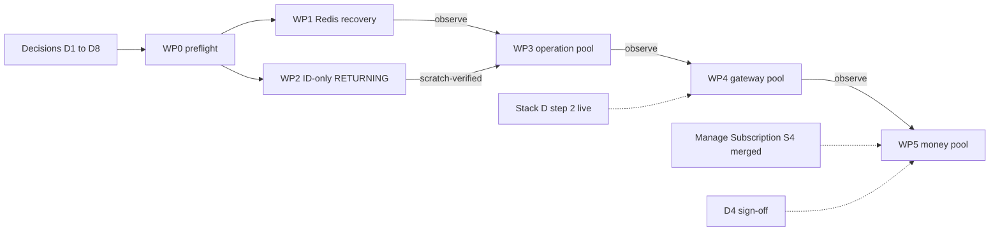

# Database Scaling Second Wave: Feasibility Analysis and Implementation Plan

- **Status:** PRE-DRAFT, planning only. No application code, test, schema, dependency, runtime setting or deployment was changed to produce this document. Nothing here is a CONFIRMED order.
- **Prepared:** 2026-10-21 by the Executor (Claude Code), for Davin.
- **Input:** the [second-wave architecture design](database-scaling-second-wave-architecture.md) (baseline `de61737e`), its [checkpoint](database-scaling-second-wave-CHECKPOINT-2026-10-20.md), the [first-batch manifest](database-scaling-manifest-work-completion.md) and the [final quick-win assessment](database-scaling-study-2026-10-20/database-scaling-study/FINAL-RECOMMENDATIONS-2026-10-20.md).
- **Checked against:** `main` at `e02c8b08`. Every production file and test the design edits, and the four `package.json` files, are byte-identical to the baseline (`git diff de61737e..HEAD` on them is empty). The working tree holds unrelated uncommitted billing work (Manage Subscription S4), partly inside `money-service/`.
- **Lifecycle:** each unit becomes its own order (PRE-DRAFT, then DRAFT by the Advisor, APPROVED by Davin, CONFIRMED by the Executor after re-verifying code and runtime state). This plan is the Executor's input to those drafts, not a substitute for them.
- **Update 2026-10-23:** `main` is now `9b40bf3d` and Manage Subscription S4 is committed, so F6's "uncommitted billing work" no longer applies (the missing authorization still does). D3 is answered by `EXECUTOR-PROTOCOL.md` §5: `frontend/` is SEPARATE_STACK and out of scope. PRE-DRAFT orders now exist for R, U and P-operation: [Redis recovery](../docs/migration-orders/adhoc-redis-background-recovery.migration-order.md), [ID-only RETURNING](../docs/migration-orders/adhoc-gateway-upsert-id-only-returning.migration-order.md), [operation-service pool deadline](../docs/migration-orders/adhoc-nest-pool-deadline-operation.migration-order.md). Two corrections found while drafting them: the study's SQL probe hard-codes an external checkout path, so WP2 writes a new scratch probe; and operation-service forces TLS, so WP3's through-service fixture needs a TLS-enabled scratch PostgreSQL.

**Reading order:** §1 verdict · §2 what was checked · §3 findings that change the design · §4 decisions needed · §5 work packages · §6 sequencing · §7 risks · §8 checklist for Davin.

## 1. Verdict

**All three units are feasible as designed.** The production changes are one to five lines each. The effort and the risk are in verification, rollout, and five points that the design does not settle:

1. **R replaces a permanent fast failure with a bounded slow failure** during long Redis outages (up to 3 s per command, instead of an instant error from a client that never recovers). This is the one real behaviour change in Unit R. See F1 and D1.
2. **The gateway's 5,000 ms candidate rests on a premise the live code contradicts.** The gateway serves HTTP reads that the monolith aborts after 5 s, so 5,000 ms consumes that whole budget. See F5 and D2.
3. **P-money is gated** by an explicit authorization that is not on record, and by uncommitted billing work in the same service. See F6 and D4.
4. **`railway-gateway/` and `money-service/` are not installed on this machine** (no `node_modules`, no generated Prisma client), so the design's installed-library checks for them cannot run until `npm ci`. See F7 and D6.
5. **U and P-gateway have nothing to observe in production** until Stack D step 2 is live (the 2026-10-20 manifest records empty ingestion tables). See F8 and D8.

| Unit                | Feasibility                              | Production diff             | Verification effort                           | Main risk                                      | Recommendation                              |
| ------------------- | ---------------------------------------- | --------------------------- | --------------------------------------------- | ---------------------------------------------- | ------------------------------------------- |
| R Redis recovery    | Feasible; both Nest services already did | 1 callback, about 5 lines   | M: real-Redis fixture (available locally)     | Outage latency (F1)                            | Proceed, gated on a measured outage table   |
| U ID-only RETURNING | Feasible, trivial                        | 1 line + 1 test expectation | S to M: needs install + scratch PostgreSQL    | Protected ingestion lane                       | Proceed; production observation waits on F8 |
| P-operation         | Feasible                                 | 1 line                      | M: saturation and connect-timeout fixtures    | Caller budgets, transaction race               | Proceed at 2,000 ms                         |
| P-gateway           | Feasible; value needs re-deciding        | 1 line                      | M: adds Bull, health and sensor-writer checks | HTTP readers share the pool; retry interaction | Proceed after D2 and D8                     |
| P-money             | Technically feasible; **gated**          | 1 line                      | L: flow-by-flow financial review              | Ambiguous financial outcomes                   | Hold until D4 and S4 merged                 |

## 2. Design claims checked against the live code

| #   | Design claim                                                                        | Result                                                                  | Evidence                                                                                                                                                                                                                                                                                                         |
| --- | ----------------------------------------------------------------------------------- | ----------------------------------------------------------------------- | ---------------------------------------------------------------------------------------------------------------------------------------------------------------------------------------------------------------------------------------------------------------------------------------------------------------- |
| 1   | Root Redis: 5 s connect, 3 s command, 3 retries, cutoff after retry 10, lazy        | Confirmed                                                               | [lib/redis/client.ts:40-60](../lib/redis/client.ts)                                                                                                                                                                                                                                                              |
| 2   | The existing test pins the cutoff                                                   | Confirmed. It must be rewritten, not extended                           | `retryStrategy(11)` expected `null` at [client.test.ts:74](../__tests__/lib/redis/client.test.ts)                                                                                                                                                                                                                |
| 3   | After the cutoff the client is terminal and the getter keeps returning it           | Confirmed in installed ioredis 5.11.1                                   | A non-number from `retryStrategy` ends the client (`built/redis/event_handler.js:187-215`); every later command is rejected at once with "Connection is closed" (`built/Redis.js:343`). The counter resets only when the client becomes ready (`event_handler.js:228`): the cutoff counts _consecutive_ failures |
| 4   | The Nest Redis providers already use the capped, never-give-up formula              | Confirmed, with the reason recorded in code                             | [operation-service redis.service.ts:16-21](../operation-service/src/redis/redis.service.ts) ("dead after a Redis restart longer than ~27 s"); money-service is identical                                                                                                                                         |
| 5   | Gateway upsert result is discarded; one wildcard handler; concurrency 1             | Confirmed                                                               | [market-data.processor.ts:50-79](../railway-gateway/src/worker/market-data.processor.ts)                                                                                                                                                                                                                         |
| 6   | The processor spec pins the exact upsert argument                                   | Confirmed. The mock resolves `{}`                                       | [market-data.processor.spec.ts:62,89](../railway-gateway/test/market-data.processor.spec.ts)                                                                                                                                                                                                                     |
| 7   | The three adapters set no pool timeout; only operation-service sets `ssl`           | Confirmed                                                               | the three `prisma.service.ts` files ([operation](../operation-service/src/prisma/prisma.service.ts), [gateway](../railway-gateway/src/prisma/prisma.service.ts), [money](../money-service/src/prisma/prisma.service.ts))                                                                                         |
| 8   | The root Next pools are already finite                                              | Confirmed: 5 s and `max: 5`. This is in-repo precedent                  | [lib/db/prisma.ts:51-53](../lib/db/prisma.ts), `lib/db/market-prisma.ts:40-42`                                                                                                                                                                                                                                   |
| 9   | Upstream budgets are 5 s read and 15 s write, writes never retried                  | Confirmed, same numbers in both clients                                 | [operation-service client:56,66](../lib/operation-service/client.ts), [money-service client:42,52](../lib/money-service/client.ts)                                                                                                                                                                               |
| 10  | A finite pool wait removes the timed-out waiter; a connect timeout kills the socket | Confirmed in pg-pool 3.14.0 (operation-service copy)                    | `operation-service/node_modules/pg-pool/index.js:206-225, 249-283`. The gateway and money copies are not installed here                                                                                                                                                                                          |
| 11  | The adapter passes options to a lazily built pool                                   | Confirmed in `@prisma/adapter-pg` 7.9.1                                 | `dist/index.js:785` builds `new pg.Pool(this.config)`; `startTransaction` acquires through `pool.connect()` (line 717), so the deadline also covers interactive transactions                                                                                                                                     |
| 12  | `$connect()` is not a connectivity probe                                            | Consistent with the lazy pool. The only connectivity check is `/health` | [health.controller.ts:80](../railway-gateway/src/health/health.controller.ts) runs `SELECT 1` through the same pool                                                                                                                                                                                              |
| 13  | Existing shutdown tests are unaffected                                              | Confirmed. No test anywhere mentions `PrismaPg`                         | The three `prisma.shutdown.spec.ts` files only spy on exit and kill. An options assertion is net-new                                                                                                                                                                                                             |
| 14  | The Redis consumer table is complete                                                | Mostly                                                                  | Missing: the world-gold FX cache ([lib/world-gold/fx.ts:7,219](../lib/world-gold/fx.ts)) and a stale mirror under `frontend/` (F3). `lib/rate-limit.ts` has one production caller (F2)                                                                                                                           |

### Answers to the design's five review questions

1. **Does the checkout still match?** Yes for every file the design edits. New Redis consumers: none added since the baseline; two the design does not list (world-gold FX, the `frontend/` mirror).
2. **Can a fixture prove recovery beyond retry 10?** Yes. A real `redis-server` 8.4.0 is installed locally (Chocolatey). Stop and restart it on a random high port, wrap the module's real `retryStrategy` in a `jest.mock('ioredis')` shim that only divides the returned delay, and the policy (including a reinstated cutoff) stays visible. Two independent mechanisms bound a pending command: `commandTimeout` and ioredis's `MaxRetriesPerRequestError` flush on every fourth attempt.
3. **Does the gateway compiler still emit a one-column return?** Not checkable here until the gateway is installed (F7). The study's `query-sql-probe.cjs` is reusable.
4. **Are 2,000 / 5,000 / 2,000 ms right?** 2,000 is sound for operation and money. 5,000 is not for the gateway (F5). Healthy checkout distributions cannot be measured from here: no production access, ingestion tables empty, PgBouncer settings unknown. The values stand on structural arguments, as the design itself says.
5. **Do money flows handle acquisition failure?** Partly answered by the code (F6): there are 19 interactive transactions and the idempotency interceptor releases its claim on failure. The flow-by-flow table is work package 5, not something to assert now.

## 3. Findings that sharpen or correct the design

### F1. R trades a permanent fast failure for a bounded slow failure (Unit R)

- **Today:** an outage longer than the ten retries ends the client. That is about 27.5 s of back-off when connections are refused, and up to about 80 s when packets are dropped (11 attempts of the 5 s `connectTimeout` plus the back-off). From then on **every command fails instantly, for the life of that process, even after Redis returns.**
- **After R:** the client keeps reconnecting with the delay capped at 30 s. Each command issued during the outage waits up to `commandTimeout` (3 s; ioredis starts that timer when the command is issued, including while it sits in the offline queue) and then rejects. After Redis returns, the next attempt comes within 30 s.
- **Why this matters:** it is not a new failure mode (every instance already behaves this way for the first 30 to 80 s of any outage), but it becomes persistent for the length of the outage. Sequential awaits add up: a cached market route does `get` then `set` around its loader (about +6 s worst case); `validate-discount` adds a rate-limit pipeline (about +3 s).
- **Already softening it:** the first batch's `singleFlight` shares each cache fill per key per instance, and the public routes also sit behind Vercel's CDN cache.
- **Plan response:** fixture case T5 measures the real per-consumer latency in the reconnecting state and records it as a table in the review record. Davin decides D1. If the table is unacceptable, the answer is a **separate** circuit-breaker design, not a wider patch.

### F2. The rate-limit surface is smaller than the design implies (Unit R)

`checkRateLimit` is imported by exactly one production route, [validate-discount](../app/api/payments/dlocal/validate-discount/route.ts) (line 51, inside its outer `try`). `checkAuthRateLimit`, `checkTierRateLimit`, `getRateLimitStatus`, `resetRateLimit` and `trackAiTokenUsage` have no production caller (the only other importers are prompt documents). `checkRateLimit` has no `try/catch` of its own, so its outage result depends on ioredis pipeline semantics. The fixture must record the actual result rather than assume the "fail open" that the design warns against assuming.

### F3. `frontend/lib/redis/client.ts` carries the same cutoff (Unit R scope)

It is a frozen copy from the initial `frontend/` commit (`0c443de0`): no `server-only`, no timeouts, no hot-reload handling. It is not in the file list of `scripts/sync-frontend.sh`, so the root edit will not reach it. It has CI workflows of its own, so whether `frontend/` is a live deployment is unknown to me. Recommendation: out of scope, recorded as a known stale copy (D3).

### F4. Prisma already limits interactive transactions to 2 s to start and 5 s to run (Unit P)

Prisma 7.9.1 defaults `maxWait` to 2,000 ms and `timeout` to 5,000 ms (`@prisma/client/runtime/client.js`). No call site in the three services overrides them. I counted `$transaction(async …)` sites: **money-service 19, operation-service 6**; the gateway has two array-form `$transaction([...])` writers (`mcd-outputs.writer.ts:266`, `state-statistics.writer.ts:113`). Consequences:

- A 2,000 ms pool deadline equals Prisma's own start deadline for interactive transactions, so it adds little there. Which error wins that race is not deterministic, so tests must accept both classes (the design already says to classify, not pin).
- P mainly changes **single statements and batch paths** (unbounded today) and whatever happens to a connection that arrives after Prisma has stopped waiting. That last point is unverified and is an explicit check in work package 3.
- So P-money's ambiguity review is mostly about non-transactional sequences (a provider call followed by a database write), not about the transactions.

### F5. The gateway is not queue-only (Unit P-gateway)

The monolith reads the gateway over HTTP with a 5 s abort ([gateway-client.ts:26](../lib/active-indicator/gateway-client.ts): `/api/v1/cycles/current`, `/api/v1/active-indicator`). The gateway also serves cycle, indicator-statistics, economic-events and currency-gold-indices reads, and `/api/v1/health` runs `SELECT 1` on the same pool. The design chose 5,000 ms because there is "no HTTP read budget to copy". That is the very budget a 5,000 ms checkout would consume, and the argument the design uses to pick 2,000 ms for operation and money. One `PrismaPg` has one deadline, so the value applies to every path. Queue jobs lose nothing from 2,000 ms: Bull retries three times with 2 s then 4 s back-off. **Recommendation: 2,000 ms (D2).** Evidence that would overturn it: a measured healthy checkout p99 above about 1 s.

### F6. P-money is gated twice (Unit P-money)

- **No authorization on record.** I searched `.claude/state` and found none; the checkpoint states that publishing the design is not implementation authorization. Non-negotiable 5 and the cutover document require Davin's explicit sign-off for this change.
- **Uncommitted billing work** sits in `money-service/src/dlocal/*`, `money-service/src/stripe/subscription-actions.ts` and `stacked-expiry.ts` (Manage Subscription S4). The edit sets do not overlap `prisma.service.ts`, but **Railway rebuilds every service on every push to `main`** (Watch Paths are unset, per `infrastructure.md`). A money timeout would ship in the same observation window as whatever billing work reaches `main`.
- **Useful precedent:** the idempotency interceptor already releases its claim when a handler fails so a genuine retry can proceed (`idempotency.interceptor.ts:162-165`), and the plan-change specs already inject a `db down` rejection into `$transaction` (`stripe-subscription.controller.plan-change.spec.ts:523,820`). An acquisition timeout reaches those same paths as a different error object, so the review extends an existing fault-injection pattern.
- **Staging note for the whole of P:** "stage operation, then gateway, then money" works only through **merge order**. Every push rebuilds all three Railway services with whatever is on `main`. Each push also runs the pre-push gate (about 5 minutes).

### F7. This machine cannot run most of the design's verification yet (environment)

| Item                      | State here                                                                                                                                                                               |
| ------------------------- | ---------------------------------------------------------------------------------------------------------------------------------------------------------------------------------------- |
| Root, `operation-service` | Installed, Prisma client generated                                                                                                                                                       |
| `railway-gateway`         | **No `node_modules`, no generated client**                                                                                                                                               |
| `money-service`           | **No `node_modules`, no generated client**                                                                                                                                               |
| Real Redis                | `redis-server` 8.4.0 (Chocolatey shim)                                                                                                                                                   |
| PostgreSQL                | 18 binaries (production is 17.11; pool and SQL-shape checks do not depend on the difference). First-batch scratch-server method applies. Davin's own service on 5432 must not be touched |
| Docker                    | Absent                                                                                                                                                                                   |
| Python                    | `python` on PATH is the Windows Store stub. The gateway's sensor specs need Python 3.11 with `pyyaml==6.0.2` and `jsonschema==4.25.0` and **skip silently** without them                 |
| Node                      | 24.12 locally; CI uses 22                                                                                                                                                                |
| Type-checking tests       | Root `tsc --noEmit` does not cover `__tests__/` (environment-gotchas); use its throwaway-tsconfig method. Each Nest service has its own `tsc` and Jest                                   |

### F8. Production state affects what can be observed (Units U and P-gateway)

The 2026-10-20 manifest records `market_data_v6`, `currency_gold_indices` and `indicator_statistics` at **0 rows**, and the infrastructure notes say the Stack D step 2 deploy runbook has not been run. If that is still true, the design's rollout criteria for U and P-gateway ("compare queue lag, cycle readiness and PIT warnings with the preceding baseline") cannot be met, because no live baseline exists. I cannot confirm the current state: I have no production access and, by rule, must not take any. Davin confirms (D8).

## 4. Decisions needed

| ID  | Decision                                                                                                                                                                                              | Recommendation                                                                                                                                                                                                                   | Blocks        |
| --- | ----------------------------------------------------------------------------------------------------------------------------------------------------------------------------------------------------- | -------------------------------------------------------------------------------------------------------------------------------------------------------------------------------------------------------------------------------- | ------------- |
| D1  | Accept a bounded slow failure (up to 3 s per Redis command, summed per route as in F1) during outages longer than about 30 s, in exchange for automatic recovery                                      | Yes, gated on fixture T5's measured table. If any route is unacceptable, open a separate circuit-breaker design instead of changing this patch                                                                                   | WP1 confirm   |
| D2  | Gateway `connectionTimeoutMillis`: 2,000 (consistent with the others) or 5,000 (the design)                                                                                                           | 2,000, per F5                                                                                                                                                                                                                    | WP4           |
| D3  | Is `frontend/` a live deployment? If not, R leaves its stale Redis copy alone                                                                                                                         | Out of scope, noted in the order                                                                                                                                                                                                 | WP1 order     |
| D4  | Explicit authorization of the money-service timeout change (design §5.4), and whether it waits for S4 to be merged                                                                                    | Wait for S4. Authorize the specific change only after WP5's flow table exists                                                                                                                                                    | WP5           |
| D5  | Approve local fixtures: a real `redis-server` and a scratch PostgreSQL 18, each on a random high port, hidden window, stopped by its own PID, data deleted (first-batch §1.5 method; never port 5432) | Approve. I announce each launch before it happens                                                                                                                                                                                | WP1 to WP5    |
| D6  | Approve `npm ci` in `railway-gateway/` and `money-service/`                                                                                                                                           | Approve. It must leave `package.json` and the lockfiles unchanged (checked with `git status`); `postinstall` only generates the Prisma client inside `node_modules`                                                              | WP2, WP4, WP5 |
| D7  | Observation window before the next push                                                                                                                                                               | R and P-operation: 24 h of normal traffic. U and P-gateway: at least 12 consecutive market-open cycles. P-money: at least 48 h including one Stripe and one dLocal webhook delivery                                              | each rollout  |
| D8  | Ordering against the Stack D step 2 go-live                                                                                                                                                           | Keep the design order R, U, P-operation. U may merge now (scratch-verified, one line), with production observation recorded as pending. P-gateway waits until step 2 has run live for a trading day. P-money waits for D4 and S4 | WP2, WP4      |

## 5. Work packages

Every package ends with the **review record** the design asks for: source SHA and scoped diff, installed library versions, exact commands and outcomes (labelled _mock_, _installed-driver probe_, _real fixture_ or _deployment observation_), the invariant comparison, measurements, unresolved evidence limits, and the direct revert path.

### WP0. Preflight (once)

1. **Drift check.** Repeat `git diff de61737e..HEAD` on the target files on the day each order is CONFIRMED. It is empty today.
2. **Decisions.** Take D1 to D8. Each order records the ones it depends on in its `Decisions taken` section (non-negotiable 7).
3. **Install and baseline** (after D6). Record counts for every suite that will be touched: root `npx tsc --noEmit`, `npm run lint`, `npm run test:ci`; per service `npx tsc --noEmit` and `npm test` with the skipped count; gateway also `npm run check:sensor-kit`. The 2026-10-20 root baseline (564 suites, 18,725 tests) predates the billing sessions and must be re-taken.
4. **Draft the orders**, one per unit, as `docs/migration-orders/adhoc-<slug>.migration-order.md` (precedent: the three first-batch orders): `redis-background-recovery`, `gateway-upsert-id-only-returning`, `nest-pool-deadline-operation`, `…-gateway`, `…-money`.
5. **Capture "before" evidence that needs the unmodified code:** the Redis fixture run against today's `lib/redis/client.ts` (it must show the dead client, proving the fixture can see the bug), and the upsert's SQL and parameters from the installed gateway client.

### WP1. Unit R, Redis background recovery

- **Production change:** `lib/redis/client.ts`, the retry callback and its inaccurate "exponential" comment. Nothing else.
- **Tests, existing:** rewrite [client.test.ts:61-76](../__tests__/lib/redis/client.test.ts). Assert delays at retry 1 → 500, 2 → 1,000, 10 → 5,000, 11 → 5,500, 60 → 30,000, 10,000 → 30,000, all finite, never `null`. Keep every other assertion (5 s, 3 s, 3 retries, lazy, ready check, offline queue not disabled, singleton, hot reload, production isolation, quit/forget/recreate). Add: a `close` or `error` event does not construct a second client.
- **Tests, new:** a gated `__tests__/lib/redis/client-recovery.redis.spec.ts`. It follows the `*.pg.spec.ts` precedent (not collected by `test:ci`, run by an explicit command) and is skipped unless `REDIS_FIXTURE_BIN` points at a `redis-server` binary. It never falls back to `REDIS_URL`. It spawns its own server on a random high port with persistence off, uses random keys, never `FLUSHALL`, and kills the server by PID in `finally`. Cases:
  - **T1 Recovery.** Server down for more than 12 attempts (record the actual count), then restarted: the same client object answers `PING`, `SET` and `GET`, and `getRedisStatus()` is `ready`, with no process restart.
  - **T2 Cold start.** The first lazy command, issued while the server is still starting, succeeds within the command budget.
  - **T3 No reply.** `CLIENT PAUSE` makes the server stop answering: the command rejects within about 3 s. A later-applied write is observed afterwards, documenting that a timeout is not a cancellation.
  - **T4 Intentional close.** After `disconnectRedis()` there are no reconnect attempts, and the next getter builds a fresh client. When graceful `quit` cannot finish, `disconnect()` runs in `finally`.
  - **T5 Outage latency table.** In the reconnecting state past attempt 11, time each helper: `getCache`, `setCache`, `checkRateLimit`, `acquireIdempotencyLock`, the engine4 claim, the alerts publisher, the FX store read and write. This is the table for D1.
  - **T6 Policy preserved**, during the outage and after recovery: cache get → `null`; cache set swallowed; idempotency lock → `true` with a logged error; engine4 → `UNGUARDED`; publish never throws; FX store honours its 500 ms race; rate limit → record the actual result; after recovery, normal results and claim TTLs read back from real keys.
  - **Timing:** a `jest.mock('ioredis')` shim wraps the module's real `retryStrategy` and divides only its returned delay (for example by 100). Connect and command timeouts stay real.
- **Mutation check** (first-batch precedent): reinstate `times > 10 → null` (T1 and the delay test must fail); drop the 30,000 cap (delay test fails); change `commandTimeout` (options test fails).
- **Gates:** root `tsc`, lint, targeted Jest, `npm run test:ci`, `npm run build` (restore `next-env.d.ts` afterwards), and the throwaway-tsconfig check of touched tests.
- **Rollout:** one push. Vercel builds the monolith; Railway rebuilds the three services with no source change. Confirm the live Vercel build, because a push is not proof of a deploy. Observe 24 h (D7): `Redis client error:` rate, `Cache get error`, `[Idempotency] Redis lock check failed`, origin database load behind the market caches. **Do not stop production Redis to prove the patch.**
- **Rollback:** revert the commit and redeploy. No keys, no data.
- **Size:** M, dominated by the fixture.

### WP2. Unit U, ID-only gateway RETURNING

- **Preconditions:** D6 (install), D5 (scratch PostgreSQL), D8 (ordering).
- **Production change:** `market-data.processor.ts`, add `select: { id: true }` to the upsert at line 70. Result stays unused; the job still returns `{ success: true }`.
- **Steps:**
  1. Save the baseline statement and parameters from the installed gateway client (WP0 step 5).
  2. Update the spec expectation at [line 89](../railway-gateway/test/market-data.processor.spec.ts) by adding only `select`. Keep the payload assertions (`create` and `update` equal the job data, including `cycle_id`), the forming-bar test (line 112), the PIT-failure-is-a-warning test (121), the rejected-upsert test (129) and the manifest dispatch tests. Add an explicit invocation-order assertion (upsert before PIT).
  3. Recompile after the change. The diff must be the `RETURNING` list only (106 columns to 1): same `INSERT … ON CONFLICT DO UPDATE` assignments, same bound parameters, no added statement.
  4. New gated `railway-gateway/test/market-data.processor.pg.spec.ts` (precedent: `cycle-readers.pg.spec.ts`, gated on `CYCLE_PG_URL` and `CYCLE_PG_ALLOW_WIPE=yes`). Run the real processor and `PrismaService` over a fixed job sequence: a new bar, the same key re-delivered, the same key in a second cycle with changed indicators and `cycle_id`, a closed bar, a forming bar. Run it twice, once as shipped and once through a thin wrapper that strips `select`. Compare `market_data_v6`, `market_data_point_in_time` and the job outcomes. Assert one row per natural key.
  5. Gates: gateway `tsc`, `npm test` (report skipped), the e2e specs, `npm run check:sensor-kit`, `nest build`.
- **Not claimed:** any speed-up. Record result width and decoding only if measurable on the scratch database.
- **Rollout:** per D8. Verify the gateway replica count in Railway: concurrency 1 is per instance, not a distributed lock (design §4.2).
- **Rollback:** revert and redeploy. No data conversion.
- **Size:** S to M.

### WP3. Unit P-operation

- **Production change:** `operation-service/src/prisma/prisma.service.ts`, add `connectionTimeoutMillis: 2_000`. Keep `ssl`, URL, logging and hooks. No `max`, idle or query option.
- **Tests:**
  - A unit spec asserting the adapter options are exactly `{ connectionString, ssl: { rejectUnauthorized: false }, connectionTimeoutMillis: 2000 }`, so the default `max` of 10 and idle 10 s are not disturbed.
  - A gated spec on the scratch PostgreSQL, using a fixture URL with an `application_name` so backends can be counted in `pg_stat_activity`:
    - **Saturation.** Hold all 10 pooled connections with `pg_sleep`. The eleventh Prisma query fails after about 2 s with the real error (record its class and message; do not pin a code). Release, and the next query succeeds, with no leaked backend and no leaked waiter.
    - **Connect timeout.** A local TCP server accepts and never answers the PostgreSQL startup: failure at about 2 s ("Connection terminated due to connection timeout"). A refused port is only a control; it errors immediately and proves nothing about the timer.
    - **Interactive transaction under saturation** (F4). The failure arrives as either error class, no late transaction is left open (`xact_start`), and the pool recovers.
    - **Not a statement timeout.** A checked-out `pg_sleep(3)` completes.
  - The existing `prisma.shutdown.spec.ts` stays unchanged and green.
- **Caller-budget inventory:** list the operation-service routes the monolith calls on the 5 s read path with the most sequential database calls and confirm 2,000 ms leaves room. This is nominal headroom only, as the design says.
- **Gates:** service `tsc`, `npm test`, `nest build`.
- **Rollout:** the first P push. Observe 24 h: `timeout exceeded when trying to connect` and `Connection terminated due to connection timeout` log lines, 504s from the monolith's operation-service client, outbox/email consumer and alert-dispatcher failures, the account-deletion worker.
- **Rollback:** revert and redeploy. This restores the unbounded wait.
- **Size:** M.

### WP4. Unit P-gateway (after D2 and D8)

- **Production change:** `railway-gateway/src/prisma/prisma.service.ts`, add `connectionTimeoutMillis` at the D2 value (recommended 2,000). No `ssl` (PgBouncer's internal listener refuses TLS; see the file's own comment).
- **Tests:** WP3's unit and gated cases against the gateway's own `pg` and `pg-pool` (installed after D6), plus:
  - **Bull interplay.** A Prisma double that throws the fixture's real timeout error: the job fails, `LANE_JOB_OPTIONS` is unchanged (3 attempts, exponential 2 s), PIT is not reached, and no manifest is published early (follow the `cycle-manifest.service.spec.ts` pattern).
  - **Health.** Under saturation `/api/v1/health` reports `degraded` with the database down instead of hanging on checkout. The `SELECT 1` after checkout remains unbounded.
  - **Sensor writers.** The two array-form `$transaction([...])` writers under acquisition failure: all or nothing, with the error reaching the existing stale and retry logic.
- **Gates:** gateway `tsc`, `npm test` with the skipped count, the e2e specs, `check:sensor-kit`, `nest build`.
- **Rollout:** after WP3's window and, per D8, after step 2 has run live for a trading day. Observe at least 12 consecutive market-open cycles: job failures and retries, queue lag, cycle-ready and manifest readiness, PIT warnings, monolith `gateway-client` timeouts.
- **Rollback:** revert and redeploy.
- **Size:** M.

### WP5. Unit P-money (gated on D4)

- **Gate 0:** Davin's explicit authorization of this specific change. None is on record.
- **Steps:**
  1. **Flow inventory.** For every money-service write path record: trigger (provider webhook with provider retry, client request with an `Idempotency-Key`, cron, outbox); the order of external call versus database write; the idempotency mechanism; the state left if acquisition fails at each database step; how it recovers. Scope: the 19 interactive transactions (Stripe webhook 8, Stripe subscription controller 4, dLocal webhook 1, affiliate conversion processor 2, disbursement webhook processor 1, subscription cron 1, Wise state reducer 2) plus the non-transactional writes, the outbox publisher and dLocal create-payment. The deliverable is a table in the order's appendix, each row "safe as is" or "needs separate design".
  2. **Fault injection** extending the existing `db down` pattern with a pool-timeout-shaped error. Assert: no second provider call; the idempotency claim is released; an event is not marked processed on failure; the HTTP status lets Stripe or dLocal retry.
  3. **Real-driver fixture** as in WP3 against money-service's own `PrismaService` (no `ssl`), including an interactive transaction.
  4. **Stop rule.** If any row is "needs separate design", this package ends with the inventory and the logic change becomes its own design, as the design requires.
  5. Only then add `connectionTimeoutMillis: 2_000`.
- **Rollout:** a separate push after S4 is merged and observed. Davin watches Stripe and dLocal webhook delivery logs; also the outbox backlog, affiliate conversion errors and reconciliation through existing procedures. Never replay writes blindly.
- **Rollback:** revert and redeploy. It does not undo completed business effects.
- **Size:** L.

## 6. Sequencing

- Preparation of several packages can overlap (separate orders, separate files). **Pushes cannot:** one unit per push, an observation window between units, and no bundling. Every push runs the pre-push gate and rebuilds all Railway services.
- Record the Railway deployment ID and the health `uptime` after each push; a push is not proof of a deploy.
- **Rough sizing:** WP0 S, WP1 M, WP2 S to M, WP3 M, WP4 M, WP5 L. That is roughly five to seven focused sessions plus the observation windows, which dominate elapsed time. The first batch fitted three small units in one session, but it had no cross-service fixtures.

## 7. Risks

| #   | Risk                                                             | Unit    | Likelihood / impact         | Mitigation                                                                                                                                             |
| --- | ---------------------------------------------------------------- | ------- | --------------------------- | ------------------------------------------------------------------------------------------------------------------------------------------------------ |
| 1   | Routes get slower during long Redis outages (F1)                 | R       | Medium during outages       | T5 table, D1, `singleFlight`, no production Redis stop                                                                                                 |
| 2   | Timeouts fire under healthy load                                 | P       | Unknown (no baseline)       | Ask Davin for PgBouncer `max_client_conn`, `default_pool_size`, `query_wait_timeout` and any Railway metrics; ship operation first; watch logs; revert |
| 3   | A money flow mistakes an acquisition timeout for a clean failure | P-money | Low likelihood, high impact | WP5 gate, flow table, stop rule, explicit sign-off                                                                                                     |
| 4   | Ingestion lane regression                                        | U, P-gw | Low                         | Scratch parity, mutation check, observation after go-live                                                                                              |
| 5   | Mixed deploy signal                                              | All     | Medium                      | One unit per push, record deployment IDs, verify the live build                                                                                        |
| 6   | Fixture leaks a process, port or database                        | All     | Medium                      | Gated specs, own-PID kill in `finally`, announce each launch, never port 5432, random high ports, delete data directories                              |
| 7   | A passing mock is read as proof                                  | All     | Medium                      | Label every result by evidence type in the review record                                                                                               |
| 8   | A silent skip reads as a green run                               | Gateway | Medium                      | Report skipped counts; install the Python 3.11 dependencies or state the skip                                                                          |

## 8. Checklist for Davin

**Decide:** D1 to D8 in §4.

**Supply (I cannot see these):**

- [ ] Whether Stack D step 2 is live and whether the ingestion tables still hold 0 rows (F8).
- [ ] The gateway's Railway replica count (design §4.2).
- [ ] PgBouncer settings (`max_client_conn`, `default_pool_size`, `query_wait_timeout`, pool mode) and any Railway or Vercel latency metrics (risk 2).
- [ ] Whether `frontend/` is deployed (D3).
- [ ] The wording of the P-money authorization when the time comes (D4).

**Permit:** `npm ci` in the gateway and money-service (D6); the local `redis-server` and scratch PostgreSQL fixtures (D5).

Nothing is committed, pushed or deployed by this plan. Each commit, push and deployment stays a separate instruction from Davin.

## 9. Not claimed

- No speed-up. R and P are resilience changes; U narrows result width and does not reduce writes, index maintenance or WAL.
- No production evidence was gathered. Everything above is source reading plus installed-library inspection on this machine. Where a result needs a fixture or production, it says so.
- The design's exclusions stand: no new infrastructure, flags or environment variables, no schema or index change, no Redis library upgrade or lifecycle redesign, no statement or lock timeouts, no write retries, no worker parallelism.
