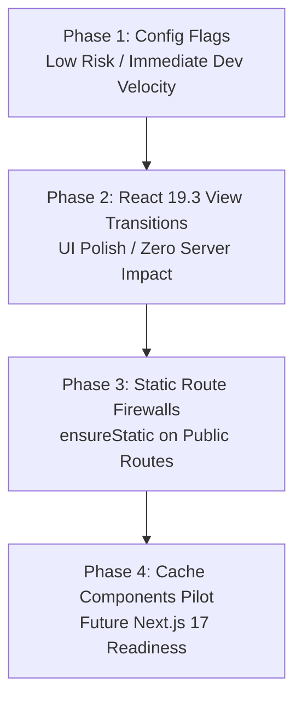

# DavinTrade SaaS: Next.js 16.4 & React 19.3 Adoption Roadmap and Feasibility Assessment

- **Document Version:** 1.0.0
- **Date:** October 14, 2026
- **Author:** Antigravity (Advisor)
- **Implementer Target:** Codex
- **Approval & Oversight:** Davin (Owner)
- **Target Repository:** `trading-alerts-saas-public` (DavinTrade SaaS V7)
- **Target Location:** `davintrade-nextjs16-4-configuration/NEXTJS-16-4-ADOPTION-ROADMAP-AND-FEASIBILITY.md`

---

## 1. Executive Summary

This document establishes the strategic, architectural, and operational roadmap for adopting the opt-in configurations and new code patterns introduced in **Next.js 16.4.0** and **React 19.3.0** across the DavinTrade SaaS platform.

The core codebase has already been upgraded to `next@16.4.0` and `react@19.3.0` with 100% test passing rates (322 test suites, 8,047 unit/integration tests) and clean production builds across all 178 routes. While default performance optimizations (Zstandard cache compression, lazy server HMR, shared runtime chunk, export name mangling) took effect automatically upon upgrade, Next.js 16.4 introduces high-value **opt-in engine configurations** and **API-ready programming models** that directly benefit DavinTrade's trading platform.

This roadmap provides Codex with a phased feasibility assessment, architectural rationale, code patterns, risk mitigations, and execution steps.

---

## 2. Current Architecture Baseline

| Component                 | Current State                              | Context in DavinTrade SaaS                                 |
| :------------------------ | :----------------------------------------- | :--------------------------------------------------------- |
| **Framework Version**     | Next.js `16.4.0`                           | Powers the 178-route App Router frontend & API monolith    |
| **React Version**         | React `19.3.0`                             | Upgraded alongside Next.js 16.4                            |
| **Bundler & Dev Tooling** | Turbopack / Next SWC                       | Used for development (`next dev`) and build (`next build`) |
| **Package Management**    | pnpm `10.34.4` (Workspace)                 | Monorepo structure with `@trading-alerts/types`            |
| **Hosting & Deployments** | Vercel (Frontend) + Railway (Services)     | Production pipeline triggered on `push` to `main`          |
| **State & Auth**          | NextAuth + Redis + PostgreSQL (Prisma 7.9) | Session cookies, RBAC (Free, Pro, VIP, Admin)              |
| **UI Characteristics**    | High-density trading charts + localized UI | Lightweight Charts, Recharts, 16 languages (`lib/i18n`)    |

---

## 3. Detailed Overview of Next.js 16.4 & React 19.3 Updates

Next.js 16.4 is a pivotal release bridging Next.js 16 with the forthcoming architecture of **Next.js 17**.

### 3.1 Cache Components Universal Recommendation

- **Universal Recommendation:** The `'use cache'` directive is no longer considered experimental; it is universally recommended and slated to become the default caching model in Next.js 17.
- **Route Segment Guard (`ensureStatic`):** Route configuration allowing developers to enforce static guarantees (`export const ensureStatic = 'navigation' | 'prefetch' | 'shell'`). If a dynamic component, uncached query, or request-bound cookie read accidentally enters the route tree, the build immediately fails.
- **Navigation Deferral APIs (`navigation()` & `prefetch()`):** Located in `next/cache`. Allows components to explicitly exclude expensive data fetches from link hover prefetches, deferring execution until the user actually executes the navigation.

### 3.2 Turbopack Performance & Developer Tooling

- **Turbopack Garbage Collection (`turbopackGc`):** Experimental engine flag to actively prune stale compilation units from RAM and disk cache across prolonged dev sessions.
- **Lazy Dynamic Imports (`turbopackLazyDynamicImports`):** Defers compiling client-side `import()` bundles until requested by the browser.
- **Worker Threads Runtime (`turbopackPluginRuntimeStrategy: 'workerThreads'`):** Runs Babel, PostCSS, and loaders in worker threads rather than separate processes.
- **Global Virtual Store (`turbopackAdditionalRoots`):** Native support for pnpm global virtual store paths.
- **Agent Tooling (`agentUpgrade`, `agentFeedback`):** Built-in framework notifications for agent pairing and security releases.

### 3.3 React 19.3 Capabilities

- **Stable View Transitions:** Native browser-backed smooth visual state changes without heavy framer-motion dependencies.
- **Fragment Refs:** Refs can now be passed directly to `<Fragment>`.
- **`browser()` API:** Modern client detection primitives.

---

## 4. Architectural Justification: Why DavinTrade SaaS Needs These Features

Adopting these opt-in features is not merely about staying on the bleeding edge; it addresses four specific operational realities in DavinTrade SaaS:

### 4.1 Cost Containment on Serverless (Vercel Invocations)

- **Problem:** DavinTrade has dozens of public marketing, legal, policy, and educational academy routes (`/pricing`, `/terms`, `/privacy`, `/disclaimer`, `/about`, `/academy`). In high-traffic localized setups (16 languages), accidental inclusion of request-bound dynamic code (like reading headers or uncached DB calls) causes Vercel serverless function invocations on every pageview.
- **Solution:** Enforcing `export const ensureStatic = 'navigation'` on public routes acts as a compile-time firewall, guaranteeing that marketing routes never invoke billable serverless compute.

### 4.2 Charting & Heavy Modal Dev Latency

- **Problem:** DavinTrade bundles heavy charting engines (`lightweight-charts`, custom canvas indicators, MT5 fractal overlays, Recharts) and payment modals (dLocal, Stripe). In local development, compiling these bundles eagerly slows down server startup and HMR.
- **Solution:** Enabling `turbopackLazyDynamicImports: true` ensures that client dynamic imports are only compiled when the engineer actually clicks on or opens that chart/modal.

### 4.3 Long-Session Developer Memory Stability

- **Problem:** Active trading development sessions often involve hours of continuous live-testing and switching between MT5 backfill relays, Engine 4 report generators, and dashboard components. Turbopack dev caches can balloon in memory and disk over time.
- **Solution:** `turbopackGc: true` reclaims stale compilation data automatically.

### 4.4 Fluid Trading UX via View Transitions

- **Problem:** Financial platforms require rapid decision-making. Switching between timeframes (e.g., M5 $\leftrightarrow$ M15) or filtering real-time alert cards currently causes instant DOM replacement that can feel jarring or disorienting.
- **Solution:** React 19.3 `<ViewTransition>` provides hardware-accelerated cross-fades and positional shifts, conveying continuity to the trader.

### 4.5 Future-Proofing for Next.js 17

- **Problem:** Next.js 17 will deprecate legacy implicit caching models in favor of Cache Components. Upgrading a 178-route enterprise platform all at once upon Next.js 17's launch would create massive regression risks.
- **Solution:** Progressive adoption allows DavinTrade to migrate cleanly and test components ahead of time.

---

## 5. Phased Implementation Roadmap

To maintain platform stability and zero downtime, implementation is split into **three isolated phases**, ordered by risk and complexity.



---

### Phase 1: Immediate Engine & Dev Flags (Configuration Only)

- **Risk Level:** Minimal (0% runtime risk to production users).
- **Target File:** `next.config.js`.
- **Scope:** Enable Turbopack Garbage Collection, Lazy Dynamic Imports, and Security Agent Upgrades.

#### Proposed Configuration Edit:

```javascript
// next.config.js
module.exports = withBundleAnalyzer({
  // ... existing configs
  experimental: {
    // 1. Reclaim stale dev compilation memory and disk space
    turbopackGc: true,

    // 2. Compile dynamic imports only on browser request
    turbopackLazyDynamicImports: true,

    // 3. Automated notification of critical security releases
    agentUpgrade: 'security',

    // Existing configs (preserve unchanged)
    serverActions: {
      bodySizeLimit: '2mb',
    },
    optimizePackageImports: [
      'lucide-react',
      'recharts',
      '@radix-ui/react-icons',
      'date-fns',
    ],
  },
  // ...
});
```

#### Feasibility & Verification:

1. `npm run dev` starts cleanly.
2. `npm run build` exits with code 0 (178 routes compiled).
3. `npm run test:quick` passes all 322 test suites.

---

### Phase 2: React 19.3 View Transitions (UI Continuity)

- **Risk Level:** Low (CSS/React client-side only; unsupported browsers degrade gracefully to standard DOM updates).
- **Target Components:**
  1. **Timeframe Switcher** in chart controls.
  2. **Alert Card Lists** (`components/alerts/alert-card.tsx` or alert feeds).
  3. **Settings Navigation** tabs.

#### Pattern Implementation 1: Chart Timeframe Transitions

```tsx
// components/charts/timeframe-switch.tsx
'use client';

import { useTransition, ViewTransition } from 'react';

interface Props {
  currentTimeframe: string;
  onSelect: (tf: string) => void;
  options: string[];
}

export function TimeframeSwitch({
  currentTimeframe,
  onSelect,
  options,
}: Props) {
  const [, startTransition] = useTransition();

  const handleSelect = (tf: string) => {
    // startTransition triggers the browser's ViewTransition
    startTransition(() => {
      onSelect(tf);
    });
  };

  return (
    <div className="bg-background-200 flex items-center gap-1.5 rounded-lg p-1">
      {options.map((tf) => (
        <button
          key={tf}
          onClick={() => handleSelect(tf)}
          className={`rounded px-2.5 py-1 text-xs font-medium transition-colors ${
            currentTimeframe === tf
              ? 'bg-primary text-primary-foreground shadow-sm'
              : 'text-muted-foreground hover:text-foreground'
          }`}
        >
          {tf}
        </button>
      ))}
    </div>
  );
}
```

#### Pattern Implementation 2: Fluid Alert List Reordering

```tsx
// components/alerts/alert-feed.tsx
'use client';

import { ViewTransition } from 'react';
import { AlertCard } from './alert-card';

export function AlertFeed({ alerts }: { alerts: AlertItem[] }) {
  return (
    <div className="grid gap-3">
      {alerts.map((alert) => (
        // Keyed ViewTransition animates items shifting when filters change or alerts arrive
        <ViewTransition key={alert.id} enter="fade-in" exit="fade-out">
          <AlertCard alert={alert} />
        </ViewTransition>
      ))}
    </div>
  );
}
```

#### Feasibility & Verification:

1. Test across Chromium 111+, Firefox 144+, Safari 18.2+.
2. Verify that browsers without `document.startViewTransition` support transition instantly without console errors.

---

### Phase 3: Route Firewalls with `ensureStatic` (Marketing & Legal)

- **Risk Level:** Low (Strictly applied to routes that must never be dynamic).
- **Target Routes:**
  - `app/(marketing)/pricing/page.tsx`
  - `app/about/page.tsx`
  - `app/terms/page.tsx`
  - `app/privacy/page.tsx`
  - `app/disclaimer/page.tsx`

#### Implementation:

```tsx
// app/(marketing)/pricing/page.tsx
export const ensureStatic = 'navigation';

export default function PricingPage() {
  return (
    <main className="min-h-screen">
      <PricingHeader />
      <PricingCards />
      <PricingFAQ />
    </main>
  );
}
```

#### Feasibility & Verification:

1. Run `npm run build`.
2. Inspect the build output manifest to confirm the route is marked with `○  (Static)` or `●  (SSG)`.
3. If an engineer inadvertently adds `cookies()` or un-cached `fetch(..., { cache: 'no-store' })` to this route, `next build` will immediately throw a compile error:
   ```text
   Error: Route /pricing was declared as ensureStatic = 'navigation', but dynamic content was detected.
   ```

---

### Phase 4: Cache Components Pilot (Targeted API & Market Data)

- **Risk Level:** Medium (Requires audit of cookies/headers on target routes).
- **Target Scope:** Semi-static market metadata and economic calendar endpoints.
- **Flag Required:** `cacheComponents: true` in `next.config.js`.

#### Pattern Implementation: Economic Calendar & Currency Indices

```tsx
// lib/market/economic-calendar.ts
import { cacheLife, cacheTag } from 'next/cache';

export async function getUpcomingEconomicEvents() {
  'use cache';
  cacheLife('hours'); // Retains cached result in shared memory/CDN for hours
  cacheTag('economic-events');

  const response = await fetch('https://api.external-market.com/events');
  if (!response.ok) throw new Error('Failed to fetch events');
  return response.json();
}
```

#### Deferred Prefetching for Deep Candle Archives:

```tsx
// components/charts/candle-history-loader.tsx
import { navigation } from 'next/cache';

export async function DeepCandleHistory({ symbol }: { symbol: string }) {
  // Excludes this heavy query from hover prefetches; loads only when clicked
  await navigation();

  const candles = await fetchYearlyM5Candles(symbol);
  return <CandleChartOverlay candles={candles} />;
}
```

---

## 6. Risk Assessment and Mitigation

| Risk                                   | Likelihood | Impact | Mitigation Strategy                                                                                                                                                                                       |
| :------------------------------------- | :--------- | :----- | :-------------------------------------------------------------------------------------------------------------------------------------------------------------------------------------------------------- |
| **Turbopack GC compatibility bug**     | Low        | Low    | GC is scoped to development builds. If any cache eviction anomaly occurs in dev, disable `turbopackGc: true` in `next.config.js`.                                                                         |
| **Lazy Dynamic Import missing asset**  | Low        | Medium | Tested locally during `npm run dev`. Turbopack handles client chunks via standard Webpack runtime fallbacks.                                                                                              |
| **`ensureStatic` build failure**       | Medium     | Low    | This is by design. If a route fails, inspect whether dynamic logic (e.g. user theme, currency preference) should be read in client components (`next-themes`, React Context) rather than the server root. |
| **View Transition rendering jank**     | Low        | Low    | Keep transitions lightweight (opacity, transform). Do not animate complex layout-triggering properties (`width`, `height`, `margin`).                                                                     |
| **Cache Component auth boundary leak** | Low        | High   | Follow Phase 4 guidelines: Never place `'use cache'` on routes reading user session tokens without explicit parameter keying.                                                                             |

---

## 7. Verification Checklist for Codex

Before submitting a PR or task completion report, Codex must execute and report the following:

- [ ] **Type Check:** `npm run type-check` (exit code 0, 0 TypeScript errors).
- [ ] **Lint Check:** `npm run lint` (exit code 0).
- [ ] **Test Suite:** `npm run test:quick` (exit code 0, all 322 test suites and 8,047 tests pass).
- [ ] **Production Build:** `npm run build` (exit code 0, all 178 routes compile successfully).
- [ ] **Git Integrity:** Ensure untracked files or unrelated working-tree modifications (e.g., `lib/engine4`, `mobile-app`) remain undisturbed.

---

## 8. Summary & Recommendation

Antigravity recommends executing **Phase 1** immediately to capture developer speedups, followed by **Phase 2 and 3** as planned sprint tasks. Phase 4 should be scoped as an architectural pilot branch before wider rollout.
