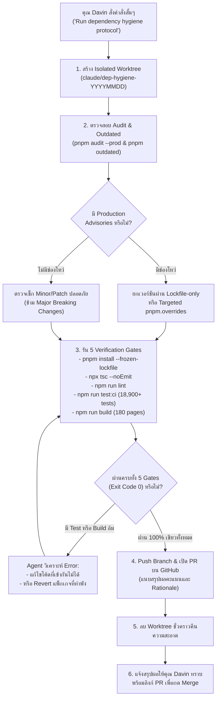

# คู่มือปฏิบัติการ: การดูแลและอัปเดต Dependency อัตโนมัติด้วย AI Agent (Claude Code & Codex)

## AI Agentic Dependency Hygiene & Continuous Security Automation Manual

- **ผู้ดูแลระบบ / ผู้มีอำนาจตัดสินใจสูงสุด (Owner & Approver):** Davin (`ripper7375`)
- **ผู้ปฏิบัติการ (Executors):** Claude Code (CLI) / OpenAI Codex (CLI)
- **ที่ปรึกษาเชิงสถาปัตยกรรม (Advisor):** Antigravity (Google DeepMind)
- **เอกสารอ้างอิงหลักในระบบ (Canonical Protocol):** [`.claude/protocols/dependency-hygiene.md`](../.claude/protocols/dependency-hygiene.md)
- **กฎเหล็กการควบคุม Overrides:** [`.claude/rules/security-overrides.md`](../.claude/rules/security-overrides.md)
- **วันที่จัดทำ:** 18 ตุลาคม 2026

---

## 1. บทนำ: ทำไมต้องเปลี่ยนจากบอทเดิม (Dependabot) มาเป็น AI Agentic Automation?

ในโปรเจกต์ระดับ Enterprise SaaS ที่มีสถาปัตยกรรมแบบ Monorepo ผสม Microservices เช่น DavinTrade (`trading-alerts-saas-public`) การใช้บอทอัตโนมัติแบบดั้งเดิมอย่าง GitHub Dependabot หรือ Renovate มักจะสร้างปัญหามากกว่าแก้ปัญหา:

```
❌ บอทอัตโนมัติทั่วไป (Dependabot)
   ├── สุ่มเปลี่ยนเลขเวอร์ชันใน package.json ทันที
   ├── ไม่เข้าใจโครงสร้าง pnpm.overrides และ monorepo -> lockfile พัง (ERR_PNPM_LOCKFILE_CONFIG_MISMATCH)
   ├── ไม่รู้ว่าเวอร์ชันใหม่มี Breaking API changes หรือไม่ -> โค้ดพัง
   └── เปิด PR สุ่ม 5-10 ตัวพร้อมกัน -> รัน Vercel Preview ล้มเหลว ขึ้น Error สีแดงเต็มหน้า Deployments

✅ ระบบอัตโนมัติด้วย AI Agent (Claude Code & Codex)
   ├── วิเคราะห์ช่องโหว่ความปลอดภัยระดับ Production อย่างแม่นยำ (pnpm audit --prod)
   ├── ยกเวอร์ชันผ่าน Lockfile-only ก่อน เพื่อไม่ให้กระทบ dependencies ตัวอื่น
   ├── ปรับ pnpm.overrides เฉพาะจุดที่จำเป็นจริงๆ พร้อมจดบันทึก Rationale ใน security-overrides.md
   ├── รันตรวจสอบความเข้ากันได้แบบ 100% Zero-Regression (tsc, lint, Jest 18,900+ ข้อ, Next.js build)
   ├── หากมี API เล็กน้อยที่เปลี่ยนชื่อ AI จะตามไปแก้ไขโค้ดให้สอดคล้องกันทันที
   └── เปิด PR ที่ผ่านการทดสอบ 100% เขียวทั้งหมดเพียง 1 PR ให้คุณ Davin กด Merge ได้ทันที
```

---

## 2. ขั้นตอนการสั่งการสำหรับคุณ Davin (Quick Command Guide)

คุณ Davin สามารถสั่งให้ Claude Code หรือ Codex เริ่มกระบวนการตรวจสอบและอัปเดต dependency ได้ตลอดเวลา (แนะนำทำสัปดาห์ละ 1 ครั้ง หรือเมื่อมีรายงานช่องโหว่ความปลอดภัยใหม่) ด้วยคำสั่งสั้นๆ เพียงคำสั่งเดียว:

### 💬 คำสั่งที่แนะนำ (เลือกใช้ภาษาใดก็ได้):

> **ภาษาอังกฤษ:**  
> `"Run dependency hygiene protocol and open PR."`

> **ภาษาไทย:**  
> `"ช่วยตรวจเช็คและอัปเดต dependency ตาม Protocol ให้หน่อยครับ"`

---

## 3. แผนผังกระบวนการทำงานของ AI Agent (Workflow Diagram)



---

## 4. รายละเอียดกฎเหล็ก 5 ประการที่ Agent ต้องปฏิบัติตาม (Non-Negotiables)

1. **ห้ามทำงานบน Working Tree ที่ไม่สะอาด (Must Use Isolated Worktree):**
   Agent จะต้องสร้าง worktree แยกต่างหากเสมอ (`.claude/worktrees/dep-hygiene-<วันที่>`) เพื่อป้องกันไม่ให้กระทบไฟล์งานที่คุณ Davin กำลังทำค้างอยู่ในเครื่อง
2. **ห้ามแตะต้องระบบการเงิน, Auth หลัก, และ Seed-Code (Strict Scope Boundary):**
   ห้ามอัปเดตแพ็กเกจที่มีความเสี่ยงสูงต่อเงินและสิทธิ์ผู้ใช้ (เช่น Stripe, dLocal, Prisma, NextAuth core) เว้นแต่ได้รับคำสั่งเฉพาะเจาะจง หรือเป็น Security Patch ที่ได้รับอนุมัติ
3. **ไม่อัปเดต Major Version โดยพลการ (Patch/Minor Focus):**
   การยกเวอร์ชันข้าม Major (เช่น v5 -> v6 หรือ v9 -> v10) มักมี Breaking Change มหาศาล จะต้องสรุปเสนอคุณ Davin ก่อนเสมอ
4. **รักษาความสมบูรณ์ของ Lockfile เสมอ (Zero Mismatch Gate):**
   ต้องสามารถรัน `pnpm install --frozen-lockfile` ผ่านได้ฉลุย เพื่อป้องกันปัญหา Vercel Build Preview Error
5. **ห้าม Direct Push เข้า `main` เด็ดขาด (PR Only):**
   Agent มีหน้าที่ส่งงานผ่าน Pull Request ที่ผ่าน CI 100% เท่านั้น สิทธิ์ในการ Merge เข้า `main` เป็นของคุณ Davin เสมอ

---

## 5. รายการคำสั่งและชุดการตรวจสอบ (Verification Gates Reference)

เมื่อ Agent ทำการยกเวอร์ชัน จะต้องรันคำสั่งตรวจสอบเหล่านี้ใน Worktree ให้ผ่าน `exit 0` ทั้งหมด:

| ลำดับ | การตรวจสอบ               | คำสั่งที่รัน                     | เกณฑ์การผ่าน (Passing Criteria)                          |
| :---: | :----------------------- | :------------------------------- | :------------------------------------------------------- |
| **1** | **Lockfile Integrity**   | `pnpm install --frozen-lockfile` | Exit 0 (ไม่มี config mismatch กับ overrides)             |
| **2** | **TypeScript Typecheck** | `npx tsc --noEmit`               | Exit 0 (ไม่มี type error แม้แต่จุดเดียว)                 |
| **3** | **ESLint Security**      | `npm run lint`                   | Exit 0 (0 errors)                                        |
| **4** | **Jest Unit Tests**      | `npm run test:ci`                | ผ่านครบทุก suites (~560 suites, 18,900+ tests, 0 failed) |
| **5** | **Production Build**     | `npm run build`                  | Exit 0 (คอมไพล์ครบ 180 หน้าของ Next.js 16)               |

---

## 6. แนวทางการรับมือกรณีพิเศษ (Special Scenarios)

### กรณีที่ 1: เจอบรรจุภัณฑ์ที่มี Breaking Change เล็กน้อย

- **สิ่งที่ Agent จะทำ:** ตรวจสอบ error log ใน Jest หรือ TypeScript หากพบว่าเป็นเพียงการเปลี่ยนชื่อ import หรือ prop types เล็กน้อย Agent จะทำการปรับแก้โค้ดให้เข้ากันได้ จากนั้นรัน Jest ซ้ำจนเขียวทั้งหมด

### กรณีที่ 2: ช่องโหว่ความปลอดภัยที่ผู้พัฒนายังไม่ออกแพตช์ (Unpatched Upstream)

- **ตัวอย่าง:** ช่องโหว่ประเภท Dev-only เช่น `braces`, `node-forge`, หรือ `@faker-js/faker`
- **สิ่งที่ Agent จะทำ:** ตรวจสอบว่ากระทบกับ Production หรือไม่ หากเป็น Dev-only และยังไม่มีเวอร์ชันแก้ไขที่ปลอดภัย Agent จะคงเวอร์ชันเดิมไว้ และจดบันทึกเป็น Accepted Advisory ในคำอธิบายของ PR อย่างโปร่งใส

### กรณีที่ 3: Microservices (NestJS / Python)

- **สิ่งที่ Agent จะทำ:** ตรวจสอบแพ็กเกจในโฟลเดอร์ของ service นั้นๆ แยกต่างหาก (`money-service/`, `operation-service/`, `railway-gateway/`) โดยรันคำสั่งทดสอบของ service นั้นๆ ก่อนเปิด PR

---

## 7. แผนต่อยอดในอนาคต: การตั้งเวลารันอัตโนมัติเต็มรูปแบบ (Future Automation)

หากในอนาคตคุณ Davin ต้องการให้ระบบตื่นขึ้นมารันเองโดยไม่ต้องพิมพ์สั่ง:

1. **ผ่าน GitHub Actions Scheduled Workflow:** สามารถสร้างไฟล์ `.github/workflows/scheduled-agent-hygiene.yml` ตั้งเวลาทุกวันจันทร์ ให้ Runner รัน Claude Code CLI และเปิด PR ส่งเข้า Notification ให้คุณ Davin
2. **ผ่าน Local Task Scheduler บน Windows:** สามารถสร้าง Script `.bat` หรือ `.ps1` ให้ Windows Task Scheduler รันคำสั่ง `claude` ในเวลาที่คุณ Davin ไม่ได้ใช้งานเครื่อง (เช่น ตี 3)

---

> **สรุปหัวใจสำคัญ:** ด้วยแนวทาง AI Agentic Automation คุณ Davin จะได้ทั้ง **"ความปลอดภัยระดับสูงสุด"** และ **"ความสะดวกสบาย"** โดยไม่ต้องเสียเวลากับ PR ขยะหรือ Error สีแดงจากบอทอัตโนมัติแบบเดิมอีกต่อไปครับ!
