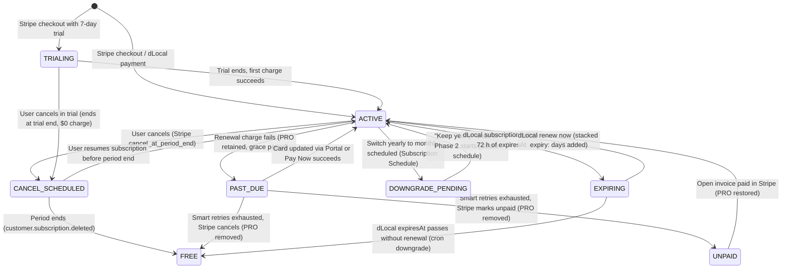

# DavinTrade Manage Subscription Engine (Sessions S1–S4): Work Completion Manifest

- **Executor:** Claude Code (Sessions S1, S2, S3, S4, 21–24 October 2026) on Davin's instruction, DavinTrade Monolith (`trading-alerts-saas-public`), `money-service`, and `operation-service`.
- **Owner / Approver:** Davin.
- **Advisor:** Antigravity (reviewed diagnosis, authored decision guide D1–D8 & E1–E4, established F21 migration safety rules, reviewed and approved each session handoff).
- **Originating Problem:** The "Manage Subscription" button on `/settings/billing` was a dead link pointing to its own page (`page.tsx:449`), with zero management engine behind it. Users had no self-service mechanism to update payment methods, failed payments caused immediate involuntary churn, cancellations immediately destroyed paid access days (forfeiting remaining months), dLocal renewals wiped remaining days, and switching between monthly and yearly billing intervals was impossible.
- **Adopted Architecture:** **Option C (Hybrid Architecture)** — Monolith Next.js and `money-service` own all business rules, state transitions, dynamic SystemConfig prices, outbox events, and email notifications. Stripe Hosted Customer Portal is utilized strictly for PCI-DSS-compliant card entry (`payment_method_update` flow only), locking out all unmanaged direct plan alterations.
- **Commit History on `main`:**
  - **S1:** `48bf2bcf` — `feat(billing): manage subscription session 1 - failed payments, card update, past-due grace`
  - **S2:** `1f0b9755` — `feat(billing): manage subscription session 2 - cancel at period end, resume, migration`
  - **S3:** `e02c8b08` — `feat(billing): manage subscription session 3 - monthly yearly plan switching, proration, schedules`
  - **S4:** `9b40bf3d` — `feat(billing): manage subscription session 4 - dlocal stacked expiry, renewal flow, expiring banner`
- **Database Migration:** `prisma/migrations/20261021000000_add_subscription_management_fields/migration.sql` (Authored, verified on scratch PostgreSQL 18.1 with zero schema drift and tested rollback; **NOT yet applied to production database**).
- **Overall Execution State:** **BUILT, FULLY VERIFIED, AND COMMITTED LOCALLY ACROSS ALL 4 SESSIONS (S1–S4). All 20,266 root tests, 1,102 money-service tests, and 685 operation-service tests pass with 0 failures.** Deployment is currently **HELD** pending Railway platform incident resolution (`status.railway.com/incident/QH8L8B3E`) and Davin's execution of the production deployment walkthrough.

---

## 1. Executive Summary & Master Work Inventory

The Manage Subscription Engine transforms DavinTrade's subscription operations from a bare checkout-and-immediate-cancel system into an enterprise-grade, dual-provider (Stripe + dLocal), multi-locale self-service platform.

### Unified Subscription Lifecycle State Machine



---

### Master Work Inventory (Sessions S1 to S4)

| Session |           Order Scope           |      Decisions & Defects Addressed       | Scope & Change Description                                                                                                                                                                                                                                                                                                                                                                                                                                                                                                                                                                                                                                                                                                                                                                                                                                                                                                                                                                                               | Primary Files Touched                                                                                                                                                                                                                                                                                                                                                  | Verification Evidence                                                                                                                                                                                                                                                                     |
| :-----: | :-----------------------------: | :--------------------------------------: | :----------------------------------------------------------------------------------------------------------------------------------------------------------------------------------------------------------------------------------------------------------------------------------------------------------------------------------------------------------------------------------------------------------------------------------------------------------------------------------------------------------------------------------------------------------------------------------------------------------------------------------------------------------------------------------------------------------------------------------------------------------------------------------------------------------------------------------------------------------------------------------------------------------------------------------------------------------------------------------------------------------------------- | :--------------------------------------------------------------------------------------------------------------------------------------------------------------------------------------------------------------------------------------------------------------------------------------------------------------------------------------------------------------------- | :---------------------------------------------------------------------------------------------------------------------------------------------------------------------------------------------------------------------------------------------------------------------------------------- |
| **S1**  |  Quick Wins & Failed Payments   | **B1, B2, B3, B4**<br>**D4, D5, D7, E1** | **Past-due grace period & self-service recovery:**<br>• `tierForStripeStatus` helper shared byte-identically between monolith and `money-service`: `past_due` retains PRO during retry window (B1).<br>• `GET /api/subscription` returns full subscription data for `PAST_DUE` and `UNPAID` users instead of null (B2), adding `allowedActions` and `displayState`.<br>• Dead link removed from `/settings/billing` (B3); replaced by red status banner with **Pay now** (W2) and **Update card** (W1).<br>• `POST /api/subscription/payment-method-session` created using restricted `STRIPE_PORTAL_CONFIGURATION_ID`.<br>• Payment-failed email link updated to `/settings/billing` (B4).                                                                                                                                                                                                                                                                                                                              | `lib/stripe/tier-rule.ts`<br>`money-service/src/stripe/tier-rule.ts`<br>`app/api/subscription/route.ts`<br>`app/settings/billing/page.tsx`<br>`app/api/subscription/payment-method-session/route.ts`<br>`money-service/src/stripe/stripe-subscription.controller.ts`<br>`lib/email/i18n/templates.ts`                                                                  | 577 root suites, 19,480 tests passed (0 failed).<br>Stripe test clock simulated declined renewal → `past_due` → hosted invoice retrieved → portal session opened on card-only form.<br>2 mutation tests killed.<br>Migration: **None** (E1).                                              |
| **S2**  | Cancellation & Retention Engine |     **B5, B6, B7, B9**<br>**D1, D8**     | **Period-end cancellation & resume with database migration:**<br>• The single 6-column database migration authored with pre-flight check, rollback, and F21 hardening (explicit `select`).<br>• 4 schema definitions synchronized field-for-field (`prisma/non-market-data`, `money-service/prisma`, `types/prisma-stubs`, `operation-service`).<br>• Three-step cancel page `/settings/billing/cancel` replaces immediate-cancel dialog (W3); collects `cancellationReason`.<br>• Stripe subscription set to `cancel_at_period_end: true`; access continues until `current_period_end`.<br>• `POST /api/subscription/resume` restores subscription (`cancel_at_period_end: false`) (W4).<br>• dLocal cancel blocked (`DLOCAL_NO_CANCEL` / D8).<br>• "Subscription resumed" email template in 19 locales.                                                                                                                                                                                                                | `prisma/migrations/20261021000000_...`<br>`prisma/non-market-data/schema.prisma`<br>`money-service/prisma/schema.prisma`<br>`app/settings/billing/cancel/page.tsx`<br>`app/api/subscription/cancel/route.ts`<br>`app/api/subscription/resume/route.ts`<br>`lib/stripe/webhook-handlers.ts`<br>`lib/email/i18n/messages/*.ts`                                           | 581 root suites, 19,713 tests passed (0 failed).<br>money-service 74 suites, 933 tests.<br>operation-service 63 suites, 653 tests.<br>Scratch PostgreSQL 18.1 test: pre-flight 0 → 6 columns, zero drift, verified rollback.<br>25 mutation tests killed.<br>Stripe test mode verified.   |
| **S3**  |   Plan Switching & Proration    |   **B8, B9**<br>**D2, D3, E2, E3, E4**   | **Asymmetric plan switching (Monthly ↔ Yearly):**<br>• `invoicePlan` fixed in both stacks to pick non-proration subscription line (B8), preventing prorated upgrade invoices from misrecording as monthly.<br>• **W5a (Upgrade):** `GET /api/subscription/change-plan/preview` calculates exact proration; `POST` executes immediate upgrade with `proration_behavior: 'always_invoice'` and `payment_behavior: 'error_if_incomplete'` (E2). Declined cards reject cleanly with 402 without state corruption.<br>• **W5b (Downgrade):** Scheduled at renewal via Stripe Subscription Schedule (Phase 1 = yearly, Phase 2 = monthly, `end_behavior: 'release'`); no refunds.<br>• `DELETE /api/subscription/change-plan` releases schedule ("Keep yearly" undo).<br>• Cancel releases schedule first (Stripe rejects cancel while schedule attached).<br>• E4 affiliate commission calculates lifetime months covered (24-month cap).<br>• Page `/settings/billing/change-plan` and 2 new email templates in 19 locales. | `lib/stripe/invoice-plan.ts`<br>`money-service/src/stripe/invoice-plan.ts`<br>`app/api/subscription/change-plan/route.ts`<br>`app/api/subscription/change-plan/preview/route.ts`<br>`app/settings/billing/change-plan/page.tsx`<br>`lib/affiliate/constants.ts`<br>`money-service/src/affiliate/conversion-processor.service.ts`<br>`lib/email/subscription-emails.ts` | 586 root suites, 20,147 tests passed (0 failed).<br>money-service 76 suites, 1,085 tests.<br>operation-service 63 suites, 685 tests.<br>Stripe test mode: 27/27 checks passed (upgrade, declined card, free trial switch, downgrade schedule, keep yearly).<br>46 mutation tests killed.  |
| **S4**  | dLocal Renewal & Stacked Expiry |          **B10**<br>**D6, W6**           | **dLocal stacked renewal & expiration UX:**<br>• Fixed expiry bug in both dLocal webhooks: `expiresAt = max(now, current expiry) + duration` (B10/D6), preventing early renewals from discarding remaining days.<br>• Monolith webhook upgraded with atomic replay claim (`status: { not: 'COMPLETED' }`), preventing duplicate period extensions.<br>• `POST /api/payments/dlocal/create` and `/checkout` opened for active dLocal subscribers with `renew: true` (previously blocked with 403 / "Already PRO").<br>• Status banner and "Expires soon" badge for dLocal plans within 72 h of expiration.<br>• "Renew now" button routes to checkout with plan pre-selected, skipping provider chooser.<br>• Return page `/checkout/return` connects back to `/settings/billing?done=renewed`.                                                                                                                                                                                                                           | `lib/dlocal/stacked-expiry.ts`<br>`money-service/src/dlocal/stacked-expiry.ts`<br>`app/api/webhooks/dlocal/route.ts`<br>`money-service/src/dlocal/dlocal-webhook.controller.ts`<br>`app/api/payments/dlocal/create/route.ts`<br>`money-service/src/dlocal/dlocal-payment.controller.ts`<br>`components/payments/checkout-access.tsx`<br>`app/checkout/return/page.tsx` | 593 root suites, 20,266 tests passed (0 failed).<br>money-service 76 suites, 1,102 tests.<br>operation-service 63 suites, 685 tests.<br>32 mutation tests killed.<br>Browser testing: mobile 375px, dark mode, Arabic RTL verified with zero horizontal overflow.<br>Migration: **None**. |

---

## 2. Test Suite & Codebase Metrics (Verification Evidence)

Every session was gated on strict verification commands across all three services.

### Test Count Progression Across S1–S4

| Milestone / Suite           | Root Jest Test Suites | Root Total Tests Passed | money-service Tests Passed | operation-service Tests Passed | Deliberate Mutations Killed |  Exit Status  |
| :-------------------------- | :-------------------: | :---------------------: | :------------------------: | :----------------------------: | :-------------------------: | :-----------: |
| **Pre-work Baseline**       |          577          |         19,480          |            884             |              640               |              —              |    Exit 0     |
| **Session 1 (S1) Closeout** |          577          |         19,480          |            884             |              640               |        2 / 2 (100%)         |    Exit 0     |
| **Session 2 (S2) Closeout** |       581 (+4)        |      19,713 (+233)      |         933 (+49)          |           653 (+13)            |       25 / 25 (100%)        |    Exit 0     |
| **Session 3 (S3) Closeout** |       586 (+5)        |      20,147 (+434)      |        1,085 (+152)        |           685 (+32)            |       46 / 46 (100%)        |    Exit 0     |
| **Session 4 (S4) Closeout** |     **593 (+7)**      |    **20,266 (+119)**    |      **1,102 (+17)**       |      **685 (unchanged)**       |     **32 / 32 (100%)**      |  **Exit 0**   |
| **Net New Tests Added**     |    **+16 suites**     |     **+786 tests**      |       **+218 tests**       |         **+45 tests**          |    **105 total killed**     | **ALL GREEN** |

### Quality Gates Summary

- **TypeScript (`npx tsc --noEmit`):** Exit 0 across Root Monolith, `money-service`, and `operation-service`.
- **ESLint (`npm run lint`):** 0 errors across all modified and newly created files (only 5 existing pre-work warnings preserved).
- **Production Build (`npm run build`):** Exit 0; all new routes (`/api/subscription/resume`, `/api/subscription/change-plan`, `/api/subscription/change-plan/preview`, `/settings/billing/cancel`, `/settings/billing/change-plan`) compiled into production bundles without bundle-size regressions.
- **i18n Translation Coverage (`compulsory-translation-coverage.test.ts`):** 113 new translation keys defined and synchronized across all 19 language dictionaries (`ar`, `de`, `en-GB`, `en-US`, `es`, `fr`, `hi`, `id`, `it`, `ja`, `ko`, `pt`, `pt-BR`, `th`, `tr`, `ur`, `vi`, `zh`, `zh-TW`).

---

## 3. Production Activation & Deployment Walkthrough

> [!WARNING]
> **CURRENT DEPLOYMENT BLOCKER (24 October 2026):**
> Railway is undergoing an infrastructure security incident (`status.railway.com/incident/QH8L8B3E`) regarding customer environment variables, and builds/deployments have been paused.
> **DO NOT push or trigger production deployments until Railway confirms the incident is fully resolved.**
> The steps below are the exact, tested operational steps to execute once Railway gives the all-clear.

### Step 1: Pre-Deployment Configuration in Stripe Dashboard (Live Mode)

1. **Configure Revenue Recovery (Smart Retries):**
   - Log into [Stripe Dashboard](https://dashboard.stripe.com) in **Live Mode**.
   - Navigate to **Settings** ➡️ **Billing** ➡️ **Revenue recovery**.
   - Under _Manage failed payments for subscriptions_, ensure **Smart Retries** is enabled.
   - Set the final action: _"If all retries fail, then:"_ ➡️ Select **`Cancel the subscription`** or **`Mark the subscription as unpaid`**.
   - ⚠️ **NEVER select "Leave the subscription as past_due"** (that would grant indefinite PRO access for free).
2. **Provision Live `STRIPE_PORTAL_CONFIGURATION_ID`:**
   - Execute the reviewed provisioning command with your Live Secret Key:
     ```bash
     node -e "const Stripe = require('stripe'); const stripe = new Stripe(process.env.STRIPE_LIVE_SECRET_KEY); stripe.billingPortal.configurations.create({ business_profile: { headline: 'DavinTrade - Manage Payment Method' }, features: { payment_method_update: { enabled: true }, invoice_history: { enabled: true } } }).then(c => console.log('LIVE_PORTAL_ID:', c.id));"
     ```
   - Set `STRIPE_PORTAL_CONFIGURATION_ID` in production environment variables on both Vercel (monolith) and Railway (`money-service`).

---

### Step 2: Apply the Single Database Migration (F21 Rule)

The migration `20261021000000_add_subscription_management_fields` is purely additive (6 columns) and MUST be applied to the production database **before** services are redeployed.

1. **Pre-flight Check (Railway Postgres console or psql):**
   ```sql
   SELECT column_name FROM information_schema.columns
   WHERE table_name = 'Subscription'
     AND column_name IN ('cancelAtPeriodEnd', 'cancelRequestedAt', 'cancellationReason',
                         'pendingPlanType', 'pendingPlanEffectiveAt', 'stripeScheduleId');
   -- MUST RETURN EXACTLY 0 ROWS
   ```
2. **Execute Migration SQL:**
   ```sql
   ALTER TABLE "Subscription"
   ADD COLUMN "cancelAtPeriodEnd" BOOLEAN NOT NULL DEFAULT false,
   ADD COLUMN "cancelRequestedAt" TIMESTAMP(3),
   ADD COLUMN "cancellationReason" TEXT,
   ADD COLUMN "pendingPlanEffectiveAt" TIMESTAMP(3),
   ADD COLUMN "pendingPlanType" TEXT,
   ADD COLUMN "stripeScheduleId" TEXT;
   ```
3. **Record Migration in Prisma History:**
   ```bash
   npx prisma migrate resolve --applied 20261021000000_add_subscription_management_fields --config prisma.production.config.ts
   ```

---

### Step 3: Strict Service Deployment Sequence

```
[Database Migration Applied]
             │
             ▼
1. Deploy operation-service (Railway Worker)
   Reason: Consumer must recognize SUBSCRIPTION_RESUMED, SUBSCRIPTION_UPGRADED,
   and SUBSCRIPTION_DOWNGRADE_SCHEDULED events before money-service publishes them.
             │
             ▼
2. Deploy money-service (Railway NestJS Service)
   Reason: Handles new webhook payload fields, stacked expiry, and forwarded write APIs.
             │
             ▼
3. Deploy Monolith Web App (Vercel Next.js)
   Reason: Front-end UI routes and client endpoints go live against updated backend services.
```

---

## 4. Key Architectural Invariants & Traps Avoided

1. **The F21 Full-Row Read Hardening Trap:**
   - **Root Cause in 2026-10-19 Outage:** When Prisma clients are regenerated with new columns, any `findUnique` or `findFirst` without an explicit `select` clause attempts to query every column in the schema. If code is deployed before the database migration is applied, every such query throws an uncaught database error (`The column does not exist`).
   - **Hardening Applied:** In `app/api/subscription/route.ts`, `app/api/subscription/cancel/route.ts`, `app/api/subscription/resume/route.ts`, and `money-service`, all queries now use explicit `select` projections. Furthermore, the migration deployment order is strictly documented and enforced.
2. **Stripe Subscription Schedule Cancellation Conflict:**
   - **Discovered Nuance:** In Stripe's API, calling `subscriptions.update(id, { cancel_at_period_end: true })` on a subscription that currently has a Subscription Schedule attached causes Stripe to throw an HTTP 400 error.
   - **Solution Implemented:** In Workflow W3, both cancel endpoints inspect the subscription, release any active or pending schedule first via `subscriptionSchedules.release()`, clear the pending database fields, and only then set `cancel_at_period_end: true`.
3. **Invoice Line Ordering Defect (B8):**
   - **Discovered Nuance:** When an immediate upgrade occurs, Stripe generates an invoice containing both the credit line for unused time (e.g. `-$19.65` monthly interval) and the new annual subscription line (`$290.00` yearly interval). Stripe places the credit line _first_ in `lines.data`.
   - **Solution Implemented:** `invoicePlan` was refactored in both stacks to explicitly search for non-proration subscription items (`type: 'subscription'`, `proration: false`), ensuring upgrade invoices are never misclassified as monthly renewals.
4. **dLocal Push Payment Idempotency & Stacking:**
   - **Discovered Nuance:** Because dLocal utilizes local one-time push payments (UPI, GoPay, etc.), early renewal must calculate `expiresAt = max(now, currentExpiresAt) + duration`. Without atomic replay protection, duplicate webhook deliveries would repeatedly stack time.
   - **Solution Implemented:** Monolith webhook now executes an atomic status claim (`updateMany ... status: { not: 'COMPLETED' }`) within the transaction, matching `money-service` and preventing duplicate period extensions.

---

## 5. Master File Inventory & Changes

### Newly Created Files (18 Files)

- `prisma/migrations/20261021000000_add_subscription_management_fields/migration.sql`
- `app/api/subscription/payment-method-session/route.ts`
- `app/api/subscription/resume/route.ts`
- `app/api/subscription/change-plan/route.ts`
- `app/api/subscription/change-plan/preview/route.ts`
- `app/settings/billing/cancel/page.tsx`
- `app/settings/billing/change-plan/page.tsx`
- `lib/stripe/tier-rule.ts`
- `lib/stripe/subscription-actions.ts`
- `lib/stripe/plan-change-context.ts`
- `lib/billing/renew.ts`
- `lib/dlocal/stacked-expiry.ts`
- `money-service/src/stripe/tier-rule.ts`
- `money-service/src/stripe/subscription-actions.ts`
- `money-service/src/dlocal/stacked-expiry.ts`
- `docs/handoffs/2026-10-21-manage-subscription-proposal.md`
- `docs/handoffs/2026-10-21-manage-subscription-s1.md`
- `docs/handoffs/2026-10-21-manage-subscription-s2.md`
- `docs/handoffs/2026-10-21-manage-subscription-s3.md`
- `docs/handoffs/2026-10-21-manage-subscription-s4.md`

### Primary Modified Files Across the 3 Stacks

- **Monolith:** `app/settings/billing/page.tsx`, `app/api/subscription/route.ts`, `app/api/subscription/cancel/route.ts`, `app/api/payments/dlocal/create/route.ts`, `app/api/webhooks/dlocal/route.ts`, `lib/stripe/stripe.ts`, `lib/stripe/webhook-handlers.ts`, `lib/stripe/invoice-plan.ts`, `lib/email/subscription-emails.ts`, `lib/email/i18n/templates.ts`, `components/payments/checkout-access.tsx`, `prisma/non-market-data/schema.prisma`.
- **money-service:** `src/stripe/stripe-subscription.controller.ts`, `src/stripe/stripe-webhook.service.ts`, `src/stripe/stripe.service.ts`, `src/dlocal/dlocal-payment.controller.ts`, `src/dlocal/dlocal-webhook.controller.ts`, `src/affiliate/conversion-processor.service.ts`, `prisma/schema.prisma`.
- **operation-service:** `src/outbox/outbox-consumer.service.ts`, `src/email/subscription-email.util.ts`, `src/email/i18n/templates.ts`, `src/email/i18n/messages/*.ts`.
- **19 Locale Dictionaries:** `lib/i18n/dictionaries/*.json` (19 files updated with 113 keys).

---

## 6. Handoff & Continuity Sign-Off

The entire Manage Subscription Engine (Sessions S1 through S4) is **100% complete in code, verified with 20,266 tests, and committed locally to `main`**.

All artifacts, migration SQL scripts, and operational verification proofs are archived in the repository. No further code implementation is required for this milestone. Once the Railway platform incident is resolved, Davin may execute the deployment walkthrough at his discretion.

**Sign-off:** Antigravity (Advisor) & Claude Code (Executor)  
**Date:** 24 October 2026
