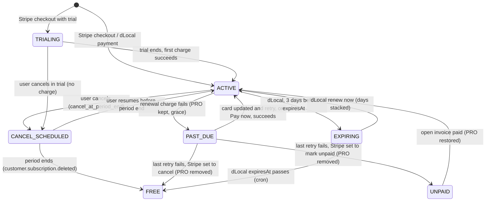
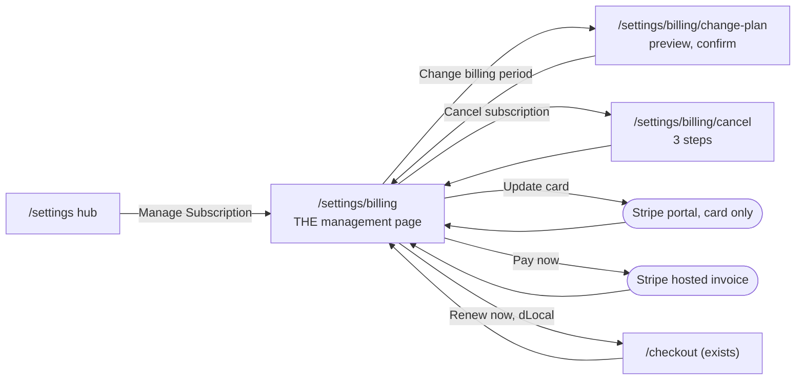

# Manage Subscription: implementation plan v2 (decisions settled)

**Date:** 2026-10-21 (v1 and v2 the same day) · **Branch:** `main` · **Status:** PLAN, docs only. Nothing is built, changed,
committed, migrated or deployed.
**Decisions:** **all settled.** D1 to D8 by Davin with the Advisor (section 2); E1 to E4, raised by the live-code check for v2, by
Davin on 2026-10-21 with the recommended answers (section 3). No decision is open for S1 to S4; what remains for Davin are
configuration actions (section 3.1).
**Next step:** the Advisor drafts the S1 order from section 10; a fresh execution session CONFIRMs it against live code and builds it
(non-negotiable 1). Every session here touches payments, so anything beyond its order's explicit steps escalates to Davin
(non-negotiable 5).

## 0. What changed from v1

- D1 to D8 recorded as decided; D2 is now **asymmetric** (upgrade now with proration, downgrade at renewal).
- **PAST_DUE grace fix added to S1** (defect B1): today both webhooks remove PRO the moment a renewal fails.
- **No separate `/manage` hub.** `/settings/billing` is the Manage Subscription page; only the two multi-step money flows get
  their own pages (section 8).
- **Schema synchronisation across the Prisma files** documented, with one migration and the F21 deploy order (section 9.3).
- **Corrections to v1 from live code:**
  - v1 gap 6 was overstated: `handleInvoiceSucceeded` already writes `planType` and `amountUsd` from the invoice's price line
    ([lib/stripe/webhook-handlers.ts:426-450](../../lib/stripe/webhook-handlers.ts)). What is missing is the sync of
    `cancel_at_period_end` and of a pending switch in `handleSubscriptionUpdated`.
  - The payment-failed e-mail opens `/settings?tab=billing`; [app/settings/page.tsx](../../app/settings/page.tsx) does not read
    `tab`, so the user lands on the settings hub, one more click away from a page that cannot update a card anyway.
- **New defects found while checking D2** (B8 and the commission point E4): an immediate upgrade produces a prorated invoice that
  today's code would misread.
- **v2.1 (same day):** E1 to E4 settled by Davin with the recommended answers; section 3 records them, and sections 9 and 10 drop
  the E1 alternative (no `pastDueSince` column, no S1 migration).

## 1. Diagnosis (unchanged)

The PRO button "Manage Subscription" links to its own page ([app/settings/billing/page.tsx:449](../../app/settings/billing/page.tsx)),
and no engine exists behind it: `createBillingPortalSession` ([lib/stripe/stripe.ts:484](../../lib/stripe/stripe.ts)) is never
called; the only subscription writes are checkout and an immediate cancel (monolith `app/api/subscription/`, `app/api/checkout/`;
money-service `stripe/checkout`, `stripe/subscriptions/cancel`, `webhooks/stripe`). Stripe prices are built per checkout from
SystemConfig with `price_data` ([lib/stripe/stripe.ts:144](../../lib/stripe/stripe.ts)), so Stripe's portal cannot switch plans
for us. dLocal has no recurring billing: each payment buys a period ending at `expiresAt`.

## 2. Settled decisions

| #   | Decision                | Settled answer                                                                                                                                                                                                          |
| --- | ----------------------- | ----------------------------------------------------------------------------------------------------------------------------------------------------------------------------------------------------------------------- |
| D1  | Stripe cancel           | **At period end** (`cancel_at_period_end: true`). PRO is kept until `current_period_end`; the user can resume before that date.                                                                                         |
| D2  | Switching period        | **Asymmetric.** Monthly to yearly: **immediately**, prorated charge, `proration_behavior: 'always_invoice'`. Yearly to monthly: **at `current_period_end`**, no refund, no prorated credit; yearly PRO kept until then. |
| D3  | Price of the new period | The **current SystemConfig price** for that period (never hardcoded; `systemconfig-figures-guard` test).                                                                                                                |
| D4  | Card update             | **Stripe hosted portal**, `flow_data: { type: 'payment_method_update' }`, a configuration with every other feature off.                                                                                                 |
| D5  | Portal configuration    | **Davin** creates it in the Stripe Dashboard and provides `STRIPE_PORTAL_CONFIGURATION_ID` (a test-mode one for local verification, a live one for production).                                                         |
| D6  | dLocal early renewal    | **Stack the remaining days:** `expiresAt = max(now, current expiresAt) + duration`.                                                                                                                                     |
| D7  | The dead button         | **Not hidden separately**; S1 replaces it.                                                                                                                                                                              |
| D8  | dLocal cancel           | **No cancel button**; prepaid access ends at `expiresAt`.                                                                                                                                                               |

## 3. Settled points from the live-code check (E1 to E4)

Raised by the v2 check because each changes what a customer is charged or keeps, or what an affiliate is paid. **SETTLED by Davin
on 2026-10-21, each with the recommended answer.**

| #   | Point                                   | Session | Settled answer                                                                                                                                                                                                                                                                              |
| --- | --------------------------------------- | ------- | ------------------------------------------------------------------------------------------------------------------------------------------------------------------------------------------------------------------------------------------------------------------------------------------- |
| E1  | How long `past_due` keeps PRO           | S1      | **Stripe's retry window.** PRO is kept for as long as Stripe reports `past_due`; Stripe's own retry schedule bounds it. When the last retry fails, Stripe cancels the subscription or marks it unpaid and the webhook removes PRO (section 5). No new column, no cron, **no S1 migration**. |
| E2  | An upgrade whose charge fails           | S3      | **`payment_behavior: 'error_if_incomplete'`.** If the prorated charge fails or needs 3-D Secure, the switch is not applied: the user stays monthly, is not charged, and sees a message.                                                                                                     |
| E3  | Monthly to yearly during the free trial | S3      | **The price changes now; the trial runs to its end; the first charge at trial end is the yearly price.** Nothing is charged at the switch.                                                                                                                                                  |
| E4  | Affiliate commission across a switch    | S3      | **Count months of lifetime covered, cap 24 months.** A monthly invoice covers 1 month, a yearly invoice 12, the prorated upgrade invoice 12 (it starts the yearly period); commission is on the amount actually paid on that invoice.                                                       |

Why E4 was needed: `processAffiliateCommission` ([lib/stripe/webhook-handlers.ts:959](../../lib/stripe/webhook-handlers.ts))
counts **invoices** and takes the cap from **this** invoice's interval (24 monthly or 2 yearly). After an upgrade at invoice 5, the
prorated yearly invoice is cycle 6 against a cap of 2, so the commission stops and the attribution is cleared; after a downgrade
the lifetime stretches past 24 months.

**How S3 reads E4 (stands unless Davin objects):** an invoice earns commission when the months already covered **before** it are
fewer than 24; an invoice that crosses month 24 is paid in full, and the next one is not. For a subscription that never switches
this gives exactly today's result (24 monthly invoices, or 2 yearly ones), so only switched subscriptions change. Cycle 1 keeps the
code's `discountPercent` as today; the existing per-invoice redelivery guard stays. Both copies change (the monolith handler and
money-service's).

### 3.1 Davin's configuration actions (not decisions)

1. **Stripe Dashboard, revenue recovery (E1), before S1 is deployed:** set the retry schedule, and set the action after the last
   failed retry to **cancel the subscription** or **mark it unpaid**, never "leave it past due" (that would keep PRO for ever).
   The payment-failed e-mail promises "**within 3 days**" (`paymentFailed.action`): if the window is not about 3 days, the text
   changes in all 19 locales of both e-mail copies (Davin gives the wording; a small addition to S1 or its own change).
2. **`STRIPE_PORTAL_CONFIGURATION_ID` (D5):** a test-mode ID before S1 is verified locally, a live one before S1 is deployed. The
   configuration enables only the payment-method update (and, if wanted, invoice history).
3. **S2 migration (section 9.3):** applied to production before any service with the regenerated client is deployed.

## 4. Defects this plan fixes

| #   | Defect                                                                                                                                                                                                                                                                                                                                                                                                                                                                              | Fixed in |
| --- | ----------------------------------------------------------------------------------------------------------------------------------------------------------------------------------------------------------------------------------------------------------------------------------------------------------------------------------------------------------------------------------------------------------------------------------------------------------------------------------- | -------- |
| B1  | **A failed renewal removes PRO at once.** `handleSubscriptionUpdated` sets `tier: 'FREE'` for any status other than `active` or `trialing`, so `past_due` downgrades: [lib/stripe/webhook-handlers.ts:213](../../lib/stripe/webhook-handlers.ts) and [money-service/src/stripe/stripe-webhook.service.ts:243](../../money-service/src/stripe/stripe-webhook.service.ts). It contradicts `handleInvoiceFailed` ("we don't immediately downgrade", line 372) and the e-mail's 3 days. | S1       |
| B2  | **A FREE user gets no subscription data.** `GET /api/subscription` returns `subscription: null` when `tier === 'FREE'` ([app/api/subscription/route.ts:150](../../app/api/subscription/route.ts)), so after B1 the user sees no past-due notice, no "Pay now", no "Update card".                                                                                                                                                                                                    | S1       |
| B3  | The "Manage Subscription" button links to its own page.                                                                                                                                                                                                                                                                                                                                                                                                                             | S1       |
| B4  | The payment-failed e-mail button opens `/settings?tab=billing` ([lib/email/i18n/templates.ts:583](../../lib/email/i18n/templates.ts) and its operation-service byte copy), which lands on the settings hub.                                                                                                                                                                                                                                                                         | S1       |
| B5  | Cancel is immediate and forfeits the paid period ([app/api/subscription/cancel/route.ts:116-143](../../app/api/subscription/cancel/route.ts)).                                                                                                                                                                                                                                                                                                                                      | S2       |
| B6  | The cancellation reason is collected and never sent ([app/settings/billing/page.tsx:224-226](../../app/settings/billing/page.tsx)).                                                                                                                                                                                                                                                                                                                                                 | S2       |
| B7  | Cancelling a dLocal plan forfeits the prepaid days (same route).                                                                                                                                                                                                                                                                                                                                                                                                                    | S2       |
| B8  | **`invoicePlan` reads the first recurring line** ([lib/stripe/invoice-plan.ts:25](../../lib/stripe/invoice-plan.ts), mirrored in money-service). A prorated upgrade invoice also carries the credit line for unused monthly time, priced monthly; if that line comes first, the yearly upgrade is recorded as `MONTHLY` at the monthly price. The fix must pick the non-proration subscription line and must not rely on line order.                                                | S3       |
| B9  | `handleSubscriptionUpdated` does not sync `cancel_at_period_end` or clear a pending switch (both stacks).                                                                                                                                                                                                                                                                                                                                                                           | S2, S3   |
| B10 | A dLocal early renewal sets `expiresAt` from now ([app/api/webhooks/dlocal/route.ts:161-168](../../app/api/webhooks/dlocal/route.ts) and money-service's dLocal webhook).                                                                                                                                                                                                                                                                                                           | S4       |

## 5. Status model and the tier rule

`CANCEL_SCHEDULED`, `EXPIRING` and a pending downgrade are **display states** derived from stored data, not new enum values.

**The tier rule, one helper in each stack** (`tierForStripeStatus`, with a table test in both, so the two webhooks cannot drift):

| Stripe status                                | DB `status` (existing `mapStripeStatus`) | `user.tier`         | The billing page shows                                 |
| -------------------------------------------- | ---------------------------------------- | ------------------- | ------------------------------------------------------ |
| `active`                                     | ACTIVE                                   | PRO                 | normal                                                 |
| `trialing`                                   | TRIALING                                 | PRO                 | trial end date                                         |
| `past_due`                                   | PAST_DUE                                 | **PRO (grace, E1)** | red banner: Pay now, Update card                       |
| `unpaid`                                     | UNPAID                                   | FREE                | banner: PRO paused, pay the open invoice to restore it |
| `canceled`                                   | CANCELED                                 | FREE                | FREE view, re-subscribe from `/pricing`                |
| `incomplete`, `incomplete_expired`, `paused` | INACTIVE                                 | FREE (as today)     | FREE view                                              |

Event order does not matter: neither `invoice.payment_failed` nor `customer.subscription.updated` removes PRO for `past_due`, and
`invoice.payment_succeeded` already sets PRO back ([webhook-handlers.ts:453-457](../../lib/stripe/webhook-handlers.ts)).
`GET /api/subscription` returns the subscription block whenever a row exists and the tier is PRO **or** the status is PAST_DUE or
UNPAID (fixes B2). Users already downgraded while past due before S1 ships see the banner once S1 is live and get PRO back by
paying; nothing restores them automatically.

## 6. What the user can do in each state

One server function computes `allowedActions` from the row and the live Stripe subscription; `GET /api/subscription` returns it
and every write route checks it, so the page never shows a button the server would refuse.

| State                     | Stripe actions                                                                | dLocal actions           |
| ------------------------- | ----------------------------------------------------------------------------- | ------------------------ |
| TRIALING                  | Update card · Switch to yearly (E3) · Cancel (ends at trial end, no charge)   | n/a                      |
| ACTIVE, monthly           | Update card · **Upgrade to yearly now** · Cancel at period end                | Renew now (days stacked) |
| ACTIVE, yearly            | Update card · **Switch to monthly at renewal** · Cancel at period end         | Renew now (days stacked) |
| ACTIVE, downgrade pending | Update card · Keep yearly (undo) · Cancel (releases the pending switch first) | n/a                      |
| CANCEL_SCHEDULED          | Resume · Update card (no switch until resumed)                                | n/a                      |
| PAST_DUE                  | **Pay now** · Update card (no switch, no cancel until paid)                   | n/a                      |
| UNPAID                    | **Pay now** · Update card                                                     | n/a                      |
| EXPIRING                  | n/a                                                                           | **Renew now**            |
| Admin view-as             | none (existing rule: actions would hit the admin's own account)               | none                     |

## 7. Workflows

**W1, update card (Stripe; S1).** Update card → `POST /api/subscription/payment-method-session` → server creates a portal
session with `configuration: STRIPE_PORTAL_CONFIGURATION_ID`, `flow_data: { type: 'payment_method_update', after_completion:
{ type: 'redirect', redirect: { return_url: <app>/settings/billing?done=card } } }` → the user enters the card on Stripe → back
on `/settings/billing`, which re-fetches `GET /api/subscription` (the `done` parameter only triggers the re-fetch and a toast;
it proves nothing). Refused with 503 if `STRIPE_PORTAL_CONFIGURATION_ID` is unset.

**W2, pay a failed renewal (Stripe; S1).** `GET /api/subscription` adds `openInvoiceUrl`, the `hosted_invoice_url` of the
subscription's latest open invoice. Pay now opens it in Stripe; the existing `invoice.payment_succeeded` handler sets ACTIVE and
PRO. If the new card is saved through W1 instead, Stripe's next retry charges it.

**W3, cancel at period end (Stripe; S2).** `/settings/billing/cancel` → `POST /api/subscription/cancel` `{ reason }` → release any
pending switch schedule, then `subscriptions.update(id, { cancel_at_period_end: true })`; store `cancelAtPeriodEnd`,
`cancelRequestedAt`, `cancellationReason`; outbox event → the existing cancellation e-mail (it already takes `cancelAt` and a
reactivate link) → PRO until the period end → `customer.subscription.deleted` → the existing handler downgrades and clears
`affiliateCodeId`. In a trial it ends the trial with no charge. For dLocal the route answers `DLOCAL_NO_CANCEL` (D8).

**W4, resume (Stripe; S2).** Only while CANCEL_SCHEDULED and before the period end: `POST /api/subscription/resume` →
`cancel_at_period_end: false`, clear the three columns, e-mail "your PRO subscription continues". After the period end the user
re-subscribes through `/pricing` (existing rule: no second affiliate discount). A downgrade released by W3 is not restored.

**W5a, upgrade monthly to yearly, immediately (Stripe; S3).** `/settings/billing/change-plan` asks the server for a preview:
`GET /api/subscription/change-plan/preview?billingPeriod=yearly` → Stripe's upcoming-invoice preview for the item changed to the
yearly SystemConfig price → `{ amountDueNowUsd, prorationDate, renewsOn }`, shown with `formatChargedAmount` and the USD note.
Confirm → `POST /api/subscription/change-plan` `{ billingPeriod: 'yearly', prorationDate }` →
`subscriptions.update(id, { items: [{ id: itemId, price_data: <yearly, same product> }], proration_behavior: 'always_invoice',
proration_date: prorationDate, payment_behavior: 'error_if_incomplete' (E2) })`. Passing the preview's `prorationDate` makes the
charge equal the amount shown. Success: the invoice is paid, `invoice.payment_succeeded` records YEARLY and the yearly amount (needs
B8), commission per E4. Failure: Stripe's 402 → "your card was not charged; you are still on monthly". During a trial: E3.

**W5b, downgrade yearly to monthly, at renewal (Stripe; S3).** Confirm on the change-plan page ("from {renewal date}, monthly at
{price}; no refund for the current year") → `POST /api/subscription/change-plan` `{ billingPeriod: 'monthly' }` → a Subscription
Schedule from the subscription: phase 1 the current yearly item until `current_period_end`, phase 2 the monthly `price_data`, then
`end_behavior: 'release'` → store `pendingPlanType`, `pendingPlanEffectiveAt`, `stripeScheduleId` → e-mail. At renewal the
monthly invoice is recorded by `invoice.payment_succeeded`; `customer.subscription.updated` clears the pending fields (B9). Keep
yearly = `DELETE /api/subscription/change-plan` → release the schedule, clear the fields.

**W6, dLocal renew now (S4).** Renew now opens the existing `/checkout` with the period preselected and a renew marker; success
returns to `/settings/billing`. Both dLocal webhooks set `expiresAt = max(now, current expiresAt) + duration` and reset
`renewalReminderSent` (D6, B10). The period chosen at renewal is the next plan; there is no other dLocal switch and no cancel (D8).

**W7, expiry and downgrade.** Unchanged: Stripe through the webhooks (with the B1 rule), dLocal through the money-service crons.

## 8. UI: one management page

**`/settings/billing` is the Manage Subscription page.** There is no `/settings/billing/manage` hub: the billing page already shows
the plan, the payment method, usage and invoices, and a second page would repeat the plan and payment blocks. The settings hub's
own "Manage Subscription" button ([app/settings/page.tsx:284](../../app/settings/page.tsx)) keeps linking to `/settings/billing`, so
it stays the gateway into it. The dead "Manage Subscription" button **inside** the billing page is removed; its jobs become the
actions below.

**Layout of `/settings/billing`, top to bottom (only what changes):**

1. **Status banner**, at most one, by priority: past due or unpaid (Pay now, Update card) · cancel scheduled ("PRO ends on {date}",
   Resume) · downgrade pending ("Monthly from {date}", Keep yearly) · dLocal expiring ("Expires on {date}", Renew now).
2. **Current plan card:** price and period (existing), one renewal line ("Renews on {date}" / "Ends on {date}" / "Expires on {date},
   does not renew automatically" for dLocal), and an **action row drawn from `allowedActions`**: Upgrade to yearly or Switch to
   monthly (to the change-plan page), Cancel subscription (to the cancel page), Resume, Renew now.
3. **Payment method** (existing block): adds **Update card** for Stripe; for dLocal "you choose how to pay each time you renew".
4. Usage and invoice history: unchanged.

**Where each action lives:** a page only for multi-step money confirmations (change-plan: preview and confirm; cancel: what is kept
until when, what stops, the reason, confirm). A confirm dialog for one-step actions that charge nothing (Resume, Keep yearly).
Stripe or `/checkout` for card entry and payment. Every flow returns to `/settings/billing` with a `done=<action>` parameter that
only triggers a re-fetch and a toast. All three e-mails (payment failed, cancellation, trial reminder) link to `/settings/billing`.

New text goes through `useLocale()` with keys in all 19 dictionaries and real translations in the 17 non-English ones
(`compulsory-translation-coverage.test.ts`); dates through `formatDate`, money through `formatCurrency` / `formatChargedAmount`.
Admin view-as hides every action, as today.

## 9. API, data, webhooks, e-mails

### 9.1 Routes

Every write route follows the cancel route's pattern: a monolith route that forwards to a money-service endpoint when
`shouldUseMoneyServiceForStripeWrite()` is on, so both stacks get the same code. Each has session auth, the `allowedActions` check,
an idempotency key and an outbox event (money-service).

| Route                                           | Session | Purpose                                                                                                           |
| ----------------------------------------------- | ------- | ----------------------------------------------------------------------------------------------------------------- |
| `GET /api/subscription` (extend)                | S1      | B2 rule; add `allowedActions`, `displayState`, `openInvoiceUrl`; later `pendingPlanChange`, `renewsAutomatically` |
| `POST /api/subscription/payment-method-session` | S1      | W1, returns `{ url }`                                                                                             |
| `POST /api/subscription/cancel` (change)        | S2      | W3, body `{ reason }`, period end; `DLOCAL_NO_CANCEL` for dLocal                                                  |
| `POST /api/subscription/resume`                 | S2      | W4                                                                                                                |
| `GET /api/subscription/change-plan/preview`     | S3      | W5a preview                                                                                                       |
| `POST` / `DELETE /api/subscription/change-plan` | S3      | W5a, W5b and the undo                                                                                             |

### 9.2 Webhooks

Both copies change together in every session (the monolith endpoint may still receive events next to money-service's, the open
4A-13 question in `waiting-on.md`): `lib/stripe/webhook-handlers.ts` and `money-service/src/stripe/stripe-webhook.service.ts`.

- S1: the tier rule of section 5 in `handleSubscriptionUpdated` (B1).
- S2: sync `cancelAtPeriodEnd` from `cancel_at_period_end`; clear it when false (B9).
- S3: clear the pending-switch fields when phase 2 starts (B9); `invoicePlan` picks the non-proration subscription line in both
  copies (B8); commission per E4.
- S4: both dLocal webhooks stack the expiry (B10).

### 9.3 Schema synchronisation (one migration, F21 deploy order)

**One migration in S2 adds all six columns** to `Subscription`, including the three S3 uses, so production goes through the F21-type
deploy step once: `cancelAtPeriodEnd Boolean @default(false)`, `cancelRequestedAt DateTime?`, `cancellationReason String?`,
`pendingPlanType String?`, `pendingPlanEffectiveAt DateTime?`, `stripeScheduleId String?`. S1 adds no column (E1 settled on
Stripe's retry window).

Files, all in the same session:

| File                                                                | Change                                                                                                                  |
| ------------------------------------------------------------------- | ----------------------------------------------------------------------------------------------------------------------- |
| `prisma/non-market-data/schema.prisma` (model at line 453)          | the six fields                                                                                                          |
| `prisma/migrations/<timestamp>_add_subscription_management_fields/` | the SQL, with a pre-flight query and the rollback in its header, as the F21 migration                                   |
| `money-service/prisma/schema.prisma` (model at line 235)            | the same six fields, same types and defaults (this file is mirrored **by hand**)                                        |
| `types/prisma-stubs.d.ts` (`interface Subscription`, line 497)      | the six fields                                                                                                          |
| `operation-service/prisma/schema.prisma` (narrow 4-field mirror)    | **no change**: it declares only the columns it reads; the session confirms no operation-service code needs the new ones |

Then `prisma generate` for the root non-market-data client and for money-service; a field-by-field comparison of the two
`Subscription` models is part of the session's checks.

**Deploy order (F21 rule, the login outage of 2026-10-19):** Davin runs `prisma migrate status`, then **applies the migration to
production first**, then deploys money-service, then the monolith; operation-service is not affected. A service deployed with the
regenerated client before the columns exist fails on every full-row read of `Subscription`, for example the `findUnique` without
`select` at [app/api/subscription/route.ts:138](../../app/api/subscription/route.ts) and
[app/api/subscription/cancel/route.ts:99](../../app/api/subscription/cancel/route.ts). New code reads `Subscription` with an
explicit `select` (the F21-H1 hardening pattern). The Executor never applies a production migration.

### 9.4 E-mails

`lib/email/i18n/` and its byte copy `operation-service/src/email/i18n/` (a test fails on any difference), 19 locales each:

- S1: the payment-failed button links to `/settings/billing` (B4).
- S2: the cancellation e-mail becomes the "cancel scheduled" e-mail (it already takes `cancelAt`); new "subscription resumed".
- S3: new "upgraded to yearly" (amount charged) and "switch to monthly scheduled" (date).
- E1: if the Stripe retry window Davin sets is not about 3 days, `paymentFailed.action` changes in all 19 locales (section 3.1).

## 10. Delivery plan

| Session | Scope                                                                                                                                                                                                 | Needs                                                                                           | Migration |
| ------- | ----------------------------------------------------------------------------------------------------------------------------------------------------------------------------------------------------- | ----------------------------------------------------------------------------------------------- | --------- |
| **S1**  | B1 (tier rule, both webhooks), B2, B3, B4; W1 (card update) and W2 (Pay now); `allowedActions`, `displayState`, `openInvoiceUrl`; the status banner and the Update card button on `/settings/billing` | E1 (settled); a test-mode `STRIPE_PORTAL_CONFIGURATION_ID`; Stripe retry settings before deploy | none      |
| S2      | D1, D8; B5, B6, B7, B9 (cancel part); W3, W4; the cancel page; the one migration (all six columns); e-mails                                                                                           | migration applied before deploy                                                                 | yes       |
| S3      | D2 (asymmetric), D3; E2, E3, E4; B8, B9 (switch part); W5a, W5b; the change-plan page with the preview; e-mails                                                                                       | E2, E3, E4 (settled)                                                                            | uses S2's |
| S4      | D6; B10; W6; the dLocal expiring banner                                                                                                                                                               | none                                                                                            | none      |

**S1 "done when":** a test-mode subscription whose renewal fails (a Stripe test clock and a declining test card) stays PRO with
status PAST_DUE in both webhook copies; `/settings/billing` shows the past-due banner; Pay now opens the hosted invoice and paying it
returns ACTIVE; Update card opens the portal on the card form only, returns, and the new card shows after the re-fetch; the dead
button is gone; `allowedActions` hides every action in admin view-as; the payment-failed e-mail links to `/settings/billing` in both
copies; the tier-rule table test passes in both stacks.

**Checks every session:** root `npx tsc --noEmit`, `npm run lint`, `npm run test:ci`, `npm run build`; money-service Jest and `tsc`;
operation-service Jest when the e-mails change; the 19-locale coverage test; Stripe **test mode** on localhost only (test keys, test
cards, test clocks); the billing page in the browser pane at 375 px, in dark mode and in Arabic (RTL).

## 11. Not verified by this plan

- The installed SDKs (`stripe` ^14.10.0 at the root, ^14.25.0 in money-service) carry types older than the pinned API version
  `2024-11-20.acacia`. Each Stripe call of sections 7 and 9 is checked in test mode before it is relied on: portal `flow_data`,
  `price_data` on a subscription item update and in schedule phases, `proration_date` with the upcoming-invoice preview, and
  `payment_behavior: 'error_if_incomplete'` together with `price_data`.
- The order of lines on a prorated invoice (B8's fix must not depend on it).
- The Stripe Dashboard's current revenue-recovery settings (E1) and whether a portal configuration already exists (D5).
- Which Stripe webhook endpoint is live (4A-13); both copies change in every session.
- How many users are today `PAST_DUE` with `tier = FREE` (a read-only count for Davin before S1 ships; nothing restores them
  automatically).
- The mobile app (`davintrade-mobile-app`) is out of scope.
